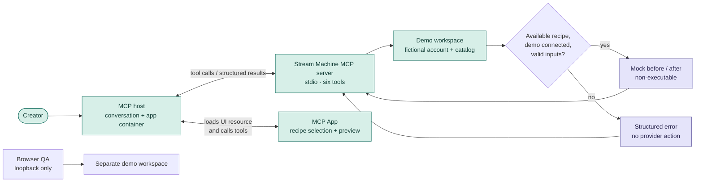
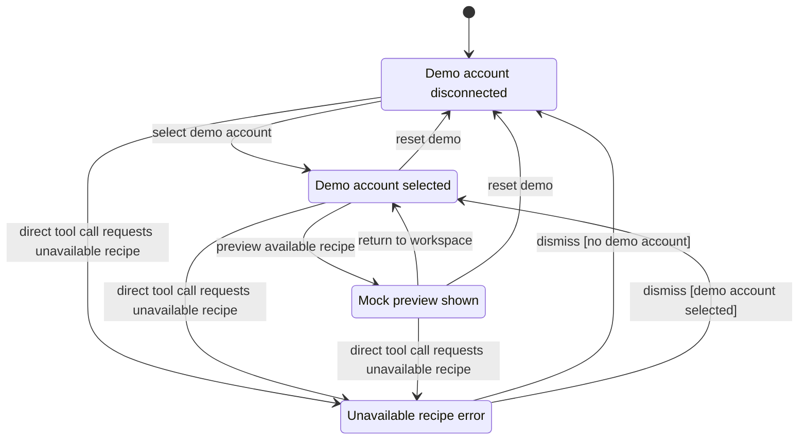
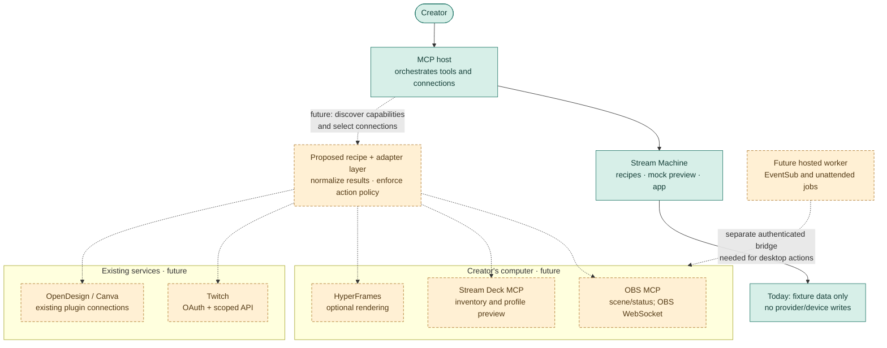

# Stream Machine architecture

Stream Machine separates reusable streaming recipes from the tools that carry out their actions. The current prototype uses fictional data to test that separation. You can select a demo account, choose a recipe, and inspect proposed changes without granting access to a live channel.

The prototype does not authorize Twitch accounts, create EventSub subscriptions, update channels, download clips, or send device commands.

The [repository](https://github.com/prime-optimal/stream-machine-plugin) tracks the initial implementation in [issue #1](https://github.com/prime-optimal/stream-machine-plugin/issues/1) and [Stream Machine project #18](https://github.com/users/prime-optimal/projects/18). [Project rules](../AGENTS.md) define the labels and development workflow.

## First usable workflow

The first workflow starts with onboarding and a clearly labeled demo Twitch account. After you choose a recipe, you can inspect its required integrations, permissions, inputs, and proposed actions. The result is a mock preview. An unavailable integration remains unavailable, so fictional data never implies that a tool is installed or authorized.

This workflow tests recipe discovery and review through chat tools and an MCP App. A separate browser preview helps test the interface locally. Browser testing cannot establish that the interface works inside an MCP host. The [setup guide](setup.md) explains how to run the prototype, and the [verification record](verification.md) describes the checks completed so far.

## How a demo request moves

The host starts the local MCP server over stdio, which carries messages through the process's standard input and output. Chat and the embedded workspace call the same tools. The workspace displays their structured results. The local browser preview uses a separate demo workspace for interface development.

### Demo states

The interface disables unavailable recipes, but a direct tool call can still request one and receive an error. A preview and an error are temporary responses rather than saved workspace states.

This chart includes a return from the preview to make the flow readable. It omits repeated previews. The [chart and model checked by TLC](statechart/README.md) describe a narrower set of states. The model checks that description, not the implementation.

## Where connectors fit

Solid paths exist today. Dashed paths show proposed integrations that are neither installed nor verified. A desktop host can coordinate local MCP processes because those processes run on the same computer. An independent cloud worker needs a separate connection to reach desktop devices. Each provider retains responsibility for its own authentication. The [integration inventory](integrations.md) records candidate contracts and verification status.

## Components and ownership

The plugin package supplies its listing, onboarding skill, recipe guidance, and local MCP declaration. Those declarations describe implemented capabilities. The local MCP server owns the demo account, recipe catalog, action previews, and structured results. Running that server over stdio does not create a public endpoint or a cloud identity.

The MCP App displays connection status, recipe choices, and action previews. Server results remain authoritative, while the app checks which features the host supports. The browser preview is a separate development interface that uses fictional data.

The proposed recipe contracts describe inputs, required capabilities, action plans, and the source of each result. They remain independent of provider tool names. Integration adapters would map those capabilities to verified tools and convert results into a common format. Each adapter would preserve the provider's authentication and execution location.

Existing plugins, including OpenDesign Cloud and Canva, would retain their connections. Stream Machine would refer to verified app IDs rather than copy credentials or invent IDs. OBS and Stream Deck MCP processes would run on the streamer's computer through local tooling supported by the host. Optional rendering tools would follow the same local execution boundary.

A desktop agent can coordinate several local MCP processes directly, so this design does not require a custom connection from the cloud to the desktop. Access from mobile devices or web clients is a separate capability. Installing the package does not establish that access.

## Recipe and adapter contracts

Recipes describe the outcome a streamer wants. A proposed recipe contract includes a stable ID, version, summary, input schema, required capabilities, and ordered steps. Its preview behavior and failure policy explain what the user can review and what happens when a step fails.

A capability identifies the provider, action, execution location, required permissions, and availability. It also distinguishes read actions from write actions. Narrow capabilities such as channel read, channel update, clip download, scene list, and deck page preview make the requested action explicit. Arbitrary shell execution and unrestricted forwarding to provider tools would defeat that boundary.

An action plan connects a recipe version and resolved inputs to a target account or device. Proposed changes, prerequisites, expiry, and a `mock` or `live` mode make the plan reviewable. A future server that executes live plans must check the target, permissions, and expiry again before any write. A preview cannot write to a provider, and a demo connection cannot represent a real authorization.

A run result would record its run ID, step results, status, artifact references, data sources, timestamps, and retry guidance. Adapter results would distinguish success from an unavailable capability, missing connection, missing permission, invalid input, rate limit, failure, or cancellation. Those distinctions let a recipe explain why an action cannot continue.

These contracts are proposed and may enter the implementation in stages. The [integration inventory](integrations.md) describes the provider-specific requirements that adapters must preserve.

## Authentication boundary

An identity in a future hosted service is separate from a Twitch identity. The [Stream Makeover implementation](https://github.com/prime-optimal/stream-makeover/blob/main/studio/lib/twitch/service.ts) contains reusable authorization-code handling, token encryption, token refresh, and state validation. Its [schema](https://github.com/prime-optimal/stream-makeover/blob/main/studio/db/schema.ts) binds one Twitch connection to one Sites user. Reuse therefore requires storage and identity adapters around that logic. Copying the Site identity or its credentials would carry the wrong ownership model into Stream Machine.

Future live tools must determine account ownership from the verified caller context. Tokens belong in server credential storage or local credential storage. Model inputs, tool results, app state, logs, and generated recipe files must not contain credentials. Developer credentials remain in fnox and 1Password. Production credential storage remains an open design decision.

Hosted MCP authorization must follow the host's [authenticated request contract](https://developers.openai.com/plugins/build/auth). Installing a local plugin does not authorize multiple users to share a hosted service.

## Native UI

Standard MCP Apps provide the base interface through UI resources, a host message bridge, structured results, and model-context updates. Tools remain usable without the interface. OpenAI Extensions add native host features when the host advertises support. The [MCP App guidance](https://developers.openai.com/plugins/build/chatgpt-ui) and [Extensions specification](https://github.com/openai/mcp-extensions/blob/main/docs/spec.md) define those contracts.

Global and thread entrypoints could expose the recipe library and the current run. A chat tool remains the fallback for opening those views. Onboarding introduces the demo connection and the first recipe through a packaged skill. Proposed settings would expose preferences and connection status, with a status tool and setup guidance as fallbacks.

Composer mentions could refer to a selected recipe or artifact. Stable IDs in chat provide the same reference when mentions are unavailable. Model context can describe the current selection and preview, while structured tool results remain available without that extension. Proposed deep links would reopen a recipe or run. Finding the record by ID remains the fallback.

In the Extensions specification, "Web" means the Work browser rather than classic ChatGPT. The [platform table](https://github.com/openai/mcp-extensions/blob/main/docs/spec.md#L7-L25) lists global and thread entrypoints, onboarding, and settings across desktop, Work web, iOS, and Android. Composer mentions cover desktop and Work web. File handlers support desktop only, and deep links exclude Android.

The table guides design choices, but it does not verify availability in this prototype. Capability negotiation and tests in each host establish what Stream Machine can use. The design therefore makes no claim of equal mobile and web support.

## Later execution paths

Live Twitch account linking is a later phase, after the demo contracts stabilize. EventSub needs its own subscription registry, renewal handling, reconciliation of subscription state, duplicate detection, replay protection, and unattended credential validation. Reliable event delivery cannot depend on a chat completion or an open browser session.

A future hosted worker may process events while chat is closed. To act on desktop devices, that worker would need an authenticated connection or a supported host tunnel. The design must also cover device pairing, permissions for each action, expiry, duplicate detection, and offline behavior. This work is deferred because a desktop host can already coordinate local processes without such a connection.

Render jobs belong in a local process or a suitable worker. HyperFrames produces assets during authoring. Overlay playback in a stock browser must remain independent of authoring tools and secrets, as described in the [existing overlay documentation](https://github.com/prime-optimal/stream-makeover/blob/main/overlays/README.md).

## Verification claims

Package validity, local process startup, tool discovery, and a harmless tool call establish different facts. Native interface rendering and browser preview require separate checks. Real account authorization, a provider action, and unattended delivery each need their own evidence. A passing check cannot establish any of the others.

The demo release requires clear labels for fictional data, a working recipe preview, and useful text results. No demo action may change a provider or device. The [verification record](verification.md) keeps these claims separate.
