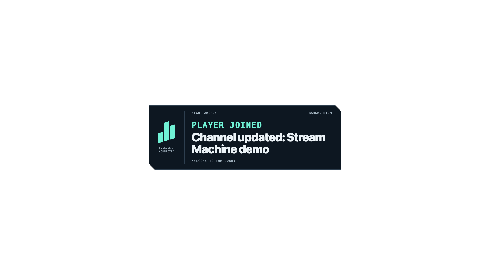

# Working Stream Machine demos

The integration branch combines the parallel implementations. Every implementation agent used RepoPrompt context building before editing. Subagents used GPT-6.1 Sol.

## Verified results

| Demo | Evidence |
| --- | --- |
| Twitch | Reused TwitchCon OAuth with a private local store. KLabFM connected with `channel:manage:broadcast`. The approved title update read back correctly, then the original title was restored. |
| OBS | Real play and replay passed in OBS Studio Rust. Idle was transparent. Broadcasting and recording stayed stopped. |
| Stream Deck | The user pressed the new 15-key USB device's button and confirmed the board opened. The integrated UI then configured it to open the local demo page and verified the stored action. |
| Independent worker | A real `channel.update` event reached the independent worker after the MCP client/server disconnected. OBS showed the expected alert. The worker recorded one success. |
| Pause | Restoring the title after pause produced a second event but no second alert. Final counters recorded one success and one skipped event. |
| OpenDesign | The existing Sealos service returned real projects and produced an isolated overlay through its installed scenario. |
| HyperFrames HTML | Editable source and playable HTML passed service read-back and browser pause, replay, update, text-safety, and finite-playback checks. No MP4 is part of the deliverable. |

The original title, `K-Lab Discovery - EDC Week Night 3`, is restored. The worker is left paused. The OBS demo source remains available for replay.

## Open the controls

Run from the repository root:

```sh
mise run preview
```

Open [the live controls](http://127.0.0.1:4318/?preview=1). The page calls the actual registered MCP tools. The mock demo remains separate and collapsed.

The server must stay running for the USB button. Release the deck through that page before another process claims it. Elgato's app is absent, so this demo uses the existing USB MCP server.

## Control the independent worker

Use these tasks from the repository root:

```sh
mise run worker:start
mise run worker:status
mise run worker:arm
mise run worker:pause
mise run worker:stop
```

Start leaves the worker paused. Arm enables the selected channel-update alert. The desktop must remain awake. A reconnect pauses the rule and requires rearming.

## Private package

The package includes the MCP server, worker, trusted event adapter, UI, skills, and fnox references. It contains no credential values. These references belong to the creator's private 1Password vault and are not public onboarding configuration.

Local commands: Bun and fnox. OBS uses `obs-cli`. Stream Deck uses uv, Python 3.11, a pinned upstream server, and native hidapi. The server is fetched on first use. Missing credentials produce provider errors, not mock success.

## Limits and corrections

The event proof disconnected the MCP client/server before the real event. It did not separately automate closing the physical chat window.

Only one process should own the USB deck. This result covers one button and a keeper process, not native Elgato profile editing.

The prototype has one local Twitch owner. It is not a shared multi-user service. OAuth callback and approval pages use localhost port 4017.

A real browser form failure was reproduced and fixed by preserving same-origin headers on the approval page. Exact Origin and browser-cookie checks remain enforced. A live keepalive timing failure was reproduced and fixed with a bounded two-second allowance. A missed heartbeat still pauses and reconnects.

The discarded MP4 experiment exposed runtime and memory limits. The original Sealos image was restored and the renderer issue was shelved after the HTML-only correction. No new renderer or increased workload resources remain active.

## Detailed records

- [Twitch implementation and checks](twitch.md)
- [OBS playback](obs.md)
- [Stream Deck hardware proof](streamdeck.md)
- [Worker and EventSub tests](worker.md)
- [Creative HTML proof](creative.md)
- [Real event receipt](event-evidence/verification.json)


