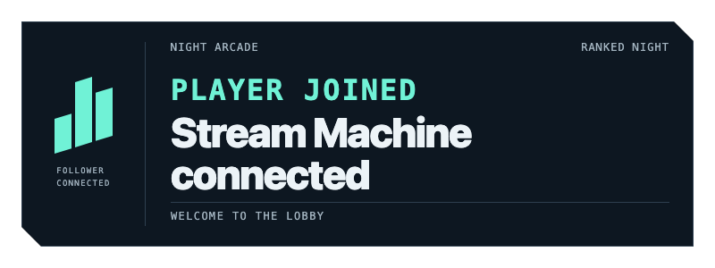
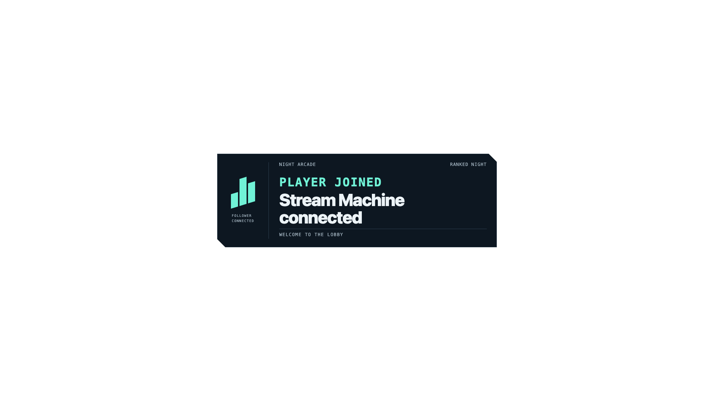

# OBS demo — issues #28 and #30

Real local OBS read and finite HTML alert. November 1, 2026.

## Run

From repository root:

```sh
mise exec -- bun scripts/obs-demo.ts
mise exec -- bun scripts/obs-demo.ts --text 'Stream Machine connected'
mise exec -- bun scripts/obs-demo.ts --replay
mise exec -- bun scripts/obs-verify.ts
```

First command reads only. Alert command creates or updates **Stream Machine Demo** / **Stream Machine Alert**, selects demo as program scene, refreshes browser source. Layout changes explicitly authorized for disposable development OBS. No command starts/stops broadcasting or recording.

Browser file: `~/Library/Application Support/Stream Machine/obs/alert.html` on macOS. Asset embedded in bundle, then installed outside checkout. Removing worktree does not break OBS. Linux uses XDG data home; Windows uses local application data.

1920×1080 demo positions 800×300 alert at (560,390). Alert lasts four seconds, returns transparent, does not loop. Source remains enabled; scene remains selected. Replay reads last text from private application-data JSON. Maximum text: 64 Unicode codepoints. Markup rendered as text.

## Interface

Import `src/adapters/obs/register.ts`:

- `registerObsTools(server)`
- `obsPreflight()`
- `obsListScenes()`
- `obsShowAlert({ text })`
- `obsShowAlert({ replay: true })`

Tools: `stream_machine_obs_preflight`, `stream_machine_obs_list_scenes`, `stream_machine_obs_show_alert`. Parent owns server wiring.

Success reports real refresh acknowledgement with `visibility: "unverified"`; screenshots establish visible acceptance separately. Timeout/rejection does not claim successful display. No automatic refresh retry.

## Reuse

Embedded template copied from accepted system-font Night Arcade artifact:
`stream-makeover/docs/qa/scenarios/artifacts/arcade-installed/index.html`.

Retains original requestAnimationFrame finite timeline, transparent idle, textContent injection boundary, reduced-motion branch, replay/cancel API and bounded browser queue. Adds validated startup payload only. No renderer or external assets. Existing provenance: [reuse evidence](../reuse-evidence.md).

## Installed CLI contract

Inspected `obs-cli --help`, `scene --help`, `input --help`, `source --help`.

Real reads use installed `obs-cli` with argument arrays and explicit localhost:4455:

| Read | CLI |
| --- | --- |
| Version/resolution | `obs-cli -j info` |
| Scenes | `obs-cli -j scene list` |
| Program scene | `obs-cli -j scene current` |
| Broadcast state | `obs-cli -j stream status` |
| Recording state | `obs-cli -j record status` |

CLI lacks scene/input creation and browser refresh commands. Small native WebSocket v5 boundary handles those missing operations. Closed request allowlist excludes every broadcast/recording command. No third-party MCP process launched. Authentication-required handshake fails explicitly; no passwords requested or exposed. Current local server accepts unauthenticated loopback connection.

## Verification

`mise run check`: passed. `mise run test`: 12 tests passed, including real loopback WebSocket identification/correlation, authentication refusal, malformed response, rejected request, forbidden StartStream rejection, Unicode text boundary and script escaping.

`mise exec -- bun scripts/obs-verify.ts`: play, program frame, transparent idle, replay, replay idle captured from running OBS. Full observations: [live.json](obs-evidence/live.json). OBS 33.0.0 / WebSocket 5.7.5, 1920×1080, 30fps. Streaming and recording stopped before/after; no broadcast/record controls invoked. Decoded PNG alpha extrema: play and replay 0–255; idle and replay-idle 0–0. Both idle frames fully transparent.






## Prototype limits

Local-only fixed endpoint. No authenticated OBS configuration yet. Per-process requests serialize through full alert duration; independent processes can contend over shared artifact. Worker and interactive tools must not run simultaneous separate writers. Refresh acknowledgement does not prove pixels, browser console health, or Twitch delivery. Synthetic manual action proves OBS adapter only. No background event delivery implied.
