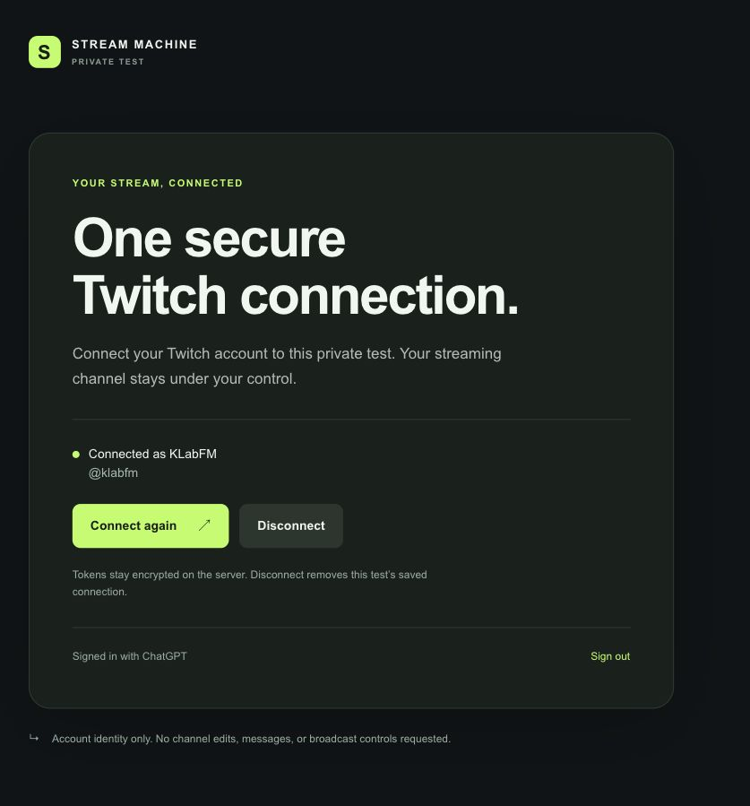

# Test hosted Twitch OAuth

Open the [hosted OAuth test](https://stream-machine-oauth-test.tinycocoa22.chatgpt.site) in a browser or on a phone. Sign in with ChatGPT, then choose **Connect Twitch** and complete Twitch consent.

The test uses the existing Stream Machine Twitch app. The user confirmed registration of this callback:

`https://stream-machine-oauth-test.tinycocoa22.chatgpt.site/api/twitch/callback`

The page requests the same baseline permissions as local Stream Machine OAuth. Review the disclosure before connecting. Existing profile-only connections need fresh Twitch consent to receive these permissions. After connection, reload the page and confirm the same account remains visible.

## Requested permissions

The request includes the baseline below, any scopes already granted to this connection, and any extra scopes passed by the service. The list is sorted and duplicates are removed. The service checks every requested scope against Twitch's validated grant before saving a replacement connection. Rejected or incomplete consent leaves the previous connection intact.

```text
bits:read
channel:bot
channel:manage:broadcast
channel:manage:clips
channel:manage:redemptions
channel:read:redemptions
channel:read:subscriptions
clips:edit
moderator:read:followers
user:bot
user:read:chat
user:write:chat
```

Local Stream Machine uses `channel:manage:broadcast` for title changes and `channel:manage:clips` for own-channel clip downloads. The other ten permissions support planned features. This standalone Site performs no channel edits, chat actions, reward changes, clip actions, or bot operations.

[Twitch scope policy](https://dev.twitch.tv/docs/authentication/scopes/) requires requesting only permissions used by an app. The broader baseline is the owner's requested local-parity policy. Consent does not prove future features work or authorize a separate bot account.

Sites sign-in is separate from Twitch consent. Each browser needs its own Sites session. A successful desktop test does not prove a phone test.

## Initial published source

The private test Site is `appgprj_6ae8040442d481918f55ca79cca3b9b2`. Sites published source commit `87dfe2726b8338bf1ba2afe6e020dbaeb818ee2b` as version `appgprj_6ae8040442d481918f55ca79cca3b9b2~appgver_7d2f7b289d2c81918ed52b90915af19a`.

Deployment `appgdep_6ae806a7de208191b918a02ab832e12f` succeeded with runtime environment revision 2. Sites maintains this source in its own repository. The retained local checkout is `docs/hosted-oauth-site/`; Git ignores that independent checkout in this repository.

The test reuses TwitchCon's server-side OAuth service and encrypted D1 storage. Server configuration uses `TWITCH_CLIENT_ID`, `TWITCH_CLIENT_SECRET`, `TWITCH_REDIRECT_URI`, and `TWITCH_TOKEN_ENCRYPTION_KEY`. Values remain outside source. The test has its own D1 database.

## Verified and pending

TypeScript, Sites build, and Site hook checks passed. Twenty-eight OAuth tests passed against SQLite fixtures using the actual SQL. The updated [state model](statechart/122-hosted-oauth/report.md) passed eight invariants and its deadlock check.

Live anonymous status, connect, and callback requests returned 401. A status request with forged Sites user headers also returned 401. This verifies the private access boundary for those requests.

Real Twitch consent and saved account status are verified. After the fix, the user connected KLabFM (`@klabfm`). The in-app browser displayed that account after a full reload. Disconnect and a phone test remain unverified. The test connection was left active.

No plugin code, plugin manifest, installed account, or existing Stream Makeover Site was changed. A future web or mobile plugin also needs a hosted MCP server and its own authorization contract. This test does not implement that integration.

## Retry after an approval failure

The first live attempt reached the callback but did not save a connection. A regression test found that token validation rejected `scopes: null` for a token without optional permissions. The parser now normalizes null to an empty list while retaining identity and expiry checks.

Sites deployed fix commit `785c2f8075e45f9b64bd682706e2eb748e83599a` in deployment `appgdep_6ae80819c8e48191ad3290ef7426cb04`. Deployment succeeded with environment revision 2. The combined suite now passes 24 tests. A fresh authorization succeeded, and the saved account survived reload.



## Scope upgrade deployment

Sites deployed scope-parity source `5b183b7a023ef69bb2cb14066ebfd0c01547ccda` in deployment `appgdep_6ae8120b2f0c819189e10ef233193c73`. Deployment succeeded with environment revision 2. Twenty-eight Site tests, TypeScript, build, and staged secret checks passed. The updated model passed eight invariants.

Refresh the Site, review the requested permissions, and choose **Connect again**. After Twitch consent, **Missing baseline scopes: None** confirms the validated token includes the baseline. The page also lists granted scopes. A connected account with missing scopes is a retained older connection, not a completed upgrade.

The user completed the expanded consent and confirmed **Missing baseline scopes: None**. A read-only check of the live D1 connection record independently confirmed all twelve baseline scopes are saved. No token or encrypted-token value was included in this report. This verifies the hosted grant upgrade; it does not verify the planned streaming features.

The [reviewable Site patch](reviews/122-hosted-oauth-scopes.patch) includes runtime, consent, tests, and generated-policy changes. The previous profile-only screenshot records the earlier test; it does not prove the expanded grant.

## Hosted MCP integration

The Site now hosts authenticated Twitch MCP tools. Version 5 deployed source `45f286258326a5b9c27515c715b24d4df09357e5` and preserved the existing Twitch connection. Version 9, source `7a6d5d591b20192565c60aaca61ad2c5668fbabd`, is the current deployment. The earlier standalone-test descriptions above record historical scope. Use the [hosted MCP guide](hosted-mcp.md) for the current default, local fallback, and verification limits.
