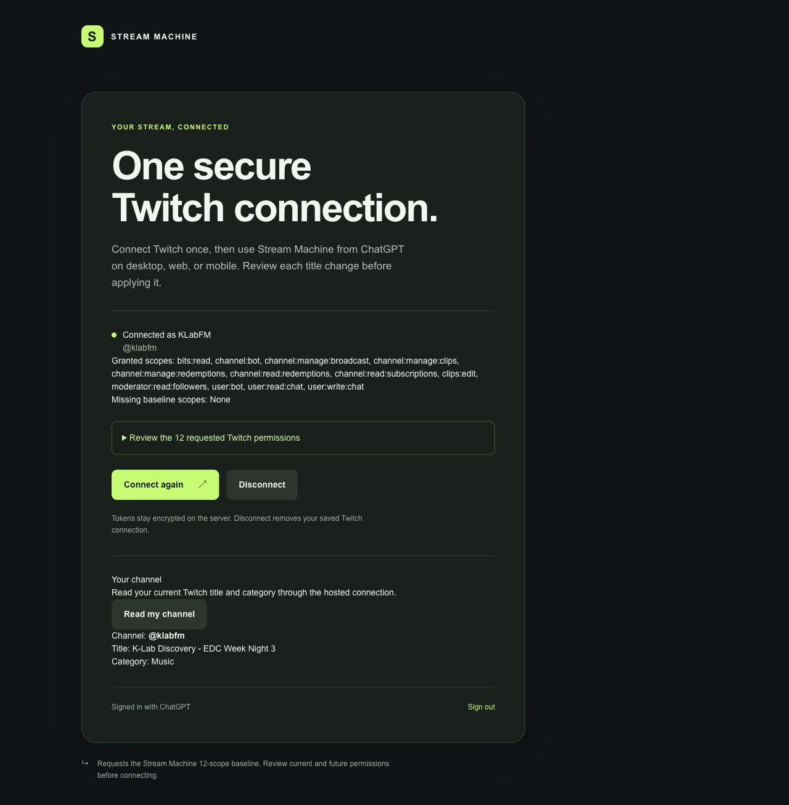

# Hosted MCP review

Issue: [#130](https://github.com/prime-optimal/stream-machine-plugin/issues/130). Branch: `codex/130-hosted-mcp`, based on `aa3fd74`.

## Required review questions

1. **Code simplification:** shared Twitch definitions now serve both local registration and the hosted JSON-RPC handler. The Site synchronizes eight pure modules rather than bundling desktop adapters. A stale-preview regression failed before the fix; moving the execution lease before the channel read prevents a second preview from overwriting a title checked before another write.
2. **Documentation clarity:** the default is the Site-backed connection. Local fallback uses a separate configuration and account store. Onboarding distinguishes Sites sign-in, Twitch consent, exact-title approval, and host connection. Historical OAuth evidence remains historical.
3. **Statechart:** required because request ownership, preview consumption, and fallback have security rules. The [checked model](../statechart/130-hosted-mcp/report.md) passes twelve invariants and its deadlock check over 139 states and 187 steps. An intentional negative configuration reproduces the former reconnect lease bug. Fallback is explicit workflow guidance; the model does not prove an automatic provider switch.

## Checks recorded so far

- Failing tests reproduced missing hosted registration, package inclusion of the ignored Site checkout, and the stale-preview write race before their fixes.
- Shared Twitch suite: 61 tests passed. Root TypeScript check passed.
- Local bundled MCP smoke: 34 tools passed. Plugin ZIP and tar.gz built with matching contents.
- Local package launch smoke: 34 tools passed through fnox using the explicit local configuration. Updated an outdated 31-tool assertion exposed by this check.
- Root hooks initially rejected a link to this review before the file existed. Final hooks must pass after staging.
- Root test discovery initially included the ignored Site clone, then failed when its generated dependencies were removed. Both test entrypoints now select `./tests`; the Site suite runs separately.
- Site TypeScript passes. Seventy-nine Site tests pass, including owner isolation, protocol negotiation, title replay guards, reconnect races, and a real Workerd/D1/R2 storage fixture.
- Independent review reproduced a second race: reconnect deleted a held execution lease while a PATCH remained in flight. Four regression cases failed first. Keeping the lease through reconnect, disconnect, token removal, and preview clearing makes all four pass. The old write must finish or its lease expire before another write can enter its protected read.
- The Site build initially failed on an ignored, unused starter stylesheet. Removing that import restores a reproducible build without adding unused CSS.

## Ownership and deployment

The Site source lives in its independent [Site source repository](https://git.chatgpt-team.site/666e1336-c60a-4924-bd62-1205dddbd6f7/appgprj_6ae8040442d481918f55ca79cca3b9b2.git). This repository keeps no copy of it. This task's Site commits are `fe62739` through `45f2862`. Issue #136 supplied the storage code, and that task owns its implementation and evidence.

Do not mark #130 complete before its required PR is merged. Keep its board status at `In Progress` while awaiting merge.

## Source review anchors

- [Shared definitions](../../src/adapters/twitch/tool-register.ts#L12) keep nine strict schemas in one place. [Title apply](../../src/adapters/twitch/service.ts#L35) acquires the owner lease before reading the current channel.
- The Site commits `fe62739` through `45f2862` contain the authenticated handler, owner-bound access, generation checks, and retained execution leases. Review them in the Site source repository.
- [Onboarding](../../skills/onboarding/SKILL.md) keeps hosted authentication failures on the hosted path and requires an explicit desktop choice. [Configuration](../../mcp.json) registers the hosted `stream-machine` server and the fnox-launched `stream-machine-local` server, so desktop installs keep their local tools.

## Published result

Sites version 5 deployed source `45f286258326a5b9c27515c715b24d4df09357e5` in deployment `appgdep_6ae81dcbfbd88191a4e297b69802ad95`, with environment revision 2 and `has_mcp: true`. The [Site](https://stream-machine-oauth-test.tinycocoa22.chatgpt.site) remains public. D1 migrations are additive. The existing KLabFM connection survived publication with all twelve baseline scopes.

Later Site versions changed clip behavior. Version 8 fixed hosted clip fetches for #136 (see the [storage review](136-hosted-user-storage.md)). Version 9 deployed source `7a6d5d591b20192565c60aaca61ad2c5668fbabd` in `appgdep_6ae82a7ad38c8191a8f8f0f24de70f0e` and made completed clip URLs public for #143 (see the [public clip review](143-public-clips.md)).

Sites returned `https://stream-machine-oauth-test.tinycocoa22.chatgpt.site/mcp` as both the MCP endpoint and OAuth resource. Its protected-resource metadata names `https://auth.openai.com` as the authorization server. Anonymous and forged-identity POSTs to `/mcp` return 401. The read-only browser route also returns 401 for anonymous and forged-identity requests.

The in-app browser successfully read KLabFM's live title, `K-Lab Discovery - EDC Week Night 3`, and category, `Music`, through the same owner-bound MCP handler. The page reported no console errors. The browser uses `/api/twitch/channel`; `/mcp` requires bearer authentication rather than browser cookies.

Native plugin discovery confirmed that the Site's canonical private plugin exists and is installed. On November 1, 2026, a fresh Codex CLI 0.166.0 session called the hosted tools through the Site-provisioned app. Preflight, status, channel, profile, and connect returned live KLabFM data on version 5. Clip lookup and download failed there with `TWITCH_UNAVAILABLE`, because Workers rejects `fetch` with `redirect: "error"`.

After the version 8 fix, the same path downloaded two KLabFM clips. "COMRADE DIMPS" stored 23,167,834 bytes, and "CAR CAR" stored 23,172,694 bytes. On version 9, an anonymous GET of each returned URL matched the SHA-256 that the tool reported. Nobody has tested a phone session, reconnect or disconnect on a phone, or a live title change. Issue #140 retains host acceptance work.

Fallback is an explicit workflow and separate configuration, not automatic failover inside the old local process. The broader provider-routing work in #132 and #133 is not claimed complete. An in-flight request can outlive cancellation; ambiguous writes remain consumed and are never replayed. A clip deadline can race a metadata insert, so a reported timeout does not guarantee that no private artifact was completed. Issue #136 owns that storage implementation.

Root verification at the original PR head: 191 tests, TypeScript, bundled smoke, package archives, local package launch, and check-only hooks passed. Site verification: 79 tests, TypeScript, production build, staged-content secret checks, and deployment passed. This task's preview server was stopped. The Site source is clean and pushed.
