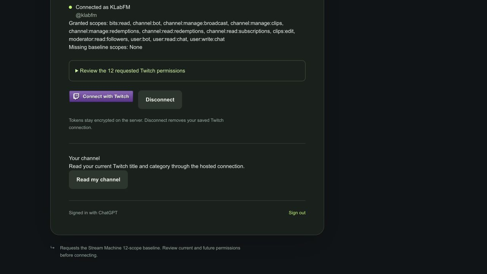

# Site publication for clip library and Twitch button

[Issue #147](https://github.com/prime-optimal/stream-machine-plugin/issues/147) requested hosted publication and live tool checks. [Issue #152](https://github.com/prime-optimal/stream-machine-plugin/issues/152) supplied the later Twitch connection button. Both Site commits are published.

## Published source

Sites version 10 deployed `7bd13f6d42954a089174f20c776740ec4efc8689`, the clip-library source, in deployment `appgdep_6ae849499ff88191a5845ae156b8b512`. Sites version 11 then deployed its descendant `f9894488c36d91e4c8545a0959bca07915181e88`, the Twitch button source, in deployment `appgdep_6ae84d1d29088191858fb1ba747c4558`.

Both deployments succeeded with MCP enabled and environment revision 2. The [Site](https://stream-machine-oauth-test.tinycocoa22.chatgpt.site) remains public. Version 11 includes the library, archive, ZIP, and hosted UI changes from version 10.

The independent Site repositories are `/private/tmp/stream-machine-site-147` and `/private/tmp/stream-machine-site-152`. The latter's commit descends from the former. Neither checkout had tracked edits at publication. The main plugin checkout had unrelated edits and was not modified.

## Site validation

On November 2, 2026, Bun 1.4.4 and macOS arm64:

- Both Site commits passed 125 tests, TypeScript, the supported production build helper, whitespace checks, and a Gitleaks scan of their respective source commits.
- The #152 checkout initially failed to resolve Miniflare in four Worker test files. A temporary link to its existing `node_modules/.aube/miniflare@4.20260515.0/node_modules/miniflare` installation restored resolution; all 125 tests then passed. The temporary link was removed.
- The deployed `/twitch_login.png` returned 200 and matched the source image byte-for-byte.
- The signed-in Site displayed KLabFM with no missing baseline scopes. The button image loaded at 170 by 32 pixels with accessible name **Connect with Twitch**. Its form remained POST `/api/twitch/connect` with target `_top`. The page logged no browser errors.
- The existing public clip returned HEAD 200. Anonymous POST `/mcp` returned 401. Authenticated hosted Twitch status returned the connected KLabFM account with all 12 scopes.

No reconnect, disconnect, consent flow, or channel mutation was performed.

## Hosted tools

The current chat initially retained the prior tool inventory. A fresh Codex CLI 0.166.0 session discovered the updated Site-provisioned Stream Machine app and called its hosted tools through `codex_apps`.

- **Library:** `first: 1` returned one live KLabFM clip and a cursor. A second call with that cursor returned a different clip. `first: 100` returned 12 clips with a null cursor and `storage: "site"`.
- **Archive:** one call requested clip `PoorTawdryTaroSMOrc-1IFadKk3EY9HeSkT`. The client returned `MCP tool call requires approval, but approval policy is never`. No archive operation ran. It was not retried.
- **ZIP:** one independent call returned a 24-hour batch containing three existing saved clips, with 69,513,222 clip bytes and `truncated: false`. Anonymous download produced a 69,513,856-byte ZIP. `unzip -t` checked all three MP4 entries and reported no errors.

The ZIP check validates existing stored clips, not the blocked archive call. Older saved clips lack Twitch clip IDs, so the library reports them as unsaved and later archiving can create another copy. ZIP capability URLs expire after 24 hours and can be used by anyone holding them.

To finish #147, run the hosted archive tool once in a session that permits its required approval. Verify the result and storage state before retrying or starting a batch. The host's approval policy blocked this session; changing it or bypassing the approval was outside this run.

## Review

1. Simplification: this task published existing source commits without changing their code. No code simplification was needed.
2. Documentation: this report separates local fixture checks, deployed behavior, and the blocked archive action. It records both deployed commits and the public Site audience.
3. Statechart: no model update is needed for publication alone. The existing [clip library model](../statechart/primary-navigation/clips/library/README.md) covers the gallery and playback flow. It does not establish archive or ZIP execution.

Issue #152 remains closed and Done. Issue #147 remains open and In Progress until the hosted archive check succeeds.
