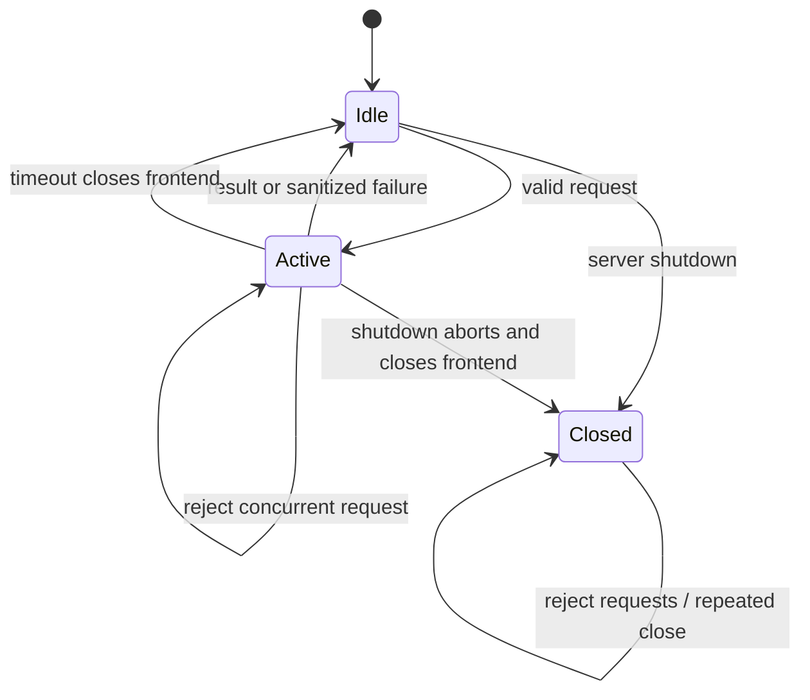

# Issue 40 review and verification

## Findings

1. Simplification: the adapter uses one provider, one connection, and one active request. No shared provider framework or mock fallback was added. `src/adapters/media/provider.ts:67-137` owns the lifecycle. `src/server.ts:40-50` composes cleanup without replacing Stream Deck cleanup. No further abstraction is needed.
2. Writing: `docs/demos/media-info.md` separates the tool contract, configuration boundary, upstream review, and actual verification status. It distinguishes synthetic tests from real provider acceptance and documents upstream logging and cache limits. No live connection is claimed.
3. Statechart: the shared broadcast and worker model is unchanged. The media lifecycle below needs no update to that model. The installed skill list has no `statechart` skill, so no formal model check is claimed. Tests check busy rejection, timeout, cancellation, explicit retry, terminal close, and repeated close.
4. Issue completion: #40 remains open and In Progress. The private one-URL acceptance criterion remains unchecked. No live provider configuration is available. A PR can be reviewed, but live upstream acceptance remains blocked.

## Media lifecycle

Every provider call requires a successful local listener check. Failed checks close the connection and return an error. Nothing starts the Python service. The listener check is a point-in-time native-host boundary, not authentication or protection against a trusted local operator creating a tunnel.

## Verification

Host: macOS arm64. Bun `1.4.4`; TypeScript `5.9.3`.

| Command | Actual exit | Result |
| --- | --- | --- |
| `mise run install` | 0 | Locked dependencies installed |
| `mise run hooks:install` | 0 | Existing global hk hooks retained |
| `mise run check` | 0 | TypeScript passes |
| `mise run test` | 0 | 91 tests pass, 0 fail |
| `mise run smoke` | 0 | Build passes; 28 tools; unconfigured media fails without breaking mock flow |
| `mise run package` | 0 | Build passes; archive has 111 inspected entries |
| `mise run hooks:check` | 0 | Markdown, whitespace, and staged secret checks pass before staging |

Earlier sandboxed mise attempts failed because mise could not write its trusted-config link. The approved escalated runs above succeeded. Build ran successfully as a dependency of both smoke and package.

`tests/media-info.test.ts:33-47` runs real temporary native listeners. It verifies loopback acceptance and wildcard rejection without an upstream launch or deployment change. Metadata and transcripts use synthetic fixtures. `tests/media-registration.test.ts` exercises real in-memory MCP registration. The bundled smoke test exercises real stdio MCP with no media configuration.

An independent read-only upstream review inspected the pinned source and supplied file anchors. The coordinator spot-checked the frontend tool handlers, schemas, logger, and Python response fields before implementation.

Oracle review could not run. Routed CLI sends failed with `targetActivationMismatch`; MCP fallback selected the parent plan context and failed on an unavailable export. No review response was returned. This record is the coordinator's review, not an Oracle approval. External review remains a PR limitation.

## Handoff inventory

Before commit, this issue worktree contains only owned changes. No other writer changed its HEAD. Sibling #39 has an edited `docs/reviews/39-clip-download.md`; its owner must finish that evidence record. #41 and #42 worktrees are clean at inspection. The native-host #46 worktree has one local-only commit; its owner must preserve or push it. Other retained worktrees are clean with no local-only commits at inspection.

Sandboxed `ps` failed with operation not permitted. Running processes could not be inventoried. No process was stopped. Process inventory remains a handoff limitation. No worktree is removed.

## Remaining acceptance

An approved existing private Python service and installed pinned frontend are required for the live demo. The adapter rejects missing configuration and unsafe or uninspectable listeners. It does not accept an exposed service with a documentation warning. Live metadata, transcript state, frontend compatibility, and real child shutdown still need verification. Do not merge or close #40 on this evidence alone.
