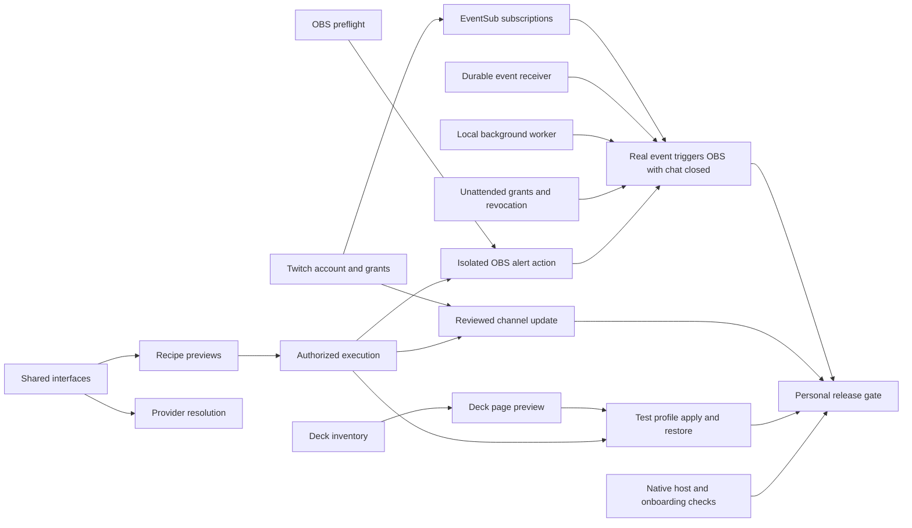

# Stream Machine implementation roadmap

Stream Machine uses nine independent work tracks. Shared interfaces let provider teams build with fixtures while account and device connections are implemented.

Repository: [prime-optimal/stream-machine-plugin](https://github.com/prime-optimal/stream-machine-plugin). Project: [Stream Machine #18](https://github.com/users/prime-optimal/projects/18). Planning work: [#9](https://github.com/prime-optimal/stream-machine-plugin/issues/9).

## Confirmed release priorities

The user selected these priorities on 2026-11-01:

- Build Twitch account connection and channel updates, OBS, and Stream Deck in parallel.
- Prove the first release on the creator's own setup before inviting other streamers.
- Include unattended automation in the first release. A real Twitch event must trigger an OBS alert through a local background worker while chat is closed.
- Keep desktop MCP providers local. The first release does not require a cloud-to-desktop bridge.
- Reuse existing provider plugins where practical. Audit and pin selected MCP servers before adoption. No calendar dates are committed.

## Release milestones

- [M1 Personal streaming and unattended alerts](https://github.com/prime-optimal/stream-machine-plugin/milestone/1): Twitch account/channel update, independent OBS and Stream Deck, and a real event-to-OBS alert while chat is closed.
- [M2 Invited streamers and creative workflows](https://github.com/prime-optimal/stream-machine-plugin/milestone/2): Optional creative/media integrations, native extension improvements, and verified invited-user onboarding/access.
- [M3 Analytics recipe catalog and distribution](https://github.com/prime-optimal/stream-machine-plugin/milestone/3): Named analytics datasets, broader reusable recipes, and public submission readiness.

Milestones define release scope. Priority determines what to take first within that scope. P0 identifies the first-release critical path and shared blockers. P1 is planned work. P2 is later expansion.

## Parallel work tracks

| Track | Epic | Proposed file ownership |
| --- | --- | --- |
| Core and recipes | [#12](https://github.com/prime-optimal/stream-machine-plugin/issues/12) | `src/contracts/`, `src/recipes/`, `src/providers/` |
| Twitch accounts and API | [#14](https://github.com/prime-optimal/stream-machine-plugin/issues/14) | `src/auth/`, `src/adapters/twitch/` |
| OBS | [#15](https://github.com/prime-optimal/stream-machine-plugin/issues/15) | `src/adapters/obs/`, `recipes/obs/` |
| Stream Deck | [#16](https://github.com/prime-optimal/stream-machine-plugin/issues/16) | `src/adapters/streamdeck/`, `recipes/streamdeck/` |
| Events and background automation | [#17](https://github.com/prime-optimal/stream-machine-plugin/issues/17) | `src/events/`, `src/worker/`, `recipes/alerts/` |
| Clips game data and analytics | [#18](https://github.com/prime-optimal/stream-machine-plugin/issues/18) | `src/adapters/media/`, `src/adapters/igdb/`, `src/analytics/` |
| Creative tools | [#19](https://github.com/prime-optimal/stream-machine-plugin/issues/19) | `src/adapters/design/`, `src/adapters/hyperframes/`, `recipes/creative/` |
| Native UI and onboarding | [#20](https://github.com/prime-optimal/stream-machine-plugin/issues/20) | `src/ui/`, `skills/` |
| Release and distribution | [#21](https://github.com/prime-optimal/stream-machine-plugin/issues/21) | `docs/releases/`, `packaging/`, `tests/integration/` |

Each child issue narrows the edit boundary. The paths are proposed module boundaries, not a claim that those directories already exist.

## Start the first wave

The following work can begin without waiting for another provider to connect:

1. Core owner: publish the smallest shared contract set in [#13](https://github.com/prime-optimal/stream-machine-plugin/issues/13). Own changes to root manifests, dependencies, shared types, and build scripts.
2. Twitch owner: start account linking in [#25](https://github.com/prime-optimal/stream-machine-plugin/issues/25) and the minimal channel/category reads in [#26](https://github.com/prime-optimal/stream-machine-plugin/issues/26). Public app-token reads do not wait for streamer OAuth.
3. OBS owner: compare providers and add read-only preflight in [#28](https://github.com/prime-optimal/stream-machine-plugin/issues/28). No Twitch account is required.
4. Stream Deck owner: discover hardware, profiles, and actions in [#31](https://github.com/prime-optimal/stream-machine-plugin/issues/31). No Twitch or OBS connection is required.
5. Automation owner: build the local worker in [#36](https://github.com/prime-optimal/stream-machine-plugin/issues/36) and the receiver against fake EventSub sessions in [#35](https://github.com/prime-optimal/stream-machine-plugin/issues/35).
6. Experience owner: verify the installed plugin through the native host in [#46](https://github.com/prime-optimal/stream-machine-plugin/issues/46). Build onboarding against connection-state fixtures.

With more capacity, media metadata [#40](https://github.com/prime-optimal/stream-machine-plugin/issues/40), IGDB [#41](https://github.com/prime-optimal/stream-machine-plugin/issues/41), OpenDesign Cloud [#43](https://github.com/prime-optimal/stream-machine-plugin/issues/43), HyperFrames [#44](https://github.com/prime-optimal/stream-machine-plugin/issues/44), and Canva [#45](https://github.com/prime-optimal/stream-machine-plugin/issues/45) can proceed independently. The upstream OBS isolation audit [#29](https://github.com/prime-optimal/stream-machine-plugin/issues/29) and invited-access decision [#54](https://github.com/prime-optimal/stream-machine-plugin/issues/54) also have no provider completion dependency.

## Read dependency links correctly

The board's Start field separates coding readiness from completion gates:

- **Independent now** means source investigation, provider discovery, or standalone implementation can start immediately. Shared contract alignment may still gate completion.
- **Fixtures now** means implementation can use fake account, device, or event data while prerequisites are built.
- **After prerequisites** means the issue verifies an integrated result and needs its listed components.
- **Epic** identifies a parent track. Child issues carry the release milestones.

GitHub's native blocked-by relationships are completion gates. They do not prohibit independent fixture work. A task is Done only when its acceptance criteria pass. Fixture tests alone do not prove a real connection or action.

The diagram summarizes integration gates. Issue dependencies are authoritative and include the smaller contract and provider requirements.

## Unattended execution boundary

The worker owns its own vetted MCP client or direct OBS connection. It cannot assume that a chat host's installed plugin tools remain available after the chat closes. Worker startup, credential references, reconnection, and cleanup are explicit acceptance criteria.

The event-to-OBS proof is [#38](https://github.com/prime-optimal/stream-machine-plugin/issues/38). It checks a real event, visible alert, durable run record, duplicate suppression, restart recovery, and pause or revocation. The desktop must remain awake and the worker must remain running. Offline delivery gaps are reported rather than hidden.

The first release gate is [#49](https://github.com/prime-optimal/stream-machine-plugin/issues/49). It also verifies a reviewed Twitch channel update and a dedicated Stream Deck test profile. Hardware tests preserve broadcasts, the program scene, and active profiles. An OBS rendering limitation requires an explicit test procedure before changes to the program scene.

## Repository coverage

| Source | Planned work | Important boundary |
| --- | --- | --- |
| [mcp-igdb](https://github.com/prime-optimal/mcp-igdb) | [#41](https://github.com/prime-optimal/stream-machine-plugin/issues/41) | The supplied server relays through Pipeworx. Choose relay or direct IGDB deliberately. |
| [obs-twitch-mcp](https://github.com/prime-optimal/obs-twitch-mcp) | [#28](https://github.com/prime-optimal/stream-machine-plugin/issues/28), [#29](https://github.com/prime-optimal/stream-machine-plugin/issues/29), [#27](https://github.com/prime-optimal/stream-machine-plugin/issues/27), [#39](https://github.com/prime-optimal/stream-machine-plugin/issues/39) | Startup side effects and credential output require review before adoption. |
| [streamdeck-mcp](https://github.com/prime-optimal/streamdeck-mcp) | [#31](https://github.com/prime-optimal/stream-machine-plugin/issues/31), [#32](https://github.com/prime-optimal/stream-machine-plugin/issues/32), [#33](https://github.com/prime-optimal/stream-machine-plugin/issues/33) | Inventory first. Writes use a dedicated profile and a tested restore path. |
| [yt-media-info-mcp](https://github.com/prime-optimal/yt-media-info-mcp) | [#40](https://github.com/prime-optimal/stream-machine-plugin/issues/40) | Metadata, transcripts, and search are distinct from media downloads. |
| [agentic-obs](https://github.com/prime-optimal/agentic-obs) | [#28](https://github.com/prime-optimal/stream-machine-plugin/issues/28), [#30](https://github.com/prime-optimal/stream-machine-plugin/issues/30) | Local stdio provider. Tool groups alone do not enforce action permissions. |
| [twitch-mcp-server](https://github.com/prime-optimal/twitch-mcp-server) | [#26](https://github.com/prime-optimal/stream-machine-plugin/issues/26), [#53](https://github.com/prime-optimal/stream-machine-plugin/issues/53) | Read operations are a reference. Undocumented GraphQL comments are excluded. |
| [open-design](https://github.com/nexu-io/open-design) | [#43](https://github.com/prime-optimal/stream-machine-plugin/issues/43) | Preserve the existing deployed plugin and authentication. |
| [Stream Makeover OAuth](https://github.com/prime-optimal/stream-makeover) | [#25](https://github.com/prime-optimal/stream-machine-plugin/issues/25) | Reuse domain logic without copying the Sites-specific account model. |
| Existing HyperFrames tooling | [#44](https://github.com/prime-optimal/stream-machine-plugin/issues/44) | Produce portable stock-browser output. Verify plugin availability before adding a dependency. |
| Existing Canva plugin | [#45](https://github.com/prime-optimal/stream-machine-plugin/issues/45) | Discover supported operations and retain provider-owned credentials. |
| [OpenAI MCP Extensions](https://github.com/openai/mcp-extensions/) | [#46](https://github.com/prime-optimal/stream-machine-plugin/issues/46), [#48](https://github.com/prime-optimal/stream-machine-plugin/issues/48) | Detect host capabilities and provide chat or in-app fallbacks. |

These boundaries come from the earlier [source review](integrations.md). Each implementation issue requires current provider verification before adoption.

## Full issue index

| Issue | Track | Milestone | Priority | Start |
| --- | --- | --- | --- | --- |
| [#13](https://github.com/prime-optimal/stream-machine-plugin/issues/13) Define versioned capability, account, event, asset, and recipe interfaces | Core and recipes | M1 | P0 | Independent now |
| [#22](https://github.com/prime-optimal/stream-machine-plugin/issues/22) Resolve capabilities across optional MCP servers and connected plugins | Core and recipes | M1 | P0 | Fixtures now |
| [#23](https://github.com/prime-optimal/stream-machine-plugin/issues/23) Load reusable recipes and generate target-bound action previews | Core and recipes | M1 | P0 | Fixtures now |
| [#24](https://github.com/prime-optimal/stream-machine-plugin/issues/24) Execute approved recipes with durable runs and idempotent steps | Core and recipes | M1 | P0 | Fixtures now |
| [#25](https://github.com/prime-optimal/stream-machine-plugin/issues/25) Connect a Twitch account and manage grants and token lifecycle | Twitch accounts and API | M1 | P0 | Independent now |
| [#26](https://github.com/prime-optimal/stream-machine-plugin/issues/26) Add the minimal read-only Twitch channel and category tools | Twitch accounts and API | M1 | P1 | Independent now |
| [#27](https://github.com/prime-optimal/stream-machine-plugin/issues/27) Preview and apply a reviewed Twitch channel update | Twitch accounts and API | M1 | P0 | Fixtures now |
| [#28](https://github.com/prime-optimal/stream-machine-plugin/issues/28) Select the OBS provider and implement read-only preflight | OBS | M1 | P0 | Independent now |
| [#29](https://github.com/prime-optimal/stream-machine-plugin/issues/29) Audit and isolate useful obs-twitch-mcp capabilities before adoption | OBS | M2 | P1 | Independent now |
| [#30](https://github.com/prime-optimal/stream-machine-plugin/issues/30) Preview and verify isolated OBS source changes and alert output | OBS | M1 | P0 | Fixtures now |
| [#31](https://github.com/prime-optimal/stream-machine-plugin/issues/31) Discover Stream Deck devices profiles and reusable actions | Stream Deck | M1 | P0 | Independent now |
| [#32](https://github.com/prime-optimal/stream-machine-plugin/issues/32) Preview a Stream Deck page from configured actions | Stream Deck | M1 | P1 | Fixtures now |
| [#33](https://github.com/prime-optimal/stream-machine-plugin/issues/33) Apply and restore one dedicated Stream Deck test profile | Stream Deck | M1 | P1 | Fixtures now |
| [#34](https://github.com/prime-optimal/stream-machine-plugin/issues/34) Manage EventSub subscription intent and connection lifecycle | Events and background automation | M1 | P0 | Fixtures now |
| [#35](https://github.com/prime-optimal/stream-machine-plugin/issues/35) Receive normalize and deduplicate EventSub WebSocket events | Events and background automation | M1 | P0 | Fixtures now |
| [#36](https://github.com/prime-optimal/stream-machine-plugin/issues/36) Run a local background worker independently of chat | Events and background automation | M1 | P0 | Independent now |
| [#37](https://github.com/prime-optimal/stream-machine-plugin/issues/37) Authorize bounded unattended recipes and support pause and revocation | Events and background automation | M1 | P0 | Fixtures now |
| [#38](https://github.com/prime-optimal/stream-machine-plugin/issues/38) Prove a Twitch event triggers an OBS alert while chat is closed | Events and background automation | M1 | P0 | After prerequisites |
| [#39](https://github.com/prime-optimal/stream-machine-plugin/issues/39) Download an authorized Twitch clip through the official API | Clips game data and analytics | M2 | P1 | Fixtures now |
| [#40](https://github.com/prime-optimal/stream-machine-plugin/issues/40) Add optional media metadata transcripts and search | Clips game data and analytics | M2 | P1 | Independent now |
| [#41](https://github.com/prime-optimal/stream-machine-plugin/issues/41) Resolve IGDB game metadata and Twitch category mappings | Clips game data and analytics | M2 | P1 | Independent now |
| [#42](https://github.com/prime-optimal/stream-machine-plugin/issues/42) Expose named analytics datasets with source and coverage | Clips game data and analytics | M3 | P2 | Fixtures now |
| [#43](https://github.com/prime-optimal/stream-machine-plugin/issues/43) Coordinate the existing OpenDesign Cloud plugin and MCP connection | Creative tools | M2 | P1 | Independent now |
| [#44](https://github.com/prime-optimal/stream-machine-plugin/issues/44) Render one portable HyperFrames alert overlay | Creative tools | M2 | P1 | Independent now |
| [#45](https://github.com/prime-optimal/stream-machine-plugin/issues/45) Add optional Canva artwork workflow through its existing plugin | Creative tools | M2 | P1 | Independent now |
| [#46](https://github.com/prime-optimal/stream-machine-plugin/issues/46) Verify the installed Stream Machine plugin in the native host | Native UI and onboarding | M1 | P0 | Independent now |
| [#47](https://github.com/prime-optimal/stream-machine-plugin/issues/47) Make onboarding resumable and provider-aware | Native UI and onboarding | M1 | P1 | Fixtures now |
| [#48](https://github.com/prime-optimal/stream-machine-plugin/issues/48) Add native settings mentions deep links and context fallbacks | Native UI and onboarding | M2 | P1 | Fixtures now |
| [#49](https://github.com/prime-optimal/stream-machine-plugin/issues/49) Verify and package the first personal release | Release and distribution | M1 | P0 | After prerequisites |
| [#50](https://github.com/prime-optimal/stream-machine-plugin/issues/50) Decide and implement invited-user identity and hosted MCP access | Release and distribution | M2 | P1 | Fixtures now |
| [#51](https://github.com/prime-optimal/stream-machine-plugin/issues/51) Validate installation onboarding and upgrades with invited streamers | Release and distribution | M2 | P1 | After prerequisites |
| [#52](https://github.com/prime-optimal/stream-machine-plugin/issues/52) Prepare public plugin submission and reusable recipe catalog | Release and distribution | M3 | P2 | After prerequisites |
| [#53](https://github.com/prime-optimal/stream-machine-plugin/issues/53) Extend Twitch read tools to streams clips videos and chat metadata | Twitch accounts and API | M2 | P1 | Fixtures now |
| [#54](https://github.com/prime-optimal/stream-machine-plugin/issues/54) Choose invited-user access account ownership and hosting scope | Release and distribution | M2 | P1 | Independent now |

## Integration rules

Each issue uses a separate `codex/<issue>-<topic>` branch and worktree from `origin/main`. Provider branches own their adapter and tests. The core owner integrates shared contracts and root configuration. Freeze small interface versions early and propose changes before editing another track's shared files.

Every provider records its source, version, license, authentication, execution location, supported actions, and verification status. Validate one record or test resource before batch work. Keep fixture completion, connection success, and real behavior as separate evidence.

Invited installations wait for [#54](https://github.com/prime-optimal/stream-machine-plugin/issues/54), not automatically for hosted infrastructure. If that decision selects hosted MCP, [#50](https://github.com/prime-optimal/stream-machine-plugin/issues/50) becomes a conditional release gate. Advanced Extensions and optional creative providers do not block basic invited onboarding unless selected as release requirements.

Public preparation [#52](https://github.com/prime-optimal/stream-machine-plugin/issues/52) reviews the chosen release subset. It does not wait for every optional provider. Publishing remains a separate release action.

## Board maintenance

Project #18 retains completed history. New items use Track, Priority, Start, native parent issues, blocked-by links, and milestones. Start is a planning classification, not an automatically recalculated dependency status. Update it when work moves from fixture development to integration.

Use one issue per focused pull request. Reference the issue with `Closes #N`. After merge, verify that the issue is closed and its project status is Done.

The machine-readable plan is [roadmap-plan.json](roadmap-plan.json). The issue and board ID map is [project-state.json](project-state.json). [Board verification](roadmap-verification.md) records the completed API checks.
