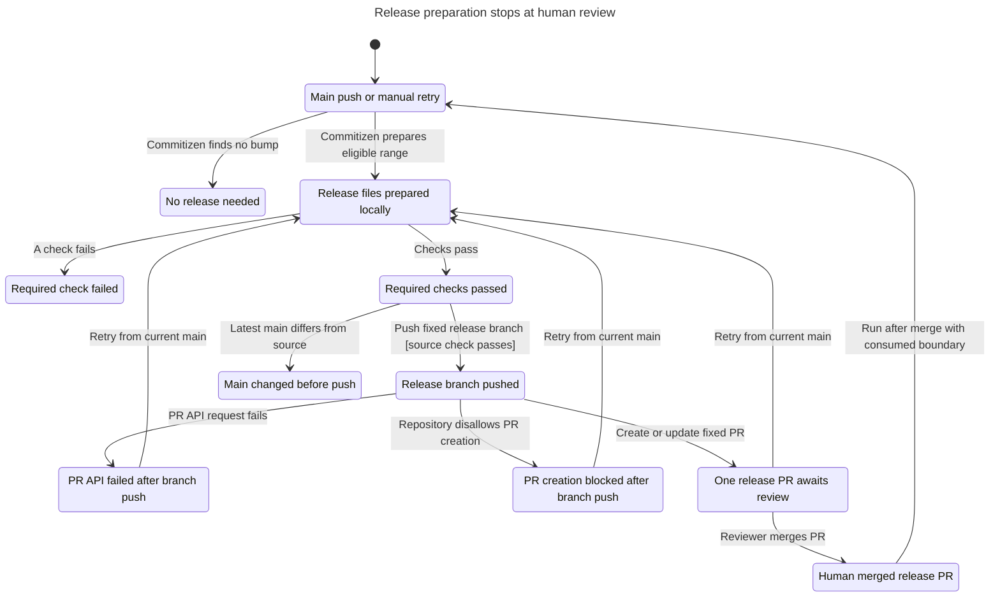

# Release preparation lifecycle

This model describes the release workflow's bounded lifecycle, not a proof of GitHub or Commitizen internals.

TLC reached 59 states and 64 steps. The checked chart contains 11 states and 14 arrows. All five invariants and the deadlock check passed. The chart hides 16 steps that retain the same visible state.

## Checked chart



The standalone [Mermaid chart](chart.mmd), [TLA+ model](Release.tla), [configuration](Release.cfg), [view](view.mjs), and [TLC output](tlc.out) contain the checked result.

## Rules and source mapping

| Rule | Meaning | Source |
| --- | --- | --- |
| `SinglePr` | Runs create or update one PR on the fixed release branch. | `.github/workflows/release-pr.yml:8-10` serializes runs. The final action uses `automation/release` and `main`. |
| `OnlyCheckedWrites` | A release branch write follows required checks and the latest-source check. | `.github/workflows/release-pr.yml:33-75` |
| `NoAutomaticRelease` | The workflow does not tag, publish, approve, or merge. | `.github/workflows/release-pr.yml` contains prepare, validation, guards, and PR creation only. |
| `BoundaryAfterHumanMerge` | The generated boundary becomes the main-branch baseline only after a human merges the PR. | `scripts/release-plan.py:84-91` writes the source SHA into proposed release files. |
| `NoReleaseLoop` | A run after release merge finds no eligible commits unless new bump-worthy work exists. | `scripts/release-plan.py:48-58` calculates only the saved-boundary range. |

No rule broke, so there is no counterexample to replay. Fixture tests, source review, and actual workflow results remain necessary.

## Permission failure and retry

The model explores both allowed and blocked PR-creation settings as environment inputs. It contains no action that changes repository settings.

The actual repository's bundled create-and-approve permission is disabled. PR creation can fail after the action pushes the release branch. The model retains that branch and allows a retry against the same PR. A retry with the permission still disabled remains blocked. Permission changes are outside the model. This is not a no-write failure.

A failed check or stale-source check stops before the release action. The model does not assume permission to read repository administration settings.

## Model limits

The model contains one serialized release run and retries for that release. It does not model GitHub API internals, action implementation, branch provenance checks, file-write atomicity, or credential handling.

The source check is a point-in-time observation. Main can advance between that check and the release action. A later main-triggered run must refresh the same PR.

The model treats Commitizen's eligible-range result as an input. It does not prove parsing, version selection, changelog formatting, or version consistency. The helper's fixture tests cover those behaviors.

`NoAutomaticRelease` checks that the modeled actions exclude automatic release operations. Source review must confirm that the workflow continues to exclude them. The human merge action represents an external reviewer, not workflow code. Since #120, a separate `Publish release` workflow tags and publishes after the merge. Its [publish model](../120-release-publish/report.md) covers that step.

## Regenerate

Run from the issue worktree with the installed Java and TLC prerequisites. The model checker writes into a new scratch directory.

```sh
scratch=$(mktemp -d /tmp/issue105-statechart.XXXXXX)
cp docs/statechart/105-release-automation/Release.tla "$scratch/"
cp docs/statechart/105-release-automation/Release.cfg "$scratch/"
cp docs/statechart/105-release-automation/view.mjs "$scratch/"
.agents/skills/statechart/scripts/statechart "$scratch/Release.tla" \
  --config "$scratch/Release.cfg" --view "$scratch/view.mjs" --out "$scratch/checked"
```

Expected result: 59 states, five invariants and `NoDeadlock` hold, and the command exits with code 0.
