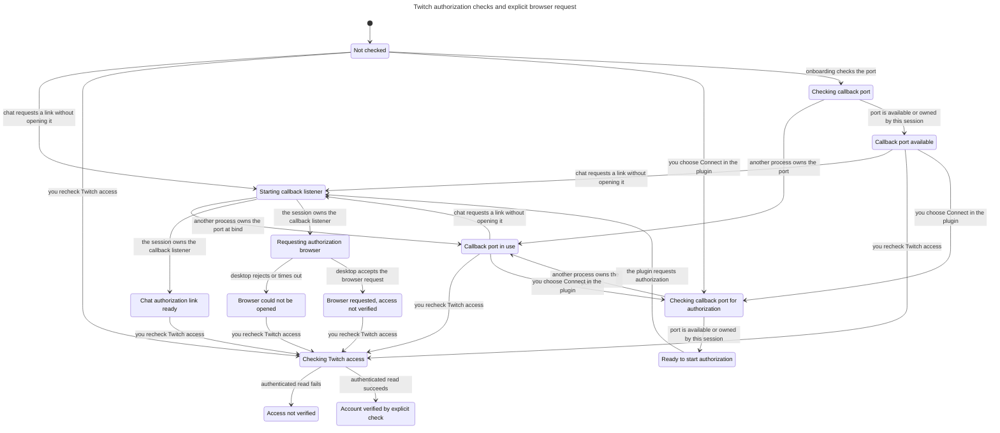

# Twitch onboarding port and browser checks

The plugin checks callback-port availability before it requests authorization. A successful check releases its probe, so another process can claim the port afterward. Connect must still acquire the callback listener before it requests the desktop browser.

The UI path checks the port and requests the browser from one explicit button action. A chat call with default inputs creates a link without opening it. Neither path verifies the account. Only a successful authenticated read after an explicit access check establishes the current account.

## Checked rules

TLC exited 0 with 71 distinct states and 118 steps. Eight invariants and the deadlock check passed. The complete search generated 121 states, with no queued states remaining.

| Rule | Requirement |
| --- | --- |
| `TypeOK` | Every modeled value stays in its declared finite domain. |
| `ProbeDoesNotClaimPort` | Preflight leaves the port owner unchanged. |
| `BusyNeverOpensBrowser` | A busy-port result makes no browser request. |
| `BrowserRequiresOwnedListener` | The session owns the callback listener before it requests a browser. |
| `BrowserDoesNotVerify` | A link or browser request does not establish account access. |
| `VerifiedRequiresExplicitCheck` | Verification follows an explicit authenticated access check. |
| `NoAutomaticRetry` | Browser and connection attempts cannot exceed explicit authorization requests. |
| `ChatLinkDoesNotOpenBrowser` | A chat call with default inputs does not request a browser. |

No checked rule failed, so this run has no counterexample path. The [TLC output](tlc.txt) and [generated report](report.md) record the actual run.

## Code and test correspondence

The model follows these entry points:

- `src/ui/connections.ts:61` starts the UI action, checks preflight, then requests `stream_machine_twitch_connect` with `openBrowser: true`.
- `src/auth/local-runtime.ts:14` binds the callback listener and maps an occupied port to `TWITCH_LOCAL_PORT_BUSY`.
- `src/auth/local-runtime.ts:107` checks an existing session-owned listener or probes availability. Connect acquires the listener before launching a browser.
- `src/auth/desktop-browser.ts:17` validates the fixed authorization address and makes one bounded desktop launch request.
- `src/ui/connections.ts:43` performs the separate access recheck.

`tests/twitch-onboarding-registration.test.ts:47` replays the race through real in-memory MCP: preflight succeeds, another server binds the port, and preflight and Connect both return `TWITCH_LOCAL_PORT_BUSY`. The browser stub receives zero calls, and the other listener remains running.

`tests/twitch-onboarding.test.ts:16` checks that preflight does not retain a listener. `tests/twitch-onboarding.test.ts:42` checks the UI request sequence and its unverified state. Browser-launch tests use injected command runners and never open Twitch.

## Model limits

Each trace contains at most one explicit authorization request and one explicit access check. A second deliberate click starts a new attempt outside this bound. The model assumes local configuration exists. It does not model OAuth cookies, token storage, consent completion, scope completeness, title approval, host rendering, or the desktop browser itself.

The port has three abstract states: available, owned by another process, or owned by this session. The model includes another process claiming the port after preflight succeeds. It does not share listeners, terminate processes, or choose an unregistered callback port.

The chart hides two port-claim steps because they do not change the visible UI state. Their consequence remains visible on the occupied-port bind result. It also omits steps that stay in one chart state. The generated chart has 14 states and 25 arrows.

## Regenerate the checked artifacts

Run from the repository root with a fresh output directory:

```sh
mise exec -- bun .agents/skills/statechart/scripts/statechart.ts \
	docs/statechart/110-twitch-onboarding/TwitchOnboarding.tla \
	--config docs/statechart/110-twitch-onboarding/TwitchOnboarding.cfg \
	--view docs/statechart/110-twitch-onboarding/view.mjs \
	--out /tmp/stream-machine-110-onboarding-recheck
```

The expected result is exit 0 with all rules above holding. Compare the new report and chart before replacing saved outputs.

## Checked chart

The Mermaid below is the generated [chart](chart.mmd), without hand edits.


