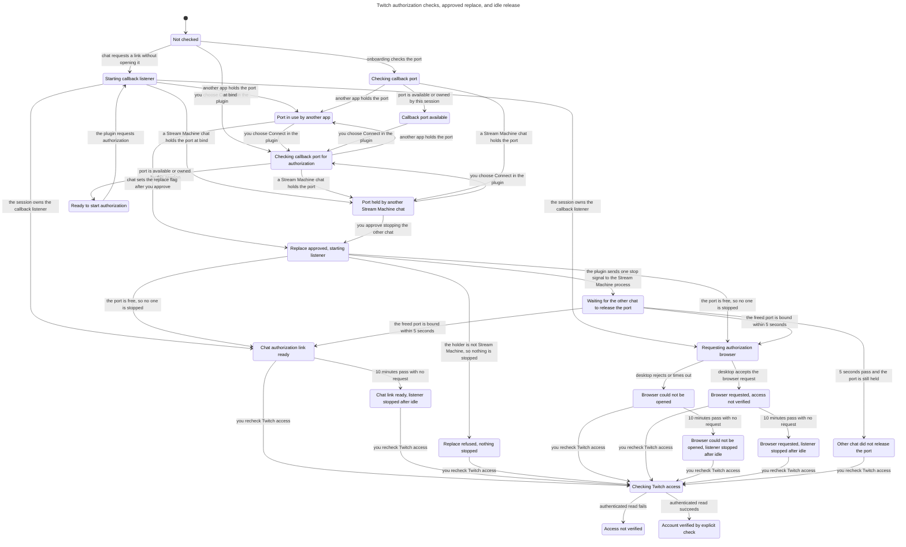

# Twitch onboarding port and browser checks

The plugin checks callback-port availability before it requests authorization. A successful check releases its probe, so another process can claim the port afterward. Connect must still acquire the callback listener before it requests the desktop browser.

The UI path checks the port and requests the browser from one explicit button action. A chat call with default inputs creates a link without opening it. Neither path verifies the account. Only a successful authenticated read after an explicit access check establishes the current account.

## Who holds the port

The model tells three kinds of port holder apart, because the plugin treats them differently.

- **This session.** The runtime owns the callback listener. A browser request is allowed only at this point.
- **Another Stream Machine chat** (`TWITCH_LOCAL_PORT_PLUGIN`). `findPluginListener` verified that exactly one other process listens on the port, that its working directory or parent holds a `plugin.json` named `stream-machine`, and that its command ends with `<root>/dist/server.js`. The UI offers **Stop the other chat and connect**.
- **Anything else** (`TWITCH_LOCAL_PORT_BUSY`). The holder is another app, an unverifiable process, more than one process, or the check failed. On platforms other than macOS and Linux the check returns no holder. The plugin never signals these processes.

## Replace with approval

Replace is a separate, explicit request. The first Connect attempt never stops anything. After you click **Stop the other chat and connect**, the UI sends `stream_machine_twitch_connect` with `openBrowser: true` and `replacePluginListener: true`, and skips the preflight. A chat can reach the same path only by passing `replacePluginListener` after you approve it. The flag defaults to `false`.

With the flag set, `connect` tries the bind first. If the port is free, the bind succeeds and nothing is signalled. If the bind fails, the plugin looks up the verified Stream Machine process again. With no verified process it fails with `TWITCH_LOCAL_PORT_BUSY` and signals nothing. With one it sends `SIGTERM` once, never `SIGKILL`, then retries the bind every 100 ms for up to 5 seconds. If the port stays held, it fails with `TWITCH_LOCAL_PORT_BUSY`. The browser opens only after a bind succeeds.

Stopping the other chat ends its Stream Machine tools until its host restarts them. The UI message says so before you approve.

## Idle release

The callback listener stops after 600 seconds with no request. Every request, every `connect`, and every `approvalUrl` call resets the timer. The next `connect` binds again. A chat that finished authorization therefore stops holding port 4017 after ten idle minutes, which makes most replace requests unnecessary.

## Checked rules

TLC exited 0 with 432 distinct states and 757 states generated. Thirteen invariants and the deadlock check passed. The complete search left no queued states.

| Rule | Requirement |
| --- | --- |
| `TypeOK` | Every modeled value stays in its declared finite domain. |
| `ProbeDoesNotClaimPort` | Preflight leaves the port holder unchanged. |
| `BusyNeverOpensBrowser` | A busy-port or failed-replace state makes no browser request. |
| `BrowserRequiresOwnedListener` | The session owns the callback listener at the moment it requests a browser. |
| `BrowserDoesNotVerify` | A link, browser request, or replace does not establish account access. |
| `VerifiedRequiresExplicitCheck` | Verification follows an explicit authenticated access check. |
| `NoAutomaticRetry` | Browser and connection attempts cannot exceed explicit requests. |
| `ChatLinkDoesNotOpenBrowser` | A chat call with default inputs does not request a browser. |
| `ReplaceNeverTargetsForeign` | The stop signal never goes to a holder that is not a verified Stream Machine process. |
| `ReplaceRequiresApproval` | A stop signal, or a replace in progress, follows an explicit approval. |
| `SignalSentOnce` | A replace sends at most one stop signal. |
| `IdleReleaseFreesPort` | An idle release leaves the port free. |
| `StaleHoldsNoListener` | A state marked "listener stopped after idle" does not own the listener. |

The old rule that any browser attempt implies an owned listener became `BrowserRequiresOwnedListener`. It now applies at request time. After an idle release the session no longer owns the listener, so the earlier wording would fail by design.

No checked rule failed, so this run has no counterexample path. The [TLC output](tlc.txt) and [generated report](report.md) record the actual run.

## Code and test correspondence

The model follows these entry points. Line numbers match the worktree for issue #110 and drift when the files change.

- `src/ui/connections.ts:61` starts the UI action. Line 67 runs the preflight unless replace is set. Line 72 requests `stream_machine_twitch_connect` and adds `replacePluginListener: true` only for replace.
- `src/ui/connections.ts:83` and `src/ui/connections.ts:87` map `TWITCH_LOCAL_PORT_PLUGIN` and `TWITCH_LOCAL_PORT_BUSY` to different messages and set `replaceable`. Line 143 shows **Stop the other chat and connect** only when `replaceable` is true.
- `src/adapters/twitch/register.ts:16` declares the `replacePluginListener` input, default `false`.
- `src/auth/callback-owner.ts:9` implements `findPluginListener`. It returns the single verified Stream Machine process ID or `null`.
- `src/auth/local-runtime.ts:15` binds the callback listener and maps `EADDRINUSE` to `TWITCH_LOCAL_PORT_BUSY`.
- `src/auth/local-runtime.ts:22` turns an occupied port into `TWITCH_LOCAL_PORT_PLUGIN` or `TWITCH_LOCAL_PORT_BUSY`.
- `src/auth/local-runtime.ts:26` is the preflight. It binds and releases a probe.
- `src/auth/local-runtime.ts:57` and `src/auth/local-runtime.ts:63` hold the 600-second idle timer and the listener start that resets it.
- `src/auth/local-runtime.ts:118` implements the replace: verify, `SIGTERM` once, retry for 5 seconds. `src/auth/local-runtime.ts:134` is `connect`, and line 138 chooses replace or the plain busy fault.
- `src/auth/desktop-browser.ts:17` validates the fixed authorization address and makes one bounded desktop launch request.
- `src/ui/connections.ts:43` performs the separate access recheck.

Test replays:

- `tests/twitch-callback-owner.test.ts:30` starts a real child process that fakes a Stream Machine plugin root. Preflight and a plain connect report `TWITCH_LOCAL_PORT_PLUGIN` and leave it running. The approved connect stops it and takes the port.
- `tests/twitch-callback-owner.test.ts:44` shows that an approved connect against a holder named `other-app` fails with `TWITCH_LOCAL_PORT_BUSY` and leaves the holder running.
- `tests/twitch-onboarding.test.ts:43` checks idle release: another session gets `TWITCH_LOCAL_PORT_BUSY` at 599 seconds and binds at 600 seconds.
- `tests/twitch-onboarding.test.ts:28` checks that a second runtime reports the occupied port without changing the owner.
- `tests/ui-connections.test.ts:99` checks that replace is a separate request with `replacePluginListener: true` and no preflight. `tests/ui-connections.test.ts:87` checks the distinct messages for `TWITCH_LOCAL_PORT_BUSY` and `TWITCH_LOCAL_PORT_PLUGIN`.
- `tests/twitch-onboarding-registration.test.ts:48` replays the race through real in-memory MCP: preflight succeeds, another server binds the port, and the later calls fail. The browser stub receives zero calls, and the other listener remains running.
- `tests/twitch-onboarding.test.ts:16` checks that preflight does not retain a listener. `tests/twitch-onboarding.test.ts:58` checks the UI request sequence and its unverified state. Browser-launch tests use injected command runners and never open Twitch.

## Model limits

Each trace contains at most two explicit connection requests (the first attempt and one replace) and one explicit access check. A second deliberate click outside that pattern starts a new attempt outside this bound. The model assumes local configuration exists. It does not model OAuth cookies, token storage, consent completion, scope completeness, title approval, host rendering, or the desktop browser itself.

The port has four abstract holders: none, this session, a verified Stream Machine process, or any other process. The model includes another process claiming the port after preflight succeeds, a plugin holder leaving or an app taking its place while the busy message is on screen, and an idle release of the session's own listener.

The model abstracts the 5-second retry as at most two failed retries followed by a give-up. The stopped plugin process may exit at any point during the wait, or never. The model does not cover the time between the holder check and the signal, so a process ID that changes owner in that gap is outside the model. It also leaves out a chat host restarting the stopped plugin and a rebind after the session's own idle release. The idle test covers that rebind. The model does not choose an unregistered callback port.

The chart hides these steps because they do not change what you see: another process claiming the port, the stopped process exiting, a failed retry, a holder change on the busy screen, waiting for the user, a recheck from the unchecked, port-available, and busy screens, and a chat link request from any screen but the first. Their effects stay visible in the bind, replace, and retry results. The generated chart has 22 states and 41 arrows. That is more than the 20 the skill recommends, and each remaining arrow ends in a different state or carries a different reason.

## Regenerate the checked artifacts

Run from the repository root with a fresh output directory:

```sh
mise exec -- bun .agents/skills/statechart/scripts/statechart.ts \
	docs/statechart/110-twitch-onboarding/TwitchOnboarding.tla \
	--config docs/statechart/110-twitch-onboarding/TwitchOnboarding.cfg \
	--view docs/statechart/110-twitch-onboarding/view.mjs \
	--out /tmp/stream-machine-110-onboarding-recheck
```

The expected result is exit 0 with all rules above holding. `tlc.txt` is the command's `tlc.out`. Compare the new report and chart before replacing saved outputs.

## Checked chart

The Mermaid below is the generated [chart](chart.mmd), without hand edits.


