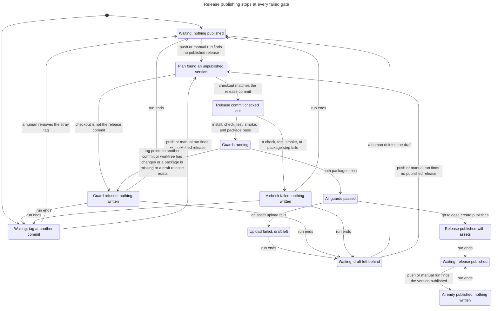

# Release publish lifecycle

This model describes the `Publish release` workflow's bounded lifecycle after a release PR merges. It is not a proof of GitHub or `gh` internals.

TLC reached 199 states and 273 steps. The checked chart contains 13 states and 23 arrows. All five invariants and the deadlock check passed. The chart hides 37 steps that stay in one chart state. Those are the guard-to-guard steps inside "Guards running" and the final "no more runs" step.

## Checked chart



The standalone [Mermaid chart](chart.mmd), [TLA+ model](Publish.tla), [configuration](Publish.cfg), [view](view.mjs), and [TLC output](tlc.out) contain the checked result.

A run that finds a published version stops (`s11` to `s12`). Any other run checks out the release commit, runs the checks, and passes the guards before it writes. An upload failure leaves a draft (`s10`). Every later run from `s10` reaches the draft guard and refuses (`s2`, `s3`, `s6`, `s4`, `s10`) until a human deletes the draft (`s10` to `s0`). The next run then publishes.

## Rules and source mapping

| Rule | Meaning | Source |
| --- | --- | --- |
| `TagAtReleaseCommit` | A published release always has its tag at the release commit. | `scripts/release-publish.ts:67` refuses a tag at another commit. `scripts/release-publish.ts:76-77` passes `--target` with the release commit. `scripts/release-publish.ts:46` derives that commit from `plugin.json`. |
| `OneReleasePerVersion` | A version gets at most one release. | `.github/workflows/release.yml:8-10` serializes runs. `scripts/release-publish.ts:58` and `scripts/release-publish.ts:63-64` stop on a published release. `.github/workflows/release.yml:36-37` skips the publish job when the plan says published. |
| `NoWriteUnlessGuarded` | `gh release create` runs only after the head check, the checks, and the four guards pass. | `.github/workflows/release.yml:47-56` verifies the checkout and runs the checks. `scripts/release-publish.ts:66-71` holds the guards. `scripts/release-publish.ts:76-77` is the only write. |
| `NeverRepublished` | A published version is never written again. | `scripts/release-publish.ts:63-64` ends the run on a published release before any guard or write. The plan job reads the same value at `.github/workflows/release.yml:33-34`. |
| `PublishedHasAssets` | A published release has both package assets. | `scripts/release-publish.ts:53-57` and `scripts/release-publish.ts:70-71` require both packages. `scripts/release-publish.ts:78-79` rejects a draft after creation. |
| `NoDeadlock` | Every state has a next step. A leftover draft or stray tag blocks publishing, but runs and human actions stay possible. | `scripts/release-publish.ts:66` and `scripts/release-publish.ts:67` refuse with an error message. The `Done` action marks the bound on runs. |

The model ties each action to the source as follows.

| Action | Source |
| --- | --- |
| `PlanStops`, `PlanFindsWork` | `.github/workflows/release.yml:12-34` and `scripts/release-publish.ts:61-62`. A draft counts as not published at `scripts/release-publish.ts:58`. |
| `VerifyHeadPasses`, `RefuseHead` | `.github/workflows/release.yml:47-50`. The same condition appears at `scripts/release-publish.ts:68`. The model checks it once, at the workflow step, because nothing between the two checks moves `HEAD`. |
| `ChecksPass`, `ChecksFail` | `.github/workflows/release.yml:52-56` runs install, check, test, smoke, and package. |
| `DraftGuardPasses`, `RefuseDraft` | `scripts/release-publish.ts:66` |
| `TagGuardPasses`, `RefuseTag` | `scripts/release-publish.ts:67` |
| `CleanGuardPasses`, `RefuseDirty` | `scripts/release-publish.ts:69` |
| `PackageGuardPasses`, `RefuseMissing` | `scripts/release-publish.ts:70-71` |
| `CreateSucceeds`, `UploadFails` | `.github/workflows/release.yml:57-64` runs the pushed commit's copy of `scripts/release-publish.ts`, which creates the release at lines 76-80. |
| `HumanDeletesDraft`, `HumanFixesTag` | Human actions outside the workflow. The error text at `scripts/release-publish.ts:66` asks for the deletion. |

No rule broke, so there is no counterexample to replay. Source review and real workflow runs stay necessary.

## Failed upload and retry

The model treats `gh release create` as two outcomes. It either publishes the release with the tag at the release commit and both assets, or it fails during the upload and leaves a draft with no tag.

A draft blocks every later run at `scripts/release-publish.ts:66`, and the guard refuses before any write. A run that finds the draft still passes the plan job, because the plan treats a draft as unpublished. The run therefore repeats the checks and then refuses.

A human deletes the draft, and the next run publishes. The model allows that deletion only between runs. A later push after publication stops in the plan step and creates no release.

A tag at another commit also blocks every run until a human removes the tag. The initial state of the model includes this case.

## Model limits

The model contains one release version and at most five serialized runs. The bound is `MaxRuns` in [Publish.cfg](Publish.cfg). It does not model GitHub API internals, `gh` behavior, partial-upload atomicity, rate limits, or credential handling.

The model assumes the outcome of `gh release create` is one of two cases. In real use `gh` can create the draft, upload some assets, and then fail. The model records only that the draft remains and the tag does not exist. It also does not model the post-create check at `scripts/release-publish.ts:78-79`, which throws when GitHub returns a draft.

Each check and guard outcome is a free choice, except the draft guard and the tag guard. Those two read the remote state. The model does not simulate what makes the worktree dirty or a package missing.

The model lets a human delete a draft or remove a stray tag only between runs. Another actor that creates a release or a draft during a run is outside the model. The concurrency group at `.github/workflows/release.yml:8-10` rules out a second workflow run, but not a human at the GitHub UI.

The model does not model a manual run on a ref other than `main`. The plan job skips that run at `.github/workflows/release.yml:13`, so no write can follow.

## Regenerate

Run from the issue worktree with the installed Java and TLC prerequisites. The model checker writes into a new scratch directory.

```sh
scratch=$(mktemp -d /tmp/issue120-statechart.XXXXXX)
cp docs/statechart/120-release-publish/Publish.tla "$scratch/"
cp docs/statechart/120-release-publish/Publish.cfg "$scratch/"
cp docs/statechart/120-release-publish/view.mjs "$scratch/"
.agents/skills/statechart/scripts/statechart "$scratch/Publish.tla" \
  --config "$scratch/Publish.cfg" --view "$scratch/view.mjs" --out "$scratch/checked"
```

Expected result is 199 states and 273 steps. The five invariants and `NoDeadlock` hold, and the command exits with code 0.
