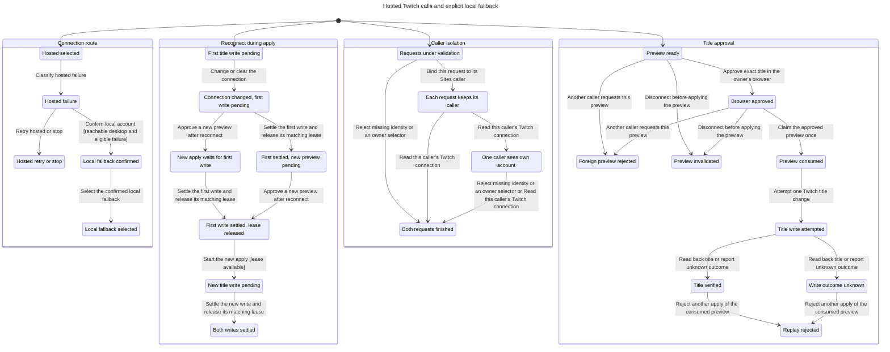

# Hosted MCP authorization model

This model checks caller isolation, title approval, and the policy for choosing the local fallback. It does not verify a deployment.

TLC passed twelve invariants and the deadlock check. The checked model contains 139 states and 187 steps. The generated chart draws 25 states and 27 arrows. It hides 61 steps within chart states, including rejected requests while another request remains pending, repeated terminal steps, and details of overlapping requests.

## Checked rules

| Rule | Meaning |
| --- | --- |
| `AuthenticatedBeforeRead` | A request must have a Sites caller before reading a connection. |
| `RequestOwnerNeverChanges` | Each request keeps the Sites caller assigned to that request. |
| `ReadOnlyOwnConnection` | A request reads only its caller's connection. |
| `SelectorsCannotChooseOwner` | Caller-supplied owner selectors fail before binding or reading an account. |
| `OnlyOwnerCanApprove` | Only the preview owner can approve the preview. |
| `NoUnapprovedWrite` | A title write requires the owner's approval and a consumed preview. |
| `AtMostOneWrite` | One preview permits at most one title write attempt. |
| `DisconnectedPreviewCannotWrite` | Disconnect before consumption prevents the preview from writing. |
| `LocalFallbackRequiresConfirmation` | Local fallback requires a reachable desktop and explicit confirmation. |
| `NoFallbackAfterAuthOrWriteFailure` | Only unreachable, server-error, or unconfigured failures permit local fallback. |
| `NoConcurrentTitleWrites` | A new apply cannot write while the previous apply still holds its lease. |
| `HeldLeaseSurvivesConnectionChanges` | Reauthorization, disconnect, invalid-token removal, and preview clearing preserve an active execution lease. |

No rule breaks under the current configuration. The former lease-deletion policy has counterexamples recorded below.

## Chart



The four starting states are independent scenarios. They are not parallel stages of one request. The caller scenario interleaves two requests to different accounts. One request can lack identity, and either request can contain a forbidden owner selector. The preview scenario checks both owners. The route scenario checks desktop availability and nine failure classes. The held-lease scenario starts with a paused write, then checks four ways to change or clear the connection while another preview is approved.

## Implementation guards

The shared source belongs to this repository. Site paths below belong to the independent checkout under `docs/hosted-oauth-site/`. The deployment report records its source commit.

| Model action | Entry point and guard |
| --- | --- |
| `Authorize`, `Reject` | Site `lib/mcp/handler.ts`, `handleMcp`, requires `sitesPrincipal` before parsing or dispatch. `createTwitchToolDefinitions` in `src/adapters/twitch/tool-register.ts` parses strict tool schemas before resolving a runtime. |
| `ReadOwnConnection` | Site `lib/mcp/runtime.ts`, `hostedRuntime`, closes over one `ownerId`. Site `lib/twitch/service.ts`, `withAccessToken`, reads that owner's connection. |
| `ApproveOwnPreview`, `RejectForeignPreview` | Site `app/api/twitch/approve/route.ts`, `POST`, requires browser identity and same-origin submission. `D1TitlePreviewStore.approve` includes the owner and preview ID in its conditional update. |
| `ConsumeBeforeWrite`, `WriteTitleOnce` | `src/adapters/twitch/service.ts`, `TwitchTitleService.apply`, checks approval, broadcaster, and scope before acquiring the execution lease. It reads the current channel while holding that lease, rejects stale previews, then consumes the preview before `writeTitle`. |
| `ChangeConnection`, `ApproveReplacement`, `BeginSecondApply`, `SettleFirstApply`, `SettleSecondApply` | Site `lib/twitch/store.ts`, `put`, `disconnect`, and `remove`, clear connection-dependent previews while preserving execution leases. `D1TitlePreviewStore.clear` preserves the lease too. Only the matching `release` or lease expiry allows another apply. |
| `WriteResult`, `RejectReplay` | `TwitchTitleService.apply` reads back the result. `pending` rejects consumed previews, including after an unknown write outcome. |
| `HostedFailure`, `ConfirmLocalFallback`, `SelectLocal`, `StayHosted` | `skills/onboarding/SKILL.md`, **Choose the local fallback**, names the eligible failure classes and requires the user's choice. This is agent guidance, not an automatic runtime failover check. |

## Scope and limits

The model represents Sites authentication as a trusted caller or a missing caller. It cannot verify that Sites strips forged identity headers. Production rejection probes must check that boundary separately.

The title scenario contains one preview. Atomic consumption abstracts the conditional store update. The held-lease scenario contains two apply attempts for one owner. It checks serialization, but it does not model title snapshots or the later stale-preview rejection. The model does not establish database transaction behavior, lease expiry, provider availability, scope validation, or the exact contents of a title. Tests must check those mechanisms against the real storage queries and services.

The held-lease scenario assumes that a live operation settles before its lease expires. Only a matching release removes the modeled lease. The runtime also permits takeover after its timeout. That timeout and provider cancellation are outside this finite model.

Disconnect is modeled before consumption. A write already claimed before disconnect can have an unknown outcome. The model never restores a consumed preview or retries that write.

The fallback scenario checks the connection policy. It does not claim that the local package automatically switches providers. Denial, cancellation, invalid state, revoked access, missing authentication, and an unknown write outcome lead to a hosted retry or a stop.

## Reproduce the check

The inputs are [HostedMcp.tla](HostedMcp.tla), [HostedMcp.cfg](HostedMcp.cfg), and [view.mjs](view.mjs). Run from the issue worktree:

```sh
mise exec -- bun .agents/skills/statechart/scripts/statechart.ts \
	docs/statechart/130-hosted-mcp/HostedMcp.tla \
	--config docs/statechart/130-hosted-mcp/HostedMcp.cfg \
	--view docs/statechart/130-hosted-mcp/view.mjs \
	--out /tmp/stream-machine-130-model-check
```

Expected result: exit 0, 139 states, twelve holding invariants, and a holding `NoDeadlock` rule. Use a new output directory for each run.

## Former lease-deletion regression

[LeaseDeletionRegression.cfg](LeaseDeletionRegression.cfg) sets `PreserveHeldLease = FALSE`. It intentionally models the former behavior that deleted an execution lease when the connection changed. The normal configuration sets this constant to `TRUE`.

The negative check exits 1 and finds these shortest paths:

- `HeldLeaseSurvivesConnectionChanges` breaks after one step. Start with the first write pending, then change the connection and delete its lease.
- `NoConcurrentTitleWrites` breaks after three steps. Change the connection, approve a replacement preview, then start another apply while the first write remains pending.

The code reproduction is Site `tests/twitch/mcp-replay.test.mjs`, the four tests named `preserves an in-flight title execution lease`. They pause the first PATCH, change the connection or clear previews, and attempt the second approved preview. The fixed code returns `TWITCH_EXECUTION_BUSY`. After the first write settles, that replacement preview returns `PREVIEW_STALE` and cannot overwrite the first result.

Reproduce the former policy with the same command and replace `--config` with `docs/statechart/130-hosted-mcp/LeaseDeletionRegression.cfg`. Use a separate output directory. The expected failure tests the model's sensitivity to lease deletion. It is not a failure of the current configuration.
