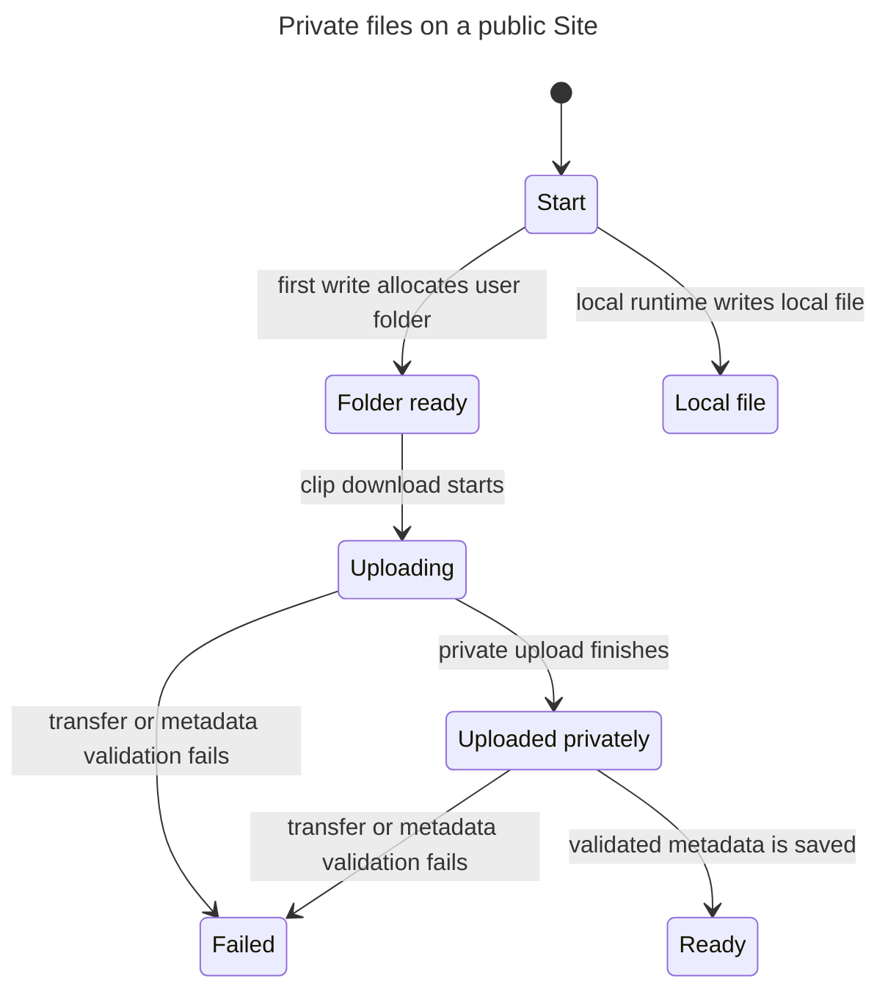

# Private user files on a public Site

This model checks the proposed storage rules for [issue #136](https://github.com/prime-optimal/stream-machine-plugin/issues/136). A public homepage does not grant access to stored files. Each file read requires a signed-in Sites user who owns the artifact.

The checked [model](UserStorage.tla) abstracts one owner's artifact, two possible folder UUIDs, three caller states, and hosted or local execution. Both signed-in callers may use the same Twitch account. A Twitch account replacement does not change the Sites folder.

## Checked flow



The diagram is the generated [chart](chart.mmd). It hides sign-in, sign-out, read attempts, Twitch account replacement, cleanup, and terminal steps. TLC still checks those steps. A failed cleanup may leave an R2 object without published metadata, which remains unreadable.

## Rules and result

The [check report](report.md) records 172 distinct states and 846 steps. Six invariants and the deadlock check passed. No counterexample requires replay.

| Rule | Meaning |
| --- | --- |
| `OwnerOnlyRead` | Only the artifact owner can receive bytes or trigger an R2 read. |
| `AnonymousDenied` | Anonymous callers receive no bytes. |
| `PendingUnreadable` | An artifact without published metadata cannot trigger an R2 read. |
| `ReadyHasObject` | Published metadata requires a completed private object. |
| `FolderStable` | The allocated folder remains unchanged, including after Twitch account replacement. |
| `NoSilentFallback` | Hosted execution never chooses a local file destination. |

The model returns 401 for anonymous reads and 404 for foreign owners or unpublished artifacts. It models trusted Sites identity as an input. It does not validate headers, OAuth, transport authentication, UUID entropy, concurrent SQL allocation, R2 behavior, byte limits, or production deployment. Runtime tests must verify those boundaries.

The authenticated file URL is a permanent locator. It grants no access by possession and has no modeled expiry or revocation. Retention and deletion policy are outside this slice.

## Reproduce the check

Run from the issue worktree:

```sh
mise exec -- bun .agents/skills/statechart/scripts/statechart.ts \
	docs/statechart/136-user-storage/UserStorage.tla \
	--config docs/statechart/136-user-storage/UserStorage.cfg \
	--view docs/statechart/136-user-storage/view.mjs \
	--out /private/tmp/stream-machine-storage-model-136-recheck
```

Expected result: six invariants and `NoDeadlock` hold. The original scratch run exited with code 0. [Raw TLC output](tlc.txt) records the check.
