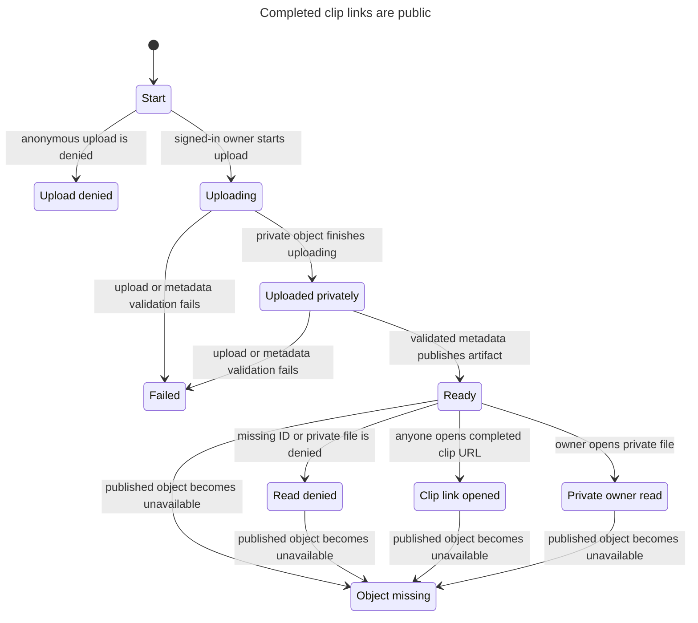

# Completed clip links are public

[Issue #143](https://github.com/prime-optimal/stream-machine-plugin/issues/143) changes the agreed clip-read policy. Anyone holding a completed clip's artifact URL can view or download it without sign-in. This supersedes the owner-only clip rule modeled in [issue #136](https://github.com/prime-optimal/stream-machine-plugin/issues/136). Other user data stays owner-private.

The [model](PublicClipFiles.tla) checks one artifact, two data kinds, the owner or a visitor, and four request targets. A visitor represents either an anonymous caller or another signed-in user. Both have the same private-file denial. The read action models generic GET fallback and the common authorization decision for public clip GET, HEAD, and range requests. It does not model generic HEAD delivery.

## Checked flow



This is the generated [chart](chart.mmd), without adaptation. Its ten visible states merge model states that share the same lifecycle and read result. It hides 448 read, cleanup, and terminal steps. Another 16 steps stay in one chart state. The reader, requested target, and data kind are fixed within each trace; TLC explores every initial combination.

## Rules and result

The [check report](report.md) records 288 distinct states and 704 steps. Seven invariants and the deadlock check passed. No counterexample requires replay.

| Rule | Agreed requirement |
| --- | --- |
| `PublicLinkWorks` | A completed clip's matching artifact URL returns its representation to any caller without resolving sign-in. |
| `PrivateOwnerOnly` | A private file returns its representation only to its owner. |
| `PublishedOnly` | A successful read requires published metadata and an available object. |
| `PendingNoBucketRead` | An artifact without published metadata cannot trigger an R2 lookup. |
| `NoListing` | Unknown IDs, folder IDs, and listing paths return no representation and trigger no R2 lookup. |
| `FolderStable` | The allocated owner folder does not change. |
| `AuthenticatedUpload` | Uploads belong to the authenticated owner; anonymous uploads cannot create an artifact. |

A representation means bytes or public clip response metadata. The model treats an available object as one with the expected stored length. Missing objects return no representation. A failed cleanup may leave an orphan object, but an orphan without a completed D1 artifact row remains unreadable.

## Source guards

Paths below belong to the independent Site source repository, not this plugin checkout. The deployment review at `docs/reviews/143-public-clips.md` records its source and runtime tests.

| Model action or rule | Site entry point and guard |
| --- | --- |
| `BeginUpload`, `DenyUpload`, `AuthenticatedUpload` | `lib/clips/download.ts:22` rejects a missing owner and binds that owner to the writer. `lib/clips/storage-writer.ts:20` also rejects a missing owner. |
| `ObjectUploaded`, `Publish`, `Fail`, `Cleanup` | `lib/user-data/store.ts:28` validates the write, uploads privately, checks completion and byte count, then inserts artifact metadata. Its failure path removes the object when possible. |
| `PublicLinkWorks`, `PublishedOnly` | `lib/clips/file-response.ts:26` validates the ID and queries completed `kind='clips'`, `media_type='video/mp4'` metadata. It checks R2 existence and length before returning a representation. |
| `PrivateOwnerOnly` | `lib/user-data/file-handler.ts:5` tries the public clip path first, then lazily resolves identity for generic GET. `lib/user-data/store.ts:51` retains the owner-scoped private read. |
| `NoListing`, `PendingNoBucketRead` | `lib/clips/file-response.ts:27` rejects invalid or unmatched IDs before R2. The file route accepts an artifact ID, not a folder or prefix. |
| Public GET and HEAD | `app/api/user-data/files/[id]/route.ts:6` delegates to the same handler. The HEAD export uses that wrapper. |

The real Worker tests replay completed public clip reads by anonymous and foreign callers, private-file denial, unpublished-object denial, missing objects, and folder/listing rejection. They also check anonymous upload denial. These tests exercise the boundaries abstracted by the model; the model result alone does not verify deployed code.

## Scope and limits

The new policy intentionally makes existing and future completed clip URLs shareable. Sign-out does not revoke a clip URL. The R2 bucket and owner folders remain private, and no listing route is added.

The model assumes trusted identity on upload and a valid artifact classification. It does not prove UUID entropy, URL secrecy, Sites header validation, Twitch consent, SQL concurrency, exact R2 bytes, HTTP status or range details, browser playback, storage failures, deployment, retention, or revocation. The runtime suite and live requests must verify those boundaries. Local filesystem fallback is unchanged and outside this model.

## Reproduce the check

Run from the issue worktree:

```sh
mise exec -- bun .agents/skills/statechart/scripts/statechart.ts \
	docs/statechart/143-public-clips/PublicClipFiles.tla \
	--config docs/statechart/143-public-clips/PublicClipFiles.cfg \
	--view docs/statechart/143-public-clips/view.mjs \
	--out /private/tmp/stream-machine-public-clips-model-143-recheck
```

Expected result: all seven invariants and `NoDeadlock` hold. The checked scratch run exited 0. [Raw TLC output](tlc.txt) preserves its result.
