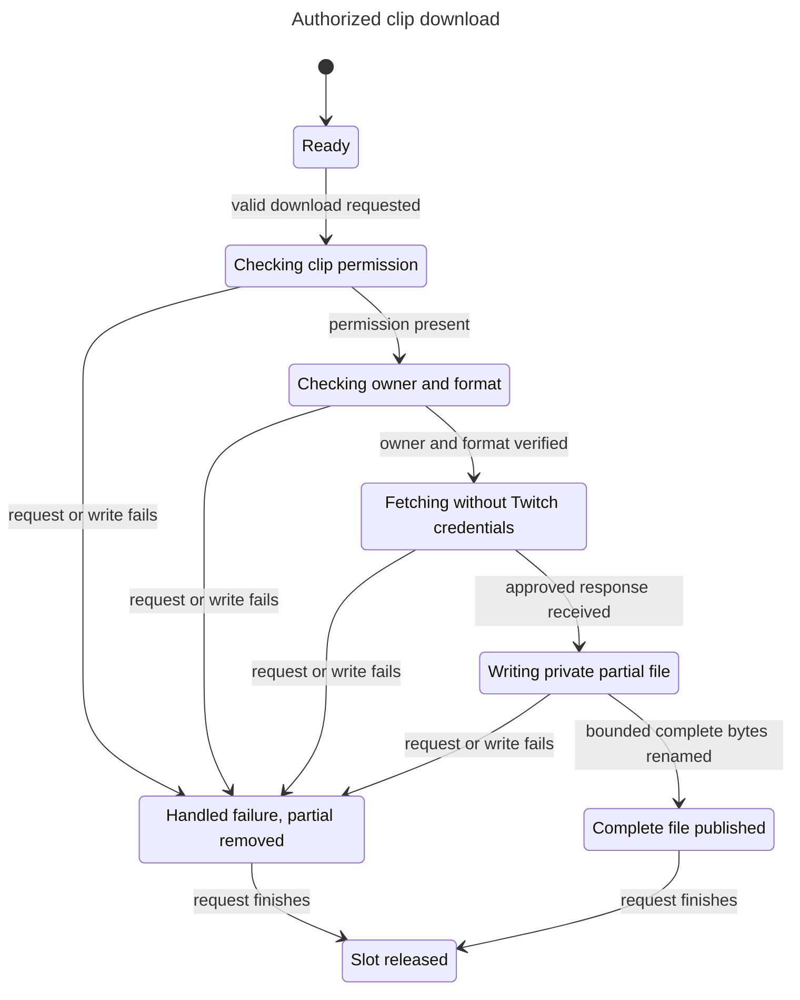

# Clip lifecycle model

This reference records bounded model checks for epic #18 at source head `8f892dd0dad8187118c1b4e55302c03c2cb47a02`.

## Checked behavior

The model follows `src/adapters/twitch/clips-service.ts:13-25` and `src/adapters/twitch/clip-artifact.ts:31-88`. Start acquires the process slot. Grant and Resolve represent successful scope, owner, and format checks. Fail represents handled authorization, API, network, and write failures. Rename represents successful bounded write, sync, close, and atomic rename.

AuthorizedFetch requires clip permission, owner match, and no Twitch credentials during binary fetch. PublishedOnlyComplete allows publication only after completion. NoPartialAfterHandledFailure excludes partial files after handled failure. SlotUntilReturn keeps the process slot until the request returns. TLC also checks NoDeadlock. Terminal states have explicit unchanged steps.

## Results

The final statechart command exits 0. TLC reaches 13 states and 25 steps. The chart draws 8 states and 11 arrows. All configured invariants hold. No bug path requires replay. The chart hides same-label steps, including rejected concurrent calls and terminal unchanged steps.

The initial draft used unassigned Boolean expressions in Init and returned statechart exit 2. The saved model uses explicit Boolean assignments. Both final checks exit 0.

The combined synthetic code run exits 0 with 27 tests across five files. See [the code-test log](../18-media-lifecycle/code-tests.txt). Live acceptance blockers remain unchanged.

## Reproduce

Run from the integration worktree. The installed skill lives in the primary checkout as an ignored project skill. It is not copied into this worktree. Commands write scratch files outside the repository. Replace the skill path if the checkout moves.

```sh
scratch=$(mktemp -d /private/tmp/stream-machine-model.XXXXXX)
cp docs/statechart/18-clip-lifecycle/Clip.tla docs/statechart/18-clip-lifecycle/Clip.cfg docs/statechart/18-clip-lifecycle/clip-view.js "$scratch/"
cd "$scratch"
/Users/prime/Documents/ChatGPT/stream-machine-plugin/.agents/skills/statechart/scripts/statechart Clip.tla --config Clip.cfg --view clip-view.js --out checked
```

Expected result: exit 0 with the state counts above. The output folder must be new. The skill uses mise-managed Java and TLC. The first run may install its tools.

From the worktree, replay the code checks with:

```sh
bun test tests/twitch-clips.test.ts tests/clip-artifact.test.ts tests/twitch-clips-registration.test.ts tests/media-info.test.ts tests/media-registration.test.ts
```

## Chart



## Limits

The model covers one request and rejected concurrent requests. It abstracts byte loops, deadlines, filesystem permissions, CDN behavior, OAuth refresh, and abrupt process termination. Cleanup calls can fail at runtime. A process kill can leave a partial file. No eventual-completion property is claimed.

These checks validate the written abstraction, not a proof that the implementation refines it. No live provider or OAuth flow ran.
