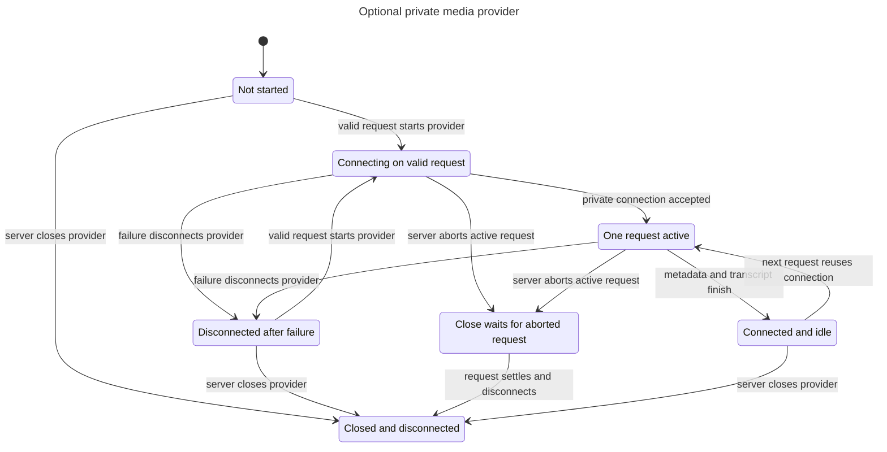

# Private media lifecycle model

This reference records bounded model checks for epic #18 at source head `8f892dd0dad8187118c1b4e55302c03c2cb47a02`.

## Checked behavior

The model follows `src/adapters/media/provider.ts:73-135`. Inspect validates input before acquisition. Connect covers the private listener and pinned-source gates. Success keeps a reusable connection. Failure clears the connection. CloseActive aborts the request, waits for settlement, and disconnects.

LazyStart prevents connection before the first valid request. OneOperation permits one active operation. ClosePreventsReuse prevents a request after close begins. ClosedDisconnects requires no active operation or connection after close finishes. TLC also checks NoDeadlock. Terminal states have explicit unchanged steps.

## Results

The final statechart command exits 0. TLC reaches 9 states and 20 steps. The chart draws 7 states and 13 arrows. All configured invariants hold. No bug path requires replay. The chart hides same-label steps, including rejected concurrent calls and terminal unchanged steps.

The initial draft used unassigned Boolean expressions in Init and returned statechart exit 2. The saved model uses explicit Boolean assignments. Both final checks exit 0.

The combined synthetic code run exits 0 with 27 tests across five files. See [the code-test log](../18-media-lifecycle/code-tests.txt). Live acceptance blockers remain unchanged.

## Reproduce

Run from the integration worktree. The installed skill lives in the primary checkout as an ignored project skill. It is not copied into this worktree. Commands write scratch files outside the repository. Replace the skill path if the checkout moves.

```sh
scratch=$(mktemp -d /private/tmp/stream-machine-model.XXXXXX)
cp docs/statechart/18-media-lifecycle/Media.tla docs/statechart/18-media-lifecycle/Media.cfg docs/statechart/18-media-lifecycle/media-view.js "$scratch/"
cd "$scratch"
/Users/prime/Documents/ChatGPT/stream-machine-plugin/.agents/skills/statechart/scripts/statechart Media.tla --config Media.cfg --view media-view.js --out checked
```

Expected result: exit 0 with the state counts above. The output folder must be new. The skill uses mise-managed Java and TLC. The first run may install its tools.

From the worktree, replay the code checks with:

```sh
bun test tests/twitch-clips.test.ts tests/clip-artifact.test.ts tests/twitch-clips-registration.test.ts tests/media-info.test.ts tests/media-registration.test.ts
```

## Chart



## Limits

The model abstracts metadata and transcript calls into one operation. It assumes connector and provider calls settle on abort. It does not prove external process shutdown, listener identity, authentication, operating-system signals, timeout responsiveness, or successful live provider access. No eventual-completion property is claimed.

These checks validate the written abstraction, not a proof that the implementation refines it. No live provider or OAuth flow ran.
