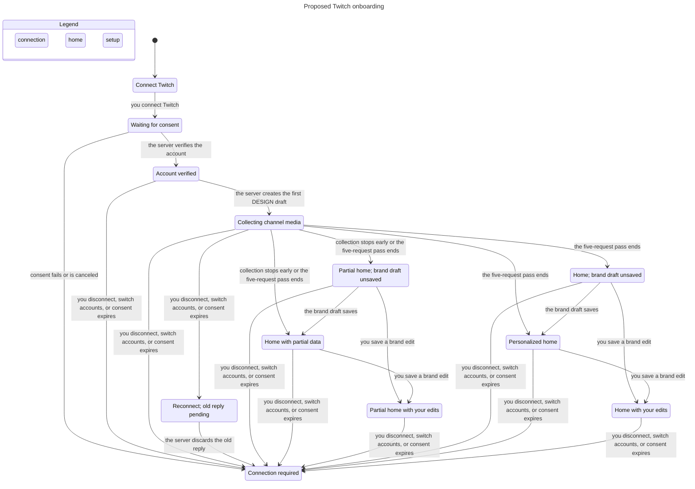

# Twitch onboarding state review

This model checks the proposed onboarding flow for issue [#201](https://github.com/prime-optimal/stream-machine-plugin/issues/201). It does not verify the current plugin implementation.

## Result

TLC checked 215 distinct states and 749 transitions with one worker. All eight invariants and the deadlock check passed. The command exited 0. No counterexample was found.

The [raw check report](check-report.md), [TLC output](tlc-output.txt), [model](Onboarding.tla), [configuration](Onboarding.cfg), and [chart view](view.mjs) preserve the evidence.

## Checked rules

| Rule | Meaning |
| --- | --- |
| TypeOK | Every value belongs to the modeled domain. |
| RequestBudget | One enrichment generation attempts at most five Twitch requests. |
| CountBeforeDispatch | Every in-flight request has already consumed its slot. |
| SeedOnce | One generation creates at most one initial brand draft. |
| HomeHasDraft | Ready and partial Home states have a draft, including an unsaved draft. |
| NoStaleMedia | Disconnect, account switch, and lost authorization clear visible media before an old reply arrives. |
| UserEditsSurvive | Once the user saves a field, evidence merges and late save completions preserve that field. |
| ConnectionBeforeEnrichment | Collection starts only after account verification and initial draft creation. |
| NoDeadlock | Each state has a next action or an explicit wait for user action. |

## Flow



The chart is the generated output, without manual changes. It shows 12 states and 24 arrows. It omits 465 transitions whose source and destination share one chart label. These include request dispatch and completion while collecting, repeated opens, retrying a draft save, and evidence merges. The model still checks these transitions.

## Failure and reuse behavior

A failure or timeout consumes the reservation made before dispatch. The pass can stop early and show partial Home. Reopening the same generation changes no state and cannot reset its budget.

Draft creation and persistence are separate. A failed save leaves an unsaved draft visible on Home. Retrying that save changes only its persistence state. It does not create another draft or spend another Twitch request. A successful user edit also saves the draft.

Invalidation clears displayed media immediately. An in-flight reply can then complete only through IgnoreLateReply, which changes no draft, request count, or media. The stored draft remains associated with the old generation. The model does not display it as the new account's draft.

## Model limits

The model represents one verified account generation and one in-flight request at a time. It treats disconnect, account switch, and revoked consent as equivalent invalidation. Connection required is the boundary where a new authenticated generation starts in the product. It does not reset and explore that next generation.

Server authentication, account-keyed storage, and atomic reservation of request slots are assumptions. Multi-worker contention, duplicate callbacks, network cancellation, cache reuse across processes, and database compare-and-swap require implementation tests. No fairness condition proves that a stalled provider eventually responds.

SeedOnce applies within this generation. Reusing an existing account's draft across a later connection is an implementation acceptance test. One symbolic field represents a user-approved value. Revision conflicts, field provenance, suggestion acceptance, retention, deletion, and OpenDesign synchronization are outside this model.

The model excludes creative generation, transcription, clip downloads, OBS changes, and Stream Deck changes. No onboarding transition starts those actions. This exclusion is a proposed boundary, not evidence about their current implementations.

## Reproduce

From the task worktree, run the following command with a new output directory:

```sh
mise exec -- bun .agents/skills/statechart/scripts/statechart.ts \
	docs/statechart/201-twitch-onboarding/Onboarding.tla \
	--config docs/statechart/201-twitch-onboarding/Onboarding.cfg \
	--view docs/statechart/201-twitch-onboarding/view.mjs \
	--out /tmp/stream-machine-201-onboarding-recheck
```

Expected result: exit 0, 215 states, 749 transitions, and no violated rules. The recorded run used Bun 1.4.4 and TLC 2.19. The runner selected its own Java runtime, shown in tlc-output.txt, preserved from the generated tlc.out.
