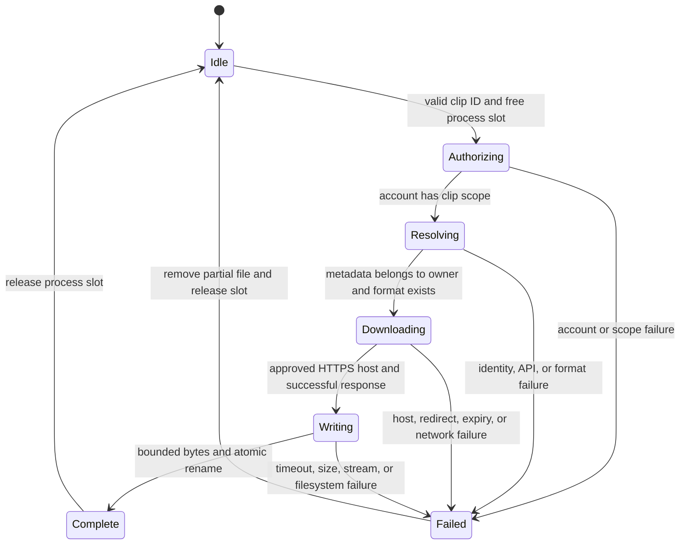

# Clip download lifecycle

This reference describes `TwitchClipService.download` and `ClipArtifactWriter.write`. It does not change the existing broadcast and worker model.

A concurrent call returns `CLIP_DOWNLOAD_BUSY` without a second provider request. Invalid input fails before acquiring the slot. Credential access ends before binary fetch. Completed files survive process restart. Handled failures remove partial files. An abrupt process termination can leave a partial file.

The installed statechart skill now checks the bounded [clip lifecycle model](18-clip-lifecycle/reproduce.md). TLC checks 13 states and 25 steps with exit 0. Four safety invariants and deadlock checking pass. The model does not prove filesystem or Twitch behavior. The earlier statement that the skill was unavailable was incorrect.

The [optional media lifecycle model](18-media-lifecycle/reproduce.md) separately checks lazy connection, one active operation, failure recovery, and shutdown. TLC checks 9 states and 20 steps with exit 0. Four safety invariants and deadlock checking pass.

Code transition checks run with `bun test tests/twitch-clips.test.ts tests/clip-artifact.test.ts tests/twitch-clips-registration.test.ts tests/media-info.test.ts tests/media-registration.test.ts`. The run exits 0 with 27 tests passing. These synthetic tests do not remove the missing clip consent or private-provider acceptance blockers.
