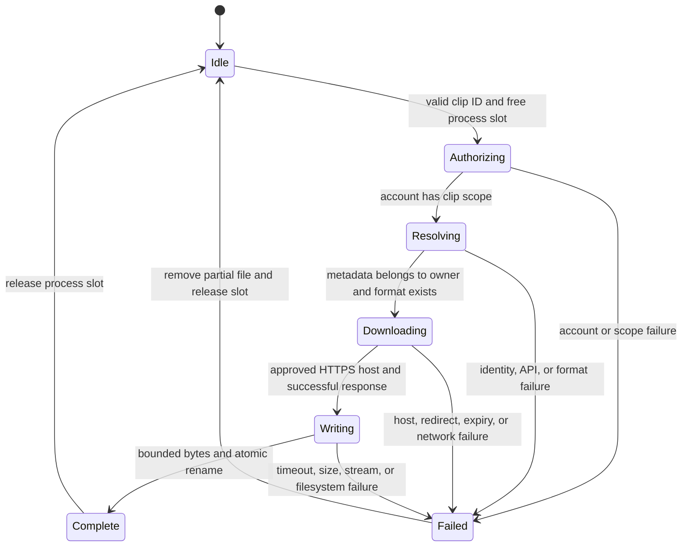

# Clip download lifecycle

This reference describes `TwitchClipService.download` and `ClipArtifactWriter.write`. It does not change the existing broadcast and worker model.

A concurrent call returns `CLIP_DOWNLOAD_BUSY` without a second provider request. Invalid input fails before acquiring the slot. Credential access ends before binary fetch. Completed files survive process restart. Handled failures remove partial files. An abrupt process termination can leave a partial file.

Reproduce transition checks with `bun test tests/twitch-clips.test.ts tests/clip-artifact.test.ts tests/twitch-clips-registration.test.ts`. These executable tests check scope, ownership, format choice, concurrency, byte limits, timeout, cleanup, and strict tool inputs. This chart is descriptive, not a model-checker proof. No `statechart` skill is installed in this session, so its formal reproduction workflow was unavailable.
