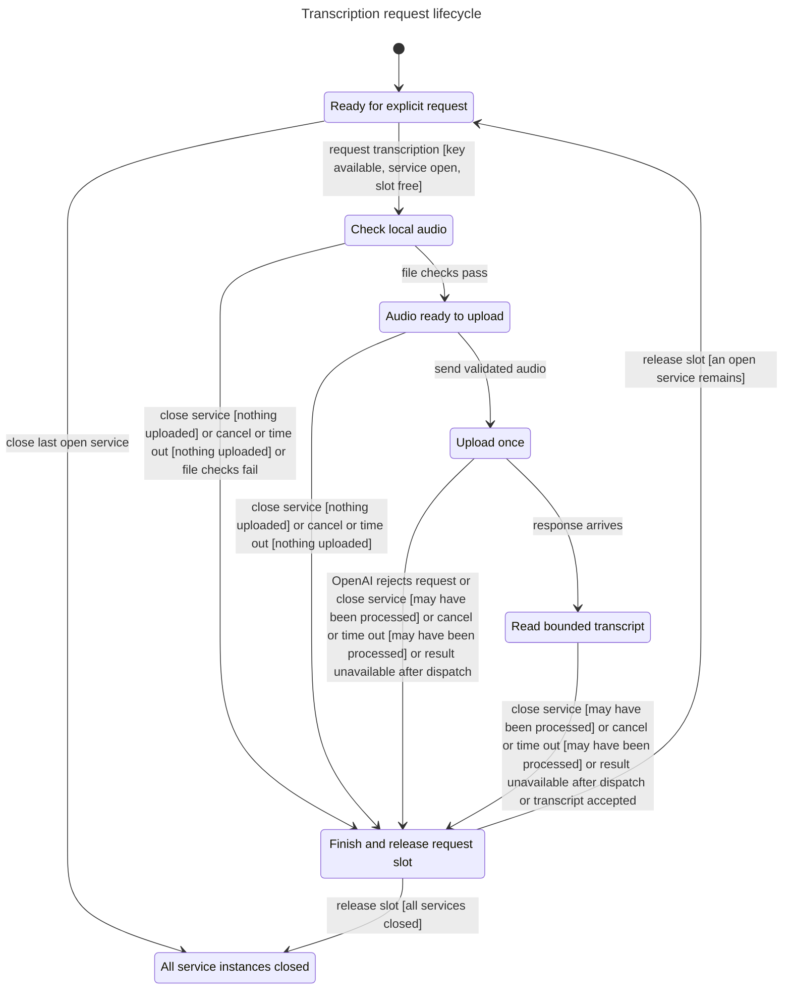

# Transcription request lifecycle

This chart describes the local request lifecycle of `TranscriptionService` for [issue #85](https://github.com/prime-optimal/stream-machine-plugin/issues/85). It follows an explicit invocation through file validation, one upload attempt, response reading, and local cleanup.

The model represents two possible service callers sharing one process-wide request slot. Closing one service prevents that instance from accepting another call. The other instance can still use the slot after cleanup.

## Chart



A cancellation or timeout before dispatch uploads nothing. After dispatch, an unavailable result can mean OpenAI processed the audio. Local cleanup releases the request slot; it does not prove that remote processing stopped. A new upload requires another explicit invocation.

## Checked rules

| Invariant | Meaning |
| --- | --- |
| `OneLocalOperation` | At most one local operation holds the shared slot. |
| `ReservationMatchesOwner` | The active operation owns the slot until cleanup. Idle and closed states hold no slot. |
| `UploadRequiresChecks` | Dispatch requires an available key and validated source. |
| `OneSendPerInvocation` | One invocation dispatches at most once. No failure transition resubmits it. |
| `CancellationBeforeUpload` | Cancellation before dispatch leaves the upload count at zero. |
| `UncertaintyIsHonest` | An uncertain outcome follows a dispatched request and is not success. |
| `SuccessRequiresSubmission` | A successful transcript follows validated source submission. |
| `ClosedIsTerminal` | When all modeled service instances close, no new request can start. |
| `ClosedOwnerDoesNotRun` | A closed instance cannot validate, upload, or read another request. |
| `TypeOK` | Every value stays within its declared finite set. |

TLC reached 56 states and 164 steps. All ten invariants and the deadlock check passed with exit 0. The chart draws seven states and 11 arrows. It omits 58 same-state transitions for waiting, early refusals, and closing one idle instance while another remains available. No inter-state arrows are hidden.

No rule-breaking path was found. The model did not identify a production bug, so there is no bug path to replay.

## Connection to the implementation

The [service](../../../src/adapters/openai/transcription-service.ts) keeps the module reservation at line 9, acquires it before asynchronous source reading, and releases it in `finally`. Its `close()` method marks the instance closed and aborts its active controller. The upload path checks source validation and cancellation before dispatch.

The service's error handler marks ambiguous post-dispatch failures with `mayHaveBeenProcessed`. Known HTTP refusals use a separate error result. The [MCP registration](../../../src/adapters/openai/transcription-register.ts) forwards `context.mcpReq.signal` to the service and returns sanitized error fields.

These mappings informed the model. They do not make the model a proof of the TypeScript implementation. Source validation, actual multipart requests, MCP cancellation, and response bounds need the separate runtime tests.

## Scope and limits

Missing keys, invalid input, and busy calls have no active-state transition. The model groups these early refusals with waiting. Source and response checks are abstract outcomes; the model does not parse media, inspect paths, resolve credentials, or call OpenAI.

Cancellation, timeout, and shutdown model their local state effects. Timers, asynchronous callbacks, stalled filesystem operations, stream cancellation, and remote processing are outside the state space. A dispatch count refers to one local invocation, not global paid jobs or remote exactly-once execution.

The model checks safety, not eventual completion. It does not prove that cleanup always finishes or that a transcript eventually arrives. It also excludes multiple Node processes, distributed locking, transcript accuracy, model access, API limits, and billing.

## Reproduce the check

The source files are [Transcription.tla](Transcription.tla), [Transcription.cfg](Transcription.cfg), and [view.mjs](view.mjs). The [generated report](report.md), [Mermaid source](chart.mmd), and [TLC output](tlc.txt) preserve the check.

Run from the repository worktree with the installed statechart runner:

```sh
mise exec -- bun /Users/prime/Documents/ChatGPT/stream-machine-plugin/.agents/skills/statechart/scripts/statechart.ts docs/statechart/85-transcription/Transcription.tla --config docs/statechart/85-transcription/Transcription.cfg --view docs/statechart/85-transcription/view.mjs --out /tmp/stream-machine-transcription-model-repeat
```

Use a fresh output directory for another run. The runner is local tooling, not bundled in the plugin; replace its absolute path on another machine. The original run used identical scratch sources under `/tmp/stream-machine-transcription-model-85/` and wrote `final/`. The retained log has trailing blank lines removed.
