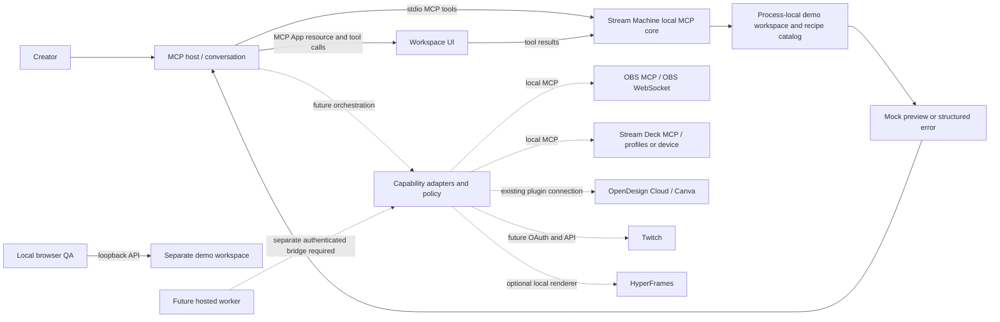

# Stream Machine architecture and state model

The architecture diagram shows where requests run. The statechart describes the visible outcomes of a demo request. Neither diagram proves that external providers work.

## Architecture and connector boundaries

Solid lines describe the current demo. Dotted lines describe proposed integrations that are not connected. The adapter placement shows the intended design, not existing connections.

The browser preview uses its own workspace. A browser test does not verify native host integration. The model excludes Twitch authorization, EventSub, provider writes, and a cloud-to-desktop bridge. The [architecture explanation](../architecture.md) describes those boundaries. The [integration inventory](../integrations.md) records the provider review.

## Demo statechart

The [rendered chart](chart.svg) and its [Mermaid source](chart.mmd) describe the outcomes that a creator sees. The model covers these actions:

- Select the demo account.
- Preview an available recipe.
- Request an unavailable recipe through a direct tool call.
- Reset the demo.

The UI disables unavailable recipe buttons. The unavailable-recipe arrows therefore represent direct tool calls, not UI selections.

The model treats an error display and the return from that display as visible outcomes. The server does not store either outcome as a workspace state. Only the connection status persists in the local process. Preview results are transient.

A repeated preview stays in the same chart state, so the chart omits that step. The model also excludes input validation, individual error types, UI navigation, process restarts, concurrency, and future connector behavior.

TLC explored 6 states and 11 steps. `MockOnly`, `PreviewNeedsDemo`, and `NoDeadlock` hold in the checked model. TLC found no paths that violate those rules.

The result checks the [TLA+ model](StreamMachine.tla), not the implementation or connector security. The [TLC report](report.md) records the counts. The [reproduction guide](reproduce.md) contains the command that regenerates them.
