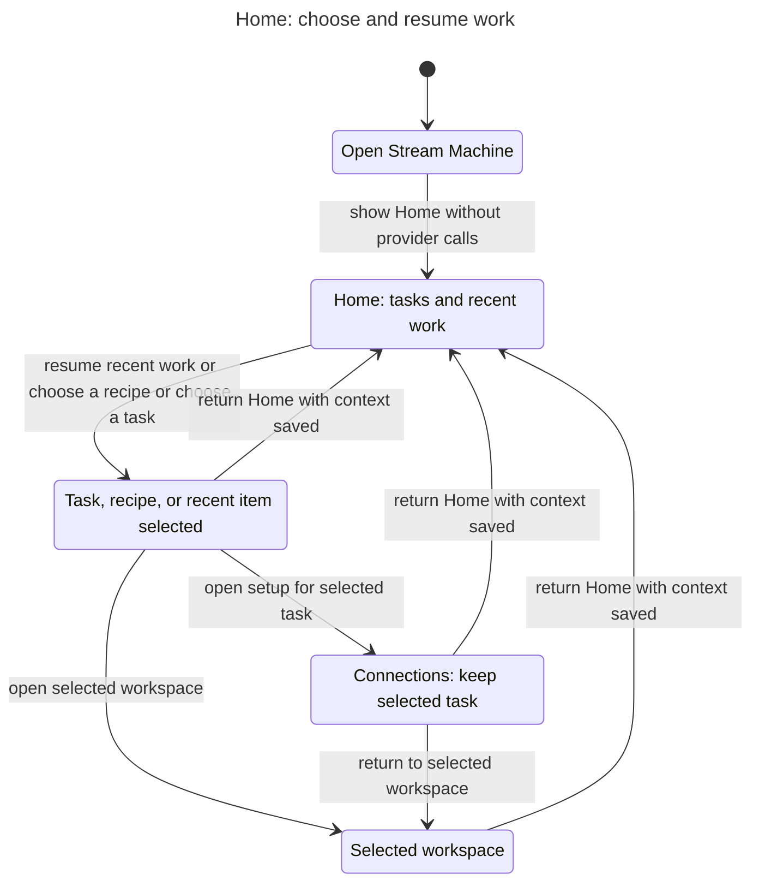
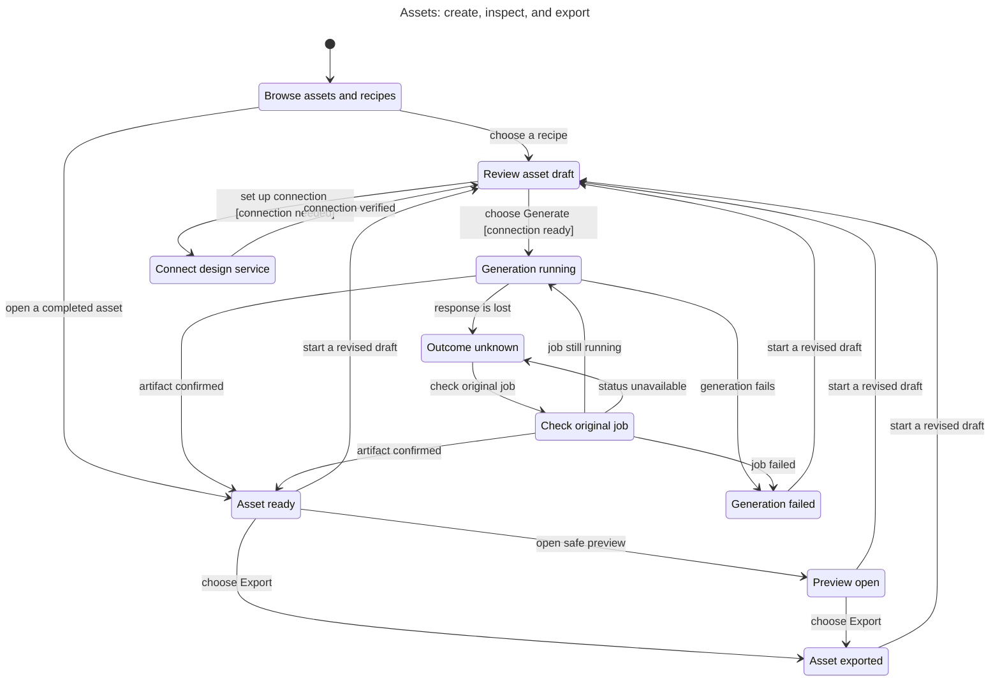
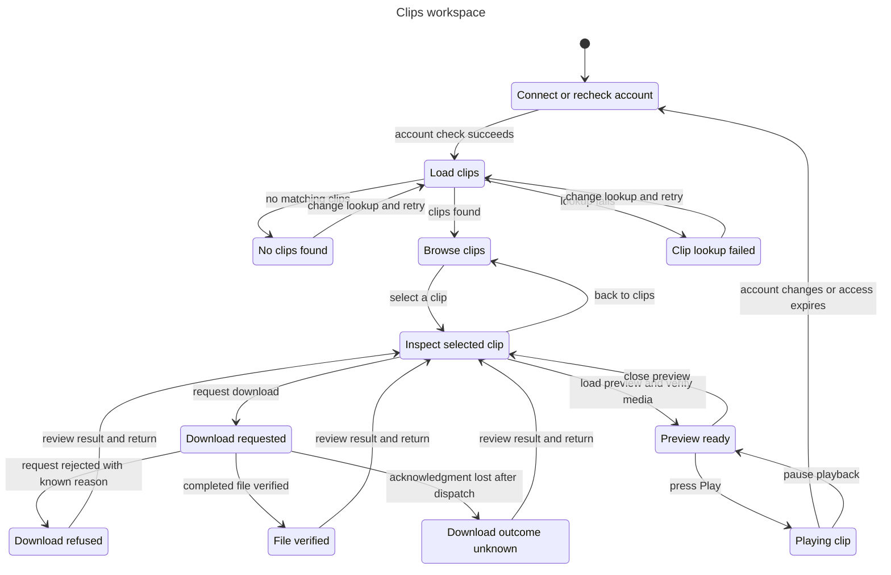
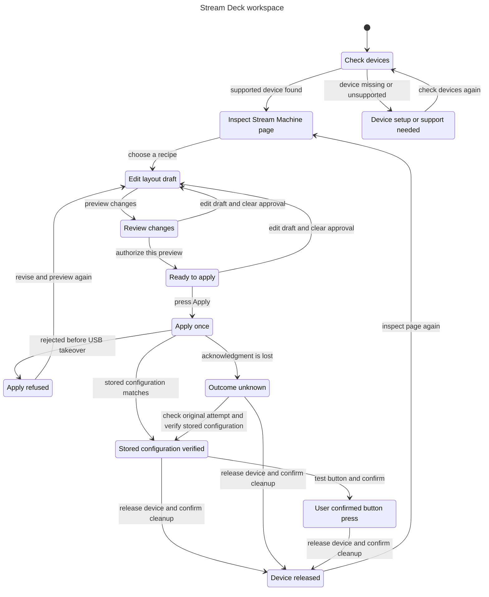
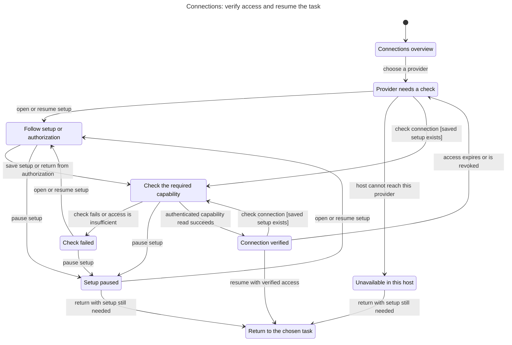

# Primary navigation statecharts

These five charts describe the proposed [Stream Machine UX](../../plans/plugin-ux-2026-11-01.md). Read each as a broad user journey, not an implementation diagram. Each section links to its checked TLA+ model, rules, limits, and reproduction command.

The models are independent. Their handoffs do not prove that the implementation connects the sections correctly. They check safety within the stated scope, not eventual completion, host compatibility, or live provider behavior. No broken rule was found, so there are no bug paths to replay.

## Check results

| Section | Model states | Steps | Chart arrows | Result |
| --- | --- | --- | --- | --- |
| [Home](home/README.md) | 47 | 272 | 8 | Five invariants and deadlock check pass |
| [Assets](assets/README.md) | 21 | 56 | 20 | Six invariants and deadlock check pass |
| [Clips](clips/README.md) | 12 | 41 | 20 | Seven invariants and deadlock check pass |
| [Stream Deck](streamdeck/README.md) | 28 | 96 | 19 | Nine invariants and deadlock check pass |
| [Connections](connections/README.md) | 64 | 112 | 17 | Six invariants and deadlock check pass |

All five checker commands exited 0. State counts include internal distinctions that the charts combine. Each model is below the skill's 500-state chart limit.

## Home

Choose a task, recipe, or recent item. Hand off its context without running a live action. [Model and limits](home/README.md).

## Assets

Review a draft, generate once, then inspect or export the completed asset. Recover an uncertain result through the original job. [Model and limits](assets/README.md).

## Clips

Check access, inspect a clip, then explicitly play or download it. Account changes clear private UI state. [Model and limits](clips/README.md).

## Stream Deck

Inspect a supported page, review and authorize a draft, then verify or release the device. Stored configuration and physical confirmation remain separate. [Model and limits](streamdeck/README.md).

## Connections

Set up the selected provider, verify its required capability, and return to the chosen task. Saved credentials alone do not prove access. [Model and limits](connections/README.md).

## What the overview leaves out

Home combines task, recipe, and recent-item choices that lead to the same destination. Assets assumes that Connections verified its dependency and that an existing asset's completed status is known. Clips abstracts media and file checks. Stream Deck treats successful cleanup as one step. Connections abstracts the selected provider and ends when the task takes control.

For readability, the charts omit waiting and other same-state transitions: 46 for Home, 19 for Assets, 11 for Clips, 54 for Stream Deck, and 12 for Connections. Clips also hides ten account-reset arrows while retaining the reset from Playing clip. Every account-reset action remains in its model and clears private UI state. No other inter-state arrows are hidden.

OAuth transport, secret storage, device timing, media codecs, persistence, cross-device access, and multi-instance races need separate implementation tests. The [detailed onboarding model](../plugin-onboarding/README.md) covers canceled checks and stale results. Current provider limits and future capabilities remain documented in the UX plan.

Use each section's reproduction command with a fresh output folder. The runner is an installed local skill, not a bundled runtime dependency.
