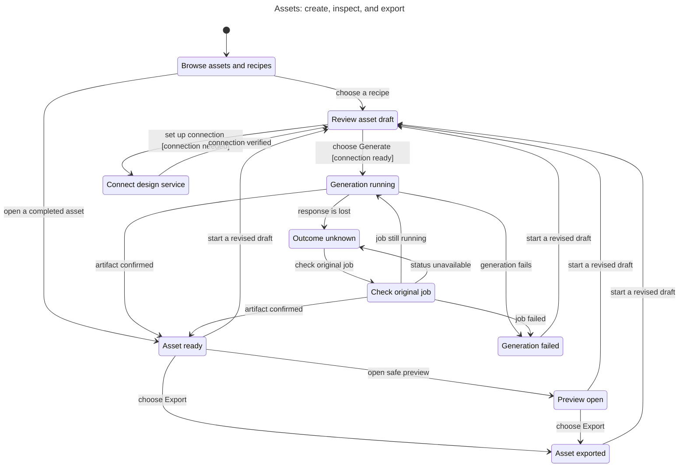

# Assets statechart

This chart explains the proposed Assets workspace in the [UX plan](../../../plans/plugin-ux-2026-11-01.md). It follows a recipe draft or an existing completed asset through generation, preview, and export. It does not verify the current plugin implementation.

A missing design connection returns to the same draft after verification. A lost response preserves the original job. Checking that job can recover its running, failed, or completed result without another generation request.

## Chart



## Checked rules

- ExplicitGeneration: an active or failed generation follows the user's Generate action.
- OneSubmissionPerDraft: one draft submits at most one generation request. A deliberate revised draft starts a new operation.
- CompleteBeforeUse: preview and export require a completed artifact. Opening an existing asset assumes that its completed status was verified.
- UnknownKeepsOriginal: an unknown outcome or status check retains the original request and cannot submit another generation.
- GenerationIsNotInstallation: generating or exporting an asset does not claim installation in OBS.
- TypeOK keeps the model within its declared states. NoDeadlock checks that every state can progress or wait for the user.

TLC checked 21 states and 56 steps. All six invariants and the deadlock check passed with exit 0. The chart draws 10 states and 20 arrows. It omits 19 same-state waiting steps; no inter-state transitions are hidden. No rule violations were found, so there are no bug paths to replay.

## Model limits

The model represents one selected draft or asset at a time. A revised draft starts a fresh operation after the previous result is known. It omits concurrent projects, account changes, job cancellation, navigation during generation, persistence, polling timers, setup failure details, and failed exports.

The model does not verify artifact isolation, format support, preview rendering, download delivery, or the internals of OpenDesign and HyperFrames. Preview is an explicit user action but its media controls are outside this chart. Setup verification is an assumed result from the Connections flow. No live provider, OBS, image-generation, or video-rendering capability is implied.

## Reproduce the check

Run from the task worktree with the locally installed statechart runner. The runner is outside the worktree; replace its absolute path on another machine. Use a fresh output directory for each run.

```sh
mise exec -- bun /Users/prime/Documents/ChatGPT/stream-machine-plugin/.agents/skills/statechart/scripts/statechart.ts docs/statechart/primary-navigation/assets/Assets.tla --config docs/statechart/primary-navigation/assets/Assets.cfg --view docs/statechart/primary-navigation/assets/view.mjs --out /tmp/stream-machine-assets-recheck
```

The original check ran the same files from `/tmp/stream-machine-assets-statechart/` and wrote `check-conditions/`. [The raw TLC output](tlc.txt) preserves that run, with trailing blank lines removed. [The generated report](report.md) summarizes the result. [The Mermaid source](chart.mmd) is the chart above.
