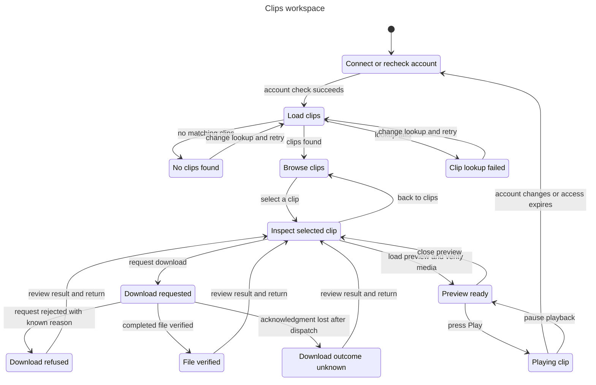

# Clips workspace

This chart describes the proposed Clips experience in the [UX plan](../../../plans/plugin-ux-2026-11-01.md#clips-experience). It covers account checks, clip lookup, selection, preview, playback, and download results.

Browse clips can contain one clip from the first release's ID lookup or a later gallery. The implemented gallery, filters, playback, and ZIP flow from issue #147 have their own checked model in [the clip library chart](library/README.md). This chart keeps the proposed single-clip download flow. Saved collections remain target capabilities, not claims about current code.

## User flow



Loading a preview verifies media before it becomes ready. It does not start playback. Play and Download are separate user actions.

A known refusal has a reason and recovery action. An unknown outcome means a download may have started, but its acknowledgment was lost. Returning to details does not retry it. The user must review that uncertainty before a new explicit download.

## Checked rules

TLC checked 12 states and 41 steps. Seven invariants and the deadlock check passed. The chart has 12 states and 20 arrows. The checker exited with code 0; no broken rule or bug path was found.

| Invariant | User-facing rule |
| --- | --- |
| `TypeOK` | Every state uses a recognized status and valid flags. |
| `PlaybackNeedsVerifiedMedia` | Playback needs the current account, a selected clip, verified media, and an explicit Play action. |
| `DownloadNeedsExplicitRequest` | A download or download result follows an explicit Download action. |
| `BrowseHasNoMediaEffects` | Account checks and clip lookup neither select a clip nor start playback or download. |
| `DisconnectedClearsPrivateState` | An account change or lost access clears the selected clip, media, playback intent, and displayed file result. |
| `SavedRequiresVerifiedFile` | A file is shown as verified only after a completed file check for the current selection. |
| `UncertainIsNotSuccess` | A refused or uncertain download never displays a verified file result. |

## Abstraction and limits

The diagram hides ten account-change arrows from states other than Playing clip to keep the flow readable. The model still checks those transitions. All account changes return to Connect or recheck account and clear private UI state. No state or distinct failure kind is merged.

The diagram also omits eleven same-state steps: waits for the user and a failed preview load that leaves the details visible with an unavailable message. The successful preview load is one atomic step representing an explicit request and successful media verification. Network loading, buffering, and detailed media errors are outside this broad model.

One account context and one selected clip keep the model small. Account invalidation resets the UI; it does not cancel a server download or delete a completed local file. Backend reconciliation, old callbacks, multiple accounts or app instances, OAuth redirects, scopes, ownership enforcement, and credential storage need separate models or runtime tests.

The model excludes pagination, filters, transcripts, codec support, media transport, file retention, and cross-device storage. It checks safety, not eventual completion. The authenticated account and media/file verification results are abstract inputs, not proof that any real provider or host performed those checks.

## Reproduce the check

From the task worktree, run the installed statechart skill against these source files. The runner is local tooling and is not bundled with a fresh worktree.

```sh
mise exec -- bun /Users/prime/Documents/ChatGPT/stream-machine-plugin/.agents/skills/statechart/scripts/statechart.ts \
	docs/statechart/primary-navigation/clips/Clips.tla \
	--config docs/statechart/primary-navigation/clips/Clips.cfg \
	--view docs/statechart/primary-navigation/clips/view.mjs \
	--out /tmp/stream-machine-clips-check-repeat
```

Use a new output directory for each check. The original run used scratch files under `/tmp/stream-machine-nav-clips/` and wrote `check/`. [The report](report.md), [TLC output](tlc.txt), and [standalone Mermaid source](chart.mmd) preserve that result. The log's trailing blank line was removed for repository whitespace checks.
