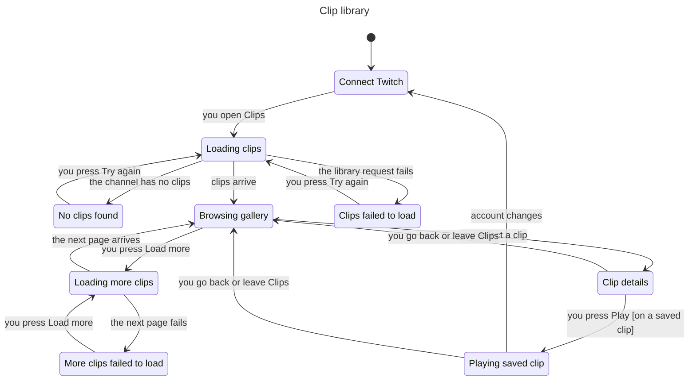

# Clip library

This chart describes the implemented Clips gallery from [issue #147](https://github.com/prime-optimal/stream-machine-plugin/issues/147) and the [clip library plan](../../../../plans/2026-11-01-clip-library.md#plugin-ui). It replaces the proposed lookup, preview, and download flow in the [Clips workspace chart](../README.md) for browsing and playback. That older chart still describes the single-clip download flow.

The UI source is `src/ui/clips.ts` (gallery), `src/ui/clips-detail.ts` (details), and `src/ui/clips-player.ts` (playback).

## User flow



Opening the Clips section loads the first page once. Search, category, and sort act on the clips already loaded, so they never call a tool. **Load more** follows the Helix cursor. A failed page keeps the loaded clips visible and offers a retry.

Selecting a clip shows its details and starts no media request. The `<video>` element exists only after you press **Play** on a clip with a saved copy. Going back or leaving Clips pauses the video, clears its source, and removes it.

The **Download ZIP** action runs beside these states. It needs a Site library, and the chart hides it. The model checks that it never runs against a local library.

## Checked rules

TLC checked 57 states and 248 steps. Seven invariants and the deadlock check passed. The checker exited with code 0.

| Invariant | User-facing rule |
| --- | --- |
| `TypeOK` | Every state uses a recognized status and valid flags. |
| `PlaybackNeedsSavedCopy` | Playback needs a selected clip with a saved copy and a loaded video source. |
| `VideoLoadsOnlyWhilePlaying` | A video source exists only while a clip plays. Leaving the clip clears it. |
| `BrowseHasNoMediaEffects` | Loading and browsing neither select a clip nor load media. |
| `ZipNeedsSiteLibrary` | A ZIP request or result exists only when the Site answered. |
| `LoadMoreNeedsNextPage` | **Load more** runs only when a cursor exists. |
| `DisconnectedClearsPrivateState` | An account change clears the selection, video source, ZIP result, and Site flag. |

## Abstraction and limits

The chart hides the ZIP steps, the wait steps, and seven account-change arrows from states other than Playing saved clip. The model still checks them.

The model has one selected clip and one account. It abstracts the cursor to a flag, the saved copy to a flag, and the Site answer to a flag. It does not model search, category, sort, thumbnails, media buffering, media errors, or Twitch and Site responses. The chart checks UI safety, not that any real host honored the Content Security Policy or played the video.

## Reproduce the check

From the task worktree, run the statechart skill with a new output directory:

```sh
mise exec -- bun .agents/skills/statechart/scripts/statechart.ts \
	docs/statechart/primary-navigation/clips/library/ClipLibrary.tla \
	--config docs/statechart/primary-navigation/clips/library/ClipLibrary.cfg \
	--view docs/statechart/primary-navigation/clips/library/view.mjs \
	--out /tmp/clip-library-check-repeat
```

[The report](report.md), [TLC output](tlc.txt), and [standalone Mermaid source](chart.mmd) preserve the original result.
