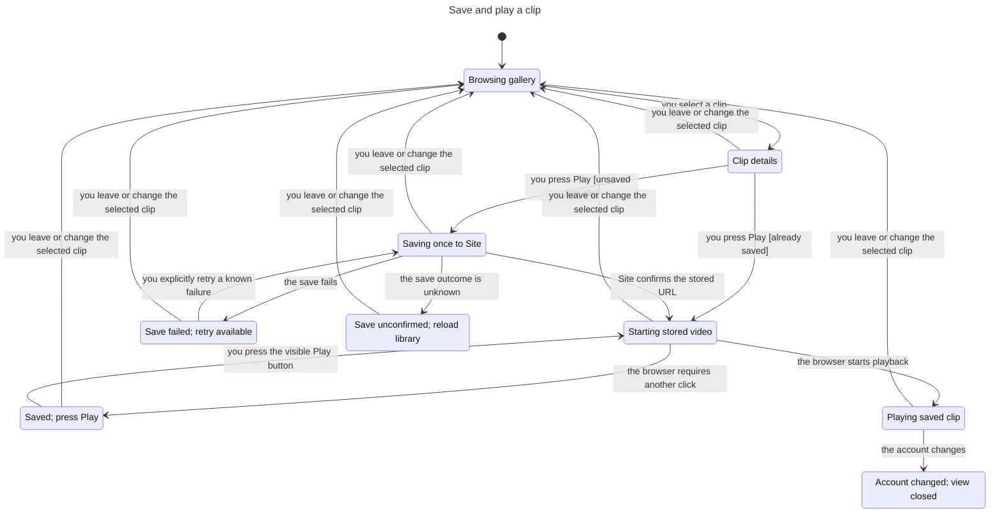
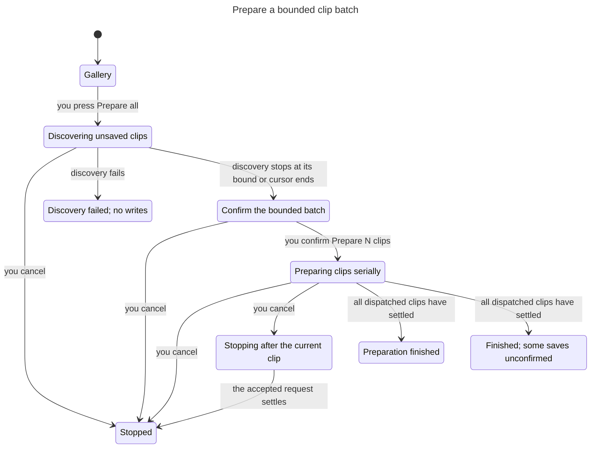

# Save, play, and prepare clips

These models describe the interaction contract for [issue #218](https://github.com/prime-optimal/stream-machine-plugin/issues/218). They replace this directory's earlier save-then-play chart. Model checks do not prove browser playback or server behavior. Runtime evidence belongs in the issue's verification report.

## Play one clip

Selecting a clip loads its details without starting video. **Play clip** reuses its saved Site copy. If the clip is unsaved, that action saves once, accepts the authoritative stored URL, and starts playback.

A save completion may update gallery data after selection changes. It cannot replace the current detail or start its video. If the browser rejects autoplay, the saved video and a visible **Play clip** action remain. Clicking that action does not archive again.

Known save failures offer an explicit retry. An unknown outcome or a response without authoritative stored metadata offers a library reload. The mounted preparation controller does not automatically retry that write.



## Prepare a bounded batch

**Prepare all** discovers at most 100 unsaved clips over ten library requests. Discovery performs no writes. The user confirms **Prepare N clips** before the serial queue starts. Gallery search and category filters do not restrict discovery.

Cancel stops future bulk dispatch. An accepted request may still settle and save its clip. The UI reports that pending result without claiming rollback. Bulk completion never starts playback. A selected Play request can retain interest in a shared job after bulk cancellation.



The bulk chart uses two clips and two pages to stay readable. The same model also passed with the production limits of 100 clips and ten pages.

## Source mapping

The mappings identify the inspected #218 implementation. They are not a proof that source and model are equivalent.

| Model action or guard | Source |
| --- | --- |
| Play unsaved, save result, and detail revision | [createDetail](../../../../../src/ui/clips-detail.ts#L50), especially the revision check before playback |
| Stored playback and visible fallback | [createPlayer.start](../../../../../src/ui/clips-player.ts#L35) and its guarded play promise |
| Shared preparation, cached outcomes, and serial dispatch | [createPreparation](../../../../../src/ui/clips-prepare.ts#L11) |
| Explicit retry only for known failure | [prepare](../../../../../src/ui/clips-prepare.ts#L42) |
| Maximum 100 clips and serial bulk loop | [startAll](../../../../../src/ui/clips-prepare.ts#L69) |
| Cancel queued bulk work, retain selected interest | [cancelAll](../../../../../src/ui/clips-prepare.ts#L91) |
| Ten discovery requests, account check, cursor stop, and 100 unsaved clips | [discoverPreparation](../../../../../src/ui/clips-prepare.ts#L111) |
| Discovery confirmation and progress | [createBulkPreparation](../../../../../src/ui/clips-bulk.ts#L15) |
| Account replacement and disposal | [setAccount](../../../../../src/ui/clips.ts#L154) and [dispose](../../../../../src/ui/clips.ts#L186) |

## Check results

All runs used Bun 1.4.4 and TLC 2.19. Each command exited 0. No counterexample was found.

| Model configuration | Distinct states | Evidence |
| --- | --- | --- |
| Selected playback | 47 | [Report](report.md), [TLC output](tlc.txt), [chart](chart.mmd) |
| Bulk preparation, 100 clips and ten pages | 10,194 | [Report](prepare-report.md), [TLC output](prepare-tlc.txt) |
| Bulk preparation chart, two clips and two pages | 84 | [Report](prepare-chart-report.md), [TLC output](prepare-chart-tlc.txt), [chart](prepare-chart.mmd) |

The playback run explored 184 transitions and checked eight invariants, the stale-completion action property, and deadlock freedom. Its chart draws nine states and 18 arrows. It omits 21 transitions within one chart label and hides 76 transitions for waits, duplicate clicks, and account changes outside playback.

Each bulk run checked eight invariants, the cancellation action property, and deadlock freedom. The smaller run explored 172 transitions. Its chart draws nine states and 11 arrows, omitting 95 transitions within one label. The full run exceeds the renderer's 500-state chart budget, so its result has no chart.

## Checked rules

| Playback rule | Meaning |
| --- | --- |
| TypeOK | States and flags use their declared values. |
| PlaybackNeedsSavedCopy | A video source requires a selected saved clip in a playback state. |
| BrowseHasNoMediaEffects | Gallery and closed views have no selection or loaded video. |
| UnknownNotRetried | An unknown save does not become a saving state. |
| SaveRequiresSite | An active selected save requires Site storage. |
| SelectionGuard | A valid save interest belongs to the open selected detail. |
| ManualPlayVisible | The autoplay fallback retains a saved video source. |
| DisconnectedClearsPrivateState | Closing for account change clears the selected clip and loaded source. |
| StaleSavePreservesView | Confirming an old save cannot change the current detail, selected storage, or video source. |

| Bulk rule | Meaning |
| --- | --- |
| TypeOK | Counts and states use their declared domains. |
| DiscoveryBound | Discovery uses at most the configured number of requests. |
| QueueBound | The queue respects its configured cap and cannot dispatch more jobs than discovered. |
| ConsentBeforeWrites | No write dispatch precedes confirmation. |
| SerialWrites | At most one write is accepted and not yet settled. |
| CancelDropsQueue | Cancellation removes undispatched bulk work. |
| UnknownRequiresSettledRequest | An unknown outcome follows a settled request. |
| NoWritesDuringDiscovery | Discovery, its error state, and confirmation perform no writes. |
| CancelStopsFutureDispatch | Once canceled, the bulk dispatch count cannot increase. |

## Abstraction and limits

The playback model represents one tracked save and an arbitrary replacement selection. Its current-interest flag represents the detail revision, including leaving and returning to the same clip. It does not enumerate clip IDs, several simultaneous selected interests, the JavaScript event queue, or DOM teardown timing. A confirmed save means the response contains validated metadata for the requested clip and the allowed Site media origin. Parser and URL validation need runtime tests.

The bulk model represents one confirmed run with unique queued items and one in-flight request. A discovery page adds zero items, one item, or fills the remaining capacity. That abstraction exercises the bounds without enumerating every possible page composition. Cursor exhaustion, repeated cursors, and an early user stop collapse into discovery completion. Discovery cancellation treats an outstanding read as ignored rather than modeling its response body.

Unknown outcomes remain recorded, and the model's explicit unknown-retry action makes no change. Repeated batches, per-ID deduplication, the lifetime of the unknown ledger, already-saved short circuits, and selected-job priority need controller tests. The cancellation property counts bulk writes only. A separately requested selected Play may continue after bulk cancellation.

These models do not prove distributed exactly-once storage, rollback of accepted writes, owner authentication, storage durability, or eventual network completion. Account replacement closes the playback model; the next account starts a separate instance. The bulk model assumes its account binding has already been verified.

Existing browsing, pagination, search, sorting, ZIP behavior, codecs, HTTP range responses, CSP enforcement, and actual host playback are outside these checks. The old 57-state result is superseded and is not evidence for #218. No transport or codec defect is inferred from this model.

## Reproduce

Run each command from the task worktree. Use new output directories.

```sh
mise exec -- bun .agents/skills/statechart/scripts/statechart.ts \
	docs/statechart/primary-navigation/clips/library/ClipLibrary.tla \
	--view docs/statechart/primary-navigation/clips/library/view.mjs \
	--out /tmp/clip-playback-218-recheck

mise exec -- bun .agents/skills/statechart/scripts/statechart.ts \
	docs/statechart/primary-navigation/clips/library/PrepareAll.tla \
	--config docs/statechart/primary-navigation/clips/library/PrepareAll.cfg \
	--view docs/statechart/primary-navigation/clips/library/prepare-view.mjs \
	--out /tmp/clip-prepare-218-recheck

mise exec -- bun .agents/skills/statechart/scripts/statechart.ts \
	docs/statechart/primary-navigation/clips/library/PrepareAll.tla \
	--config docs/statechart/primary-navigation/clips/library/PrepareAll-chart.cfg \
	--view docs/statechart/primary-navigation/clips/library/prepare-view.mjs \
	--out /tmp/clip-prepare-chart-218-recheck
```

The checker writes raw logs as `tlc.out`. This directory stores those logs as `.txt` so Git includes them.
