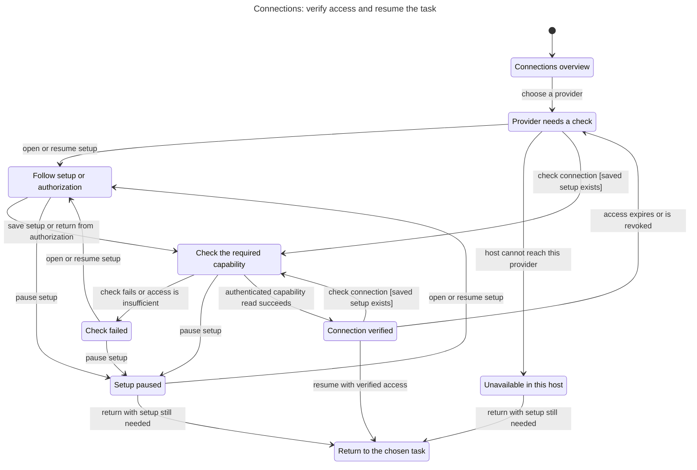

# Connections statechart

This chart describes the proposed Connections workspace in the [UX plan](../../../plans/plugin-ux-2026-11-01.md#contextual-onboarding). It covers one selected provider and the return to the task that requested access.

Saved credentials and a completed authorization redirect do not establish readiness. The plugin must read the required capability successfully before it shows Connection verified. A paused or unsupported setup can return to the same task with setup still needed.

## Flow



[Mermaid source](chart.mmd) and [checker report](report.md) accompany the model. The two check-connection arrows require saved setup. A provider-specific check determines whether that setup is valid.

## Checked rules

| Rule | Meaning |
| --- | --- |
| `ReadyRequiresVerifiedCapability` | Connection verified requires an authenticated read of the required capability. |
| `SetupDoesNotProveAccess` | Provider selection, setup, checking, failure, pause, and host limitations cannot claim verified access. |
| `ReturnKeepsTask` | Returning preserves the task that requested the connection. |
| `ReturnedStatusIsHonest` | A return marked ready carries verified access. A paused or unsupported return does not. |
| `ChecksPreserveLiveOutput` | Connection setup and checks leave the starting live-output state unchanged. |
| `TypeOK` | Model values stay within the declared states and value sets. |

TLC checked 64 states and 112 steps. All six invariants and the deadlock check passed with exit code 0. No rule-breaking path was found. The chart draws nine states and 17 arrows. It omits 12 terminal self-loops after the task takes control; no transition between different displayed states is hidden.

## Scope and limits

This is a proposal check, not verification of the current plugin or a provider. The model uses two task names and two initial output states to check task preservation and output safety. It does not model task execution after the return.

The selected provider is abstract. The model does not distinguish Twitch scopes, OBS versions, individual devices, or account identities. It leaves credential storage, OAuth transport, permission details, stale asynchronous responses, account switching, multiple providers, persistence, time-based expiry, and eventual completion to implementation checks.

The [detailed onboarding model](../../plugin-onboarding/README.md) covers canceled attempts and stale responses. Provider-specific UI must also distinguish refusal, unreachable service, and unsupported protocol within Check failed. No live connection, broadcast control, scene change, or USB operation ran during this check.

## Reproduction

The checked sources are [Connections.tla](Connections.tla), [Connections.cfg](Connections.cfg), and [view.mjs](view.mjs). [TLC output](tlc.txt) retains the check output with trailing blank lines removed.

The runner is a locally installed skill, not a bundled dependency of this worktree. From the repository root, the verified local command is:

```sh
mise exec -- bun /Users/prime/Documents/ChatGPT/stream-machine-plugin/.agents/skills/statechart/scripts/statechart.ts docs/statechart/primary-navigation/connections/Connections.tla --config docs/statechart/primary-navigation/connections/Connections.cfg --view docs/statechart/primary-navigation/connections/view.mjs --out /tmp/stream-machine-connections-check-repeat
```

Use a new output directory for another run. On another machine, replace the runner path with the installed statechart skill's script. The original checked run used the same sources in `/tmp/stream-machine-connections-statechart/` and wrote `final/`.
