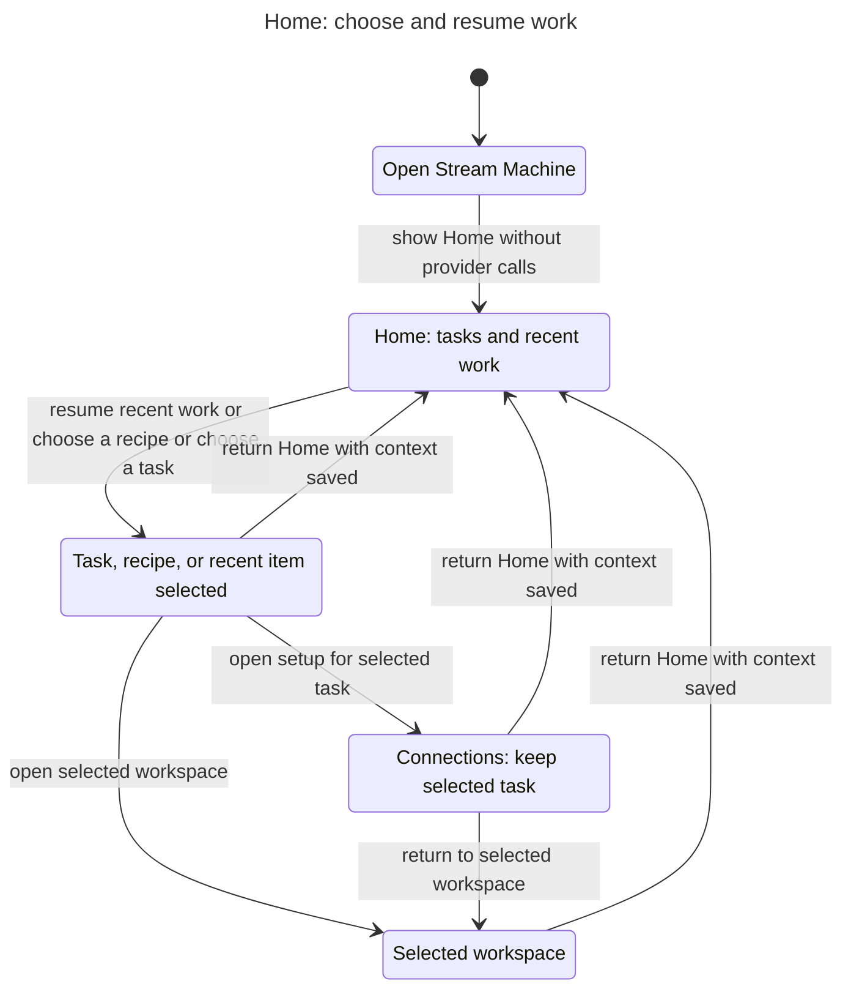

# Home statechart

Home lets you choose a task, start from a recipe, or resume recent items. The selected context follows you into a workspace or Connections. Returning Home keeps that context.

This chart describes the proposed [plugin UX](../../../plans/plugin-ux-2026-11-01.md), not the current implementation. It covers the Home layout and navigation rules in the plan's Product direction, Routed shell, and Home sections.

## Chart



The chart combines Assets, Clips, and Stream Deck destinations into Selected workspace. Task cards, recipes, and recent items keep their distinct context in the model. Connections is a navigation handoff, not evidence that setup succeeded.

## Checked rules

| Invariant | Reader's rule |
| --- | --- |
| `TypeOK` | Every state, destination, and selection source is valid. |
| `ExplicitSelection` | A task destination requires a deliberate task, recipe, or recent-item choice. |
| `HandoffPreservesTask` | The workspace or setup handoff uses the selected task. |
| `NavigationDoesNotAct` | Opening Home and navigating do not execute a live action. |
| `NavigationDoesNotClaimCompletion` | Reaching a workspace does not claim its task completed. |

TLC checked 47 states and 272 steps. All five invariants and the deadlock check passed. The command exited 0. No rule-breaking path was found.

The chart has five visible states and eight arrows. It omits 46 waiting transitions that remain within the same visible state. No transition between distinct visible states is hidden.

## Model limits

The model covers global Home entry and a selected task handoff. It does not check deep links, loading failures, rendering, host support, recent-item freshness, persistence, account switching, or provider execution. Connections owns verification and recovery; the Home model permits a return to the workspace without claiming readiness.

Task drafts and job IDs are represented by a selected destination and source, not full records. The model does not prove that implementation retains those records. It checks safety, not eventual progress.

## Reproduce

Run from the repository worktree. The runner below is a locally installed skill, not a bundled dependency. Replace its absolute path when using another checkout or machine. Use a new output folder for each check.

```sh
mise exec -- bun /Users/prime/Documents/ChatGPT/stream-machine-plugin/.agents/skills/statechart/scripts/statechart.ts docs/statechart/primary-navigation/home/Home.tla --config docs/statechart/primary-navigation/home/Home.cfg --view docs/statechart/primary-navigation/home/view.mjs --out /tmp/stream-machine-home-statechart-repeat
```

The original check used the same model, config, and view from `/tmp/stream-machine-home-statechart/`, with output in `check/`. [TLC output](tlc.txt) preserves that run with trailing blank lines removed. [Generated report](report.md) and [Mermaid source](chart.mmd) record the result.
