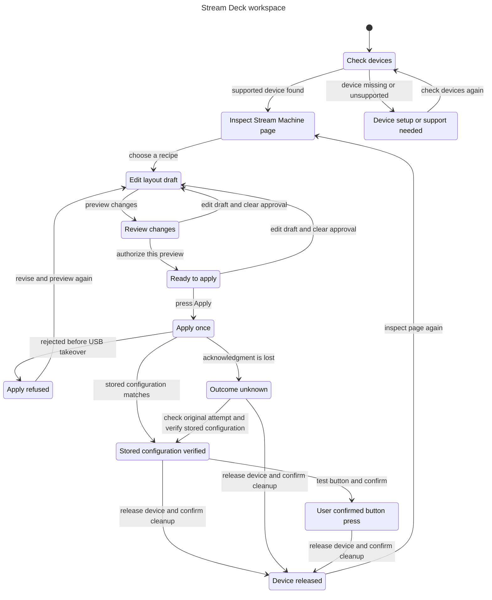

# Stream Deck workspace

This chart describes the proposed Stream Deck experience in the [UX plan](../../../plans/plugin-ux-2026-11-01.md). It models one supported device and one layout attempt. It does not prove that the current plugin implements these screens or recovery actions.

The first slice uses a separate Stream Machine USB page on an Original 3×5 device. The chart does not claim access to native Elgato profiles.

## User flow

Choose a supported device, inspect its source-labeled page, and create a draft from a recipe. Review the changes before authorizing and applying them. A known refusal permits a revised draft. An uncertain result requires inspection of the original attempt or confirmed release before further work.

Stored configuration verification and a user-confirmed button press are separate states. Release requires an explicit action and confirmed cleanup. Leaving the workspace preserves device ownership and the current attempt.



## Checked rules

| Invariant | User-facing rule |
| --- | --- |
| `OwnershipRequiresConsent` | USB ownership, including possible ownership after a lost response, requires explicit consent. |
| `BrowsingDoesNotOwnDevice` | Inventory, inspection, drafts, and previews do not take USB ownership. |
| `EditsNeedFreshApproval` | Editing a draft clears its preview and authorization. |
| `ApprovalRequiresPreview` | Authorization applies only to the current reviewed preview. |
| `StoredIsNotPhysicalProof` | A matching stored configuration does not confirm a physical button press. |
| `PhysicalNeedsStoredProof` | The user confirms a physical press only after the stored configuration is verified. |
| `UnknownCannotApplyAgain` | An uncertain attempt has no reusable preview or authorization. |
| `NoNativeProfileClaim` | The inspected source is unknown or a Stream Machine page, never a native Elgato profile. |
| `TypeOK` | Every model value stays within its declared finite set. |

Navigation is an explicit model action. It changes only whether the user is away, leaving ownership, consent, and the attempt unchanged.

## Check result

The statechart command exited 0. TLC reached 28 states and 96 steps. All nine invariants and the deadlock check passed. No bug paths were found.

The chart has 12 states and 19 arrows. It hides 54 transitions that stay in the same displayed state: navigation, waiting, and edits while already in the draft. No transitions between distinct displayed states are hidden.

The source model, configuration, view module, generated [chart](chart.mmd), and [report](report.md) are included. [TLC output](tlc.txt) preserves the successful run, with its trailing blank line removed.

## Limits

This is a safety model of the proposed UX. It abstracts device discovery and read-back into outcomes, and treats successful release as one action. It does not model USB timing, failed release, preview expiry, stale responses, process crashes, device unplugging, multiple app instances, or competing device owners. Those require implementation tests.

The current plan's blank-device restriction, closed Elgato application, and keeper process are preconditions to authorization. This chart does not establish those facts from hardware. A known refusal means rejection before takeover. If takeover may have occurred, the model uses Outcome unknown.

The model allows a matching original attempt to resolve uncertainty. It does not resubmit that attempt. Navigation and waiting remain possible, so passing the deadlock check does not prove that a device operation eventually completes.

## Reproduce

Run from the task worktree. The runner is an installed local skill; replace its absolute path on another machine. Use a fresh output directory for another run.

```sh
mise exec -- bun /Users/prime/Documents/ChatGPT/stream-machine-plugin/.agents/skills/statechart/scripts/statechart.ts docs/statechart/primary-navigation/streamdeck/StreamDeck.tla --config docs/statechart/primary-navigation/streamdeck/StreamDeck.cfg --view docs/statechart/primary-navigation/streamdeck/view.mjs --out /tmp/stream-machine-deck-statechart-repeat
```

The recorded run used scratch sources under `/tmp/stream-machine-deck-statechart-81/` and output directory `/tmp/stream-machine-deck-statechart-81/check`. No live provider action occurred.
