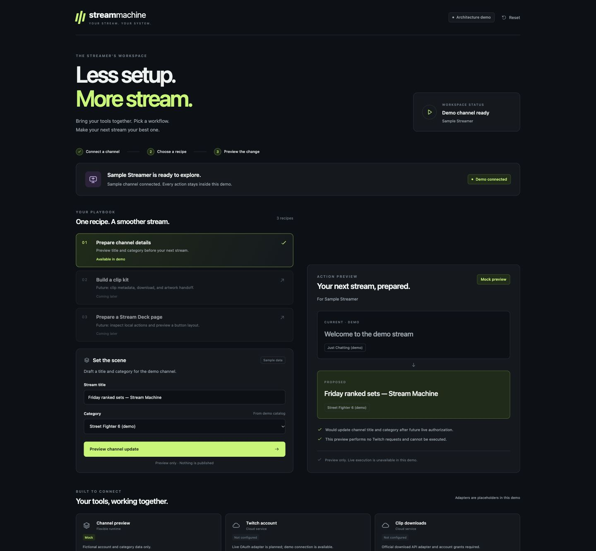

# Stream Machine scaffold verification

Date: 2026-11-01 (America/Los_Angeles).

Repository: https://github.com/prime-optimal/stream-machine-plugin

Project: Stream Machine #18, owner prime-optimal.

Issue: #1. Branch: `codex/1-plugin-architecture`.

## Implemented

- Portable plugin manifest and stdio MCP configuration.
- Onboarding and recipe-preview skills.
- Six typed tools, global/thread entrypoint metadata, bundled MCP App resource.
- Process-local demo account, explicit capability availability, one working preview recipe.
- Two future recipe placeholders, disabled until providers exist.
- Separate loopback browser preview; no live network/provider actions.

## Checks

| Check | Result |
|---|---|
| TypeScript `mise run check` | Pass |
| Domain tests `mise run test` | 5 pass, 15 assertions |
| Bundled stdio `mise run smoke` | Six tools discovered; disconnected rejection, demo connection, preview, UI resource, reset pass |
| Archive validation | Manifest JSON and skill YAML parsed; archive entries inspected; no dependency directory/secrets/config cache packaged |
| Extracted archive runtime | MCP smoke passes from temporary directory outside checkout, with no node_modules |
| Browser flow | Connect fictional Sample Streamer → title/category input → exact before/after preview → reset disables form |
| Browser console | No warning/error entries during exercised flow |
| Responsive DOM checks | No horizontal overflow at measured CSS viewports 375×811, 767×1024, 1440×900 |
| Source review | Separate read-only review of domain, MCP registration, preview server, build and packaging: no actionable findings |
| File size convention | Every source file under 500 lines |

Browser viewport controls were adjusted for current host zoom; table records measured CSS dimensions rather than requested control dimensions. Screenshot capture used explicit clip to avoid host full-page capture cropping.

## Delivery

- [Architecture](architecture.md)
- [Integration inventory](integrations.md)
- [Accepted and deferred decisions](decisions.md)
- [Run/package instructions](setup.md)
- Local archive: `docs/packages/stream-machine-0.1.0.tar.gz` (generated, ignored by Git).

No package uploaded or installed into a host. Native view metadata and resource verified through protocol; native rendering not yet verified. Browser preview is not native-host proof. No hosted endpoint, multi-user authentication, durable run history, real Twitch authorization, EventSub subscription, download, OBS operation, or Stream Deck mutation implemented or exercised.

Existing plugins remain separate connections. No candidate MCP repository vendored or automatically started. Existing Stream Makeover deployment and public stream-machine repository unchanged.
