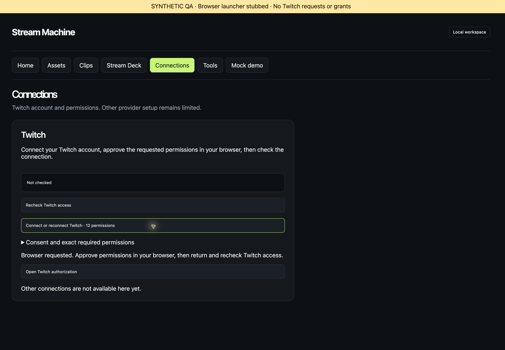
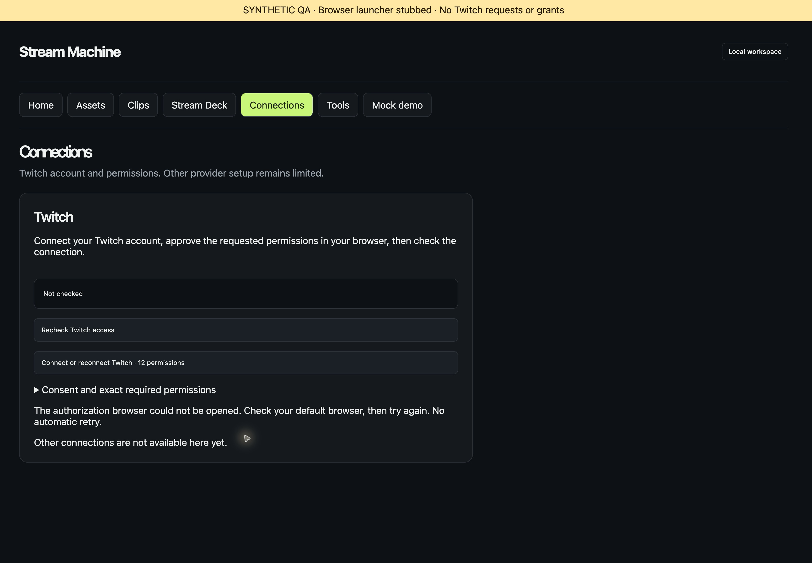
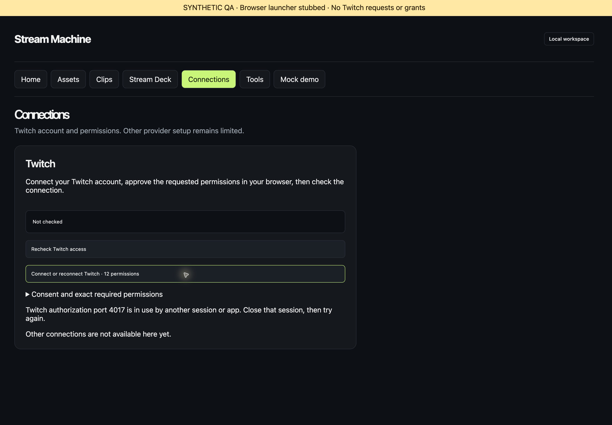
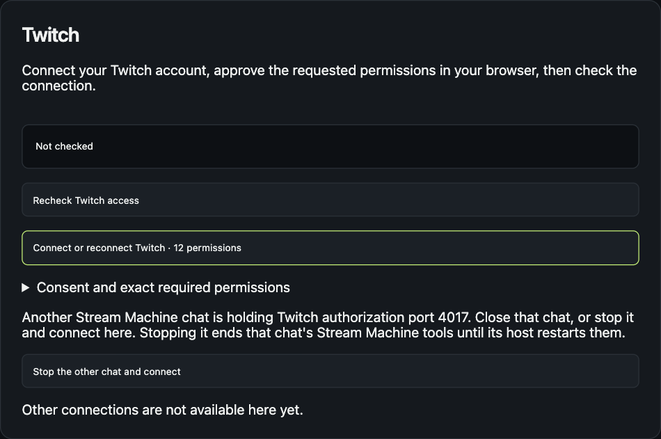
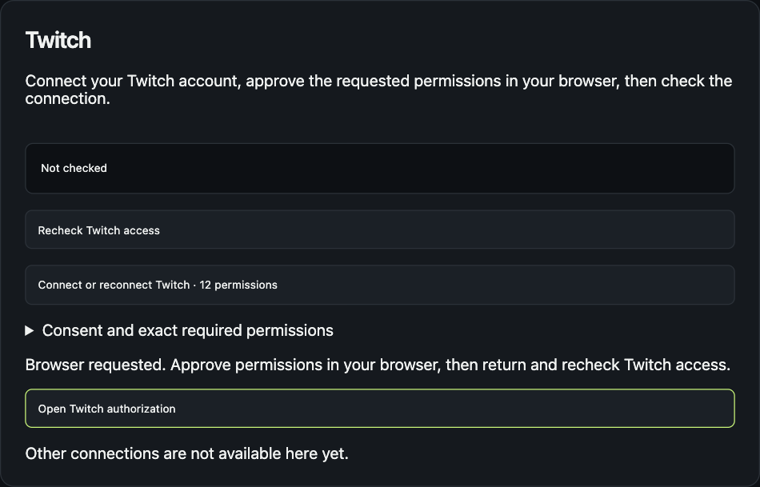

# Verify Twitch onboarding controls

This is synthetic browser evidence for issue #110. It does not prove desktop ChatGPT integration or a real browser launch.

## Run the fixture

From the issue worktree, run:

```sh
mise run build
mise exec -- bun docs/verification/110-twitch-onboarding/serve.ts
```

Open `http://127.0.0.1:4390/?preview=1` in a browser. Choose Connections, then **Connect with Twitch**. Expect the browser-requested message and an unverified account.

The fixture forwards calls through real `registerTwitchTools` and in-memory MCP. Its runtime uses an isolated callback port, synthetic credentials, and an in-memory store. It replaces only the advertised callback and connection addresses with the production contract before registration wraps the result. The browser launcher is a stub. Provider requests throw. No real authorization URL is visited.

Select error scenarios through the fixture API:

```sh
curl --fail --silent 'http://127.0.0.1:4390/scenario?value=browser_failed'
curl --fail --silent 'http://127.0.0.1:4390/scenario?value=busy'
curl --fail --silent 'http://127.0.0.1:4390/scenario?value=plugin'
```

Each selection affects the next explicit button click. The `plugin` scenario reports `TWITCH_LOCAL_PORT_PLUGIN` until Connect receives `replacePluginListener: true`. The fixture does not stop any process. Inspect `http://127.0.0.1:4390/observations` for call order and counters. Stop the fixture with Ctrl+C.

## Observed results

Native computer-use controls exercised Brave 156.1.98.63 on macOS at 125% zoom. Screenshots were cropped to remove unrelated browser tabs.

| Action | Result |
| --- | --- |
| Open Connections | Account remained Not checked; no provider or browser call |
| Click Connect | Preflight, then Connect with `openBrowser: true`; one stub launch; account remained Not checked |
| Click Open Twitch authorization | Same two-call sequence; one additional stub launch |
| Simulate launch failure, click authorization | One additional stub attempt; actionable browser error; no retry |
| Simulate occupied port, click Connect | Preflight only; actionable port error; no Connect or additional launch |
| Read final observations | Three stub browser requests, zero provider requests |

[Final observations](observations.json) contain the exact call sequence. The fixture and its isolated callback listener stopped. The QA browser tab closed.

## Screenshots







## Observed replacement results

A headless Chromium tab drove the `plugin` scenario against a fresh `mise run build`.

| Action | Result |
| --- | --- |
| Click Connect | Preflight only. The panel showed the other-chat message and **Stop the other chat and connect**. No browser request. |
| Click **Stop the other chat and connect** | One Connect call with `openBrowser: true` and `replacePluginListener: true`, no second preflight, and one stub launch. Zero provider requests. |





## Remaining verification

Install the updated package in desktop ChatGPT, refresh the plugin panel, and click Connect. Confirm that the desktop browser opens Twitch authorization without copying a URL. Approval remains a separate user action. Return and recheck access after consent.

The callback stays on port 4017 because Twitch requires a registered redirect URI. Preflight is a point-in-time check. Connect still checks the actual bind and reports a race as `TWITCH_LOCAL_PORT_BUSY` or `TWITCH_LOCAL_PORT_PLUGIN`. The fixture does not exercise the real `SIGTERM`. `tests/twitch-callback-owner.test.ts` covers that path with real child processes.
