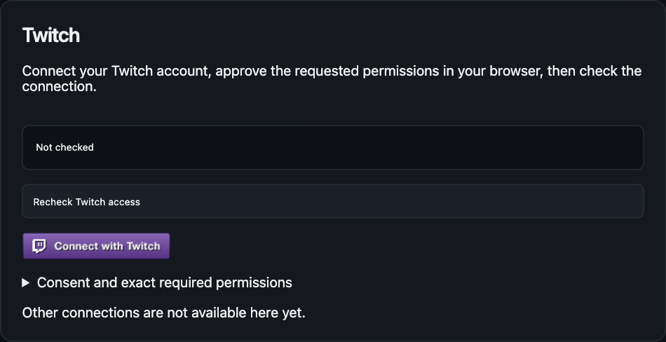
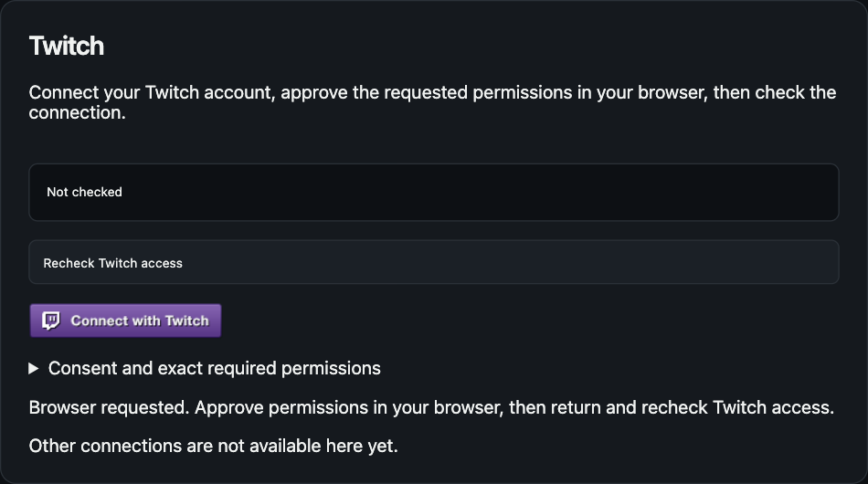
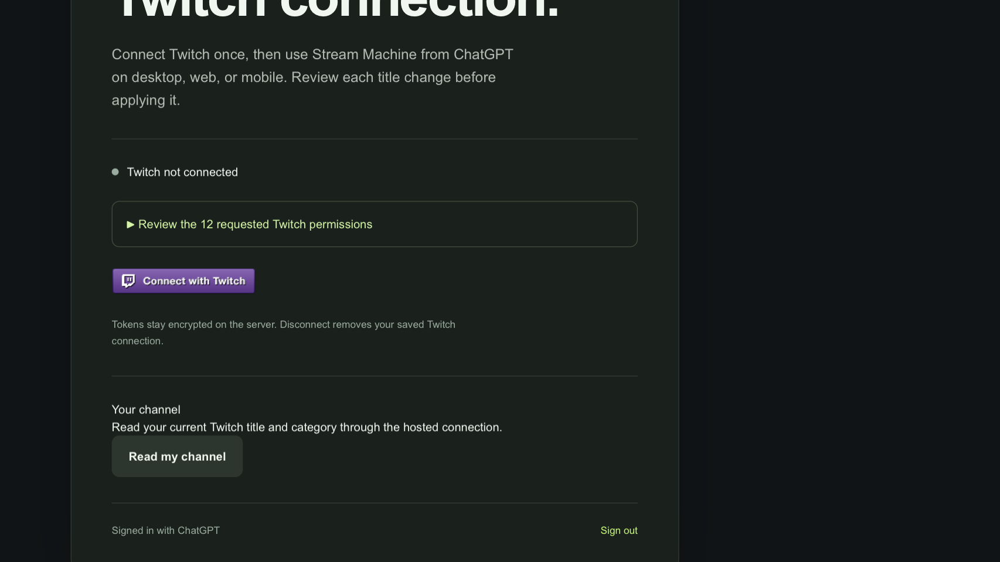

# Connect with Twitch button verification

Issue #152 replaces the generic Twitch connect buttons with the official 170×32 **Connect with Twitch** image (`src/ui/twitch_login.png`). This file records the browser checks for the plugin UI and the hosted Site page.

## Plugin UI

The build inlines the PNG as a data URI through the `inline-png` plugin in `scripts/build.ts`, so `dist/app.html` stays a single file. The duplicate **Open Twitch authorization** button was removed. The image button starts the same preflight-then-Connect path.

Reproduce with the #110 fixture:

```sh
mise run build
mise exec -- bun docs/verification/110-twitch-onboarding/serve.ts
```

Open `http://127.0.0.1:4390/?preview=1`, choose **Connections**, then select **Connect with Twitch**. Expected result: the browser-requested message, an unverified account, and focus back on the button.

Observed in a headless Chromium tab: the button measured 170×32, one click produced the browser-requested message, and the page logged no errors. The fixture's browser launcher is a stub, so no real Twitch authorization page opened.





## Hosted Site

The Site change is in commit `f989448` on the Site branch `feat/152-twitch-button`, which is based on `7bd13f6`. `components/connection.tsx` renders the image inside the existing `POST /api/twitch/connect` form, and `public/twitch_login.png` serves the file. The commit also syncs `lib/stream-machine/ui-html.ts` from this branch's `dist/app.html`.

Observed with `bun run dev` and the local test sign-in: the image loaded at 170×32, and the form posts to `/api/twitch/connect` with `target="_top"`. The local server has no Twitch app credentials, so the page reports setup pending. For the screenshot, an in-page `fetch` wrapper returned `{"ready":true,"connected":false}` for `/api/twitch/status` only. The button was not clicked, and no real authorization ran.



Site gates: `bun run check` and `bun run build` passed. `bun test tests` passed 125 of 125 tests after a temporary `node_modules/miniflare` symlink was added. The test files import `miniflare`, but this aube install keeps it only under `node_modules/.aube`; without the link, the 4 worker test files fail to load at the base commit `7bd13f6` too. Lint reports the same 4 errors as the base commit. This change adds one lint warning, `@next/next/no-img-element`, for the fixed-size image.

## Not verified

The deployed Site and the desktop ChatGPT plugin panel were not checked with a real Twitch consent flow.
