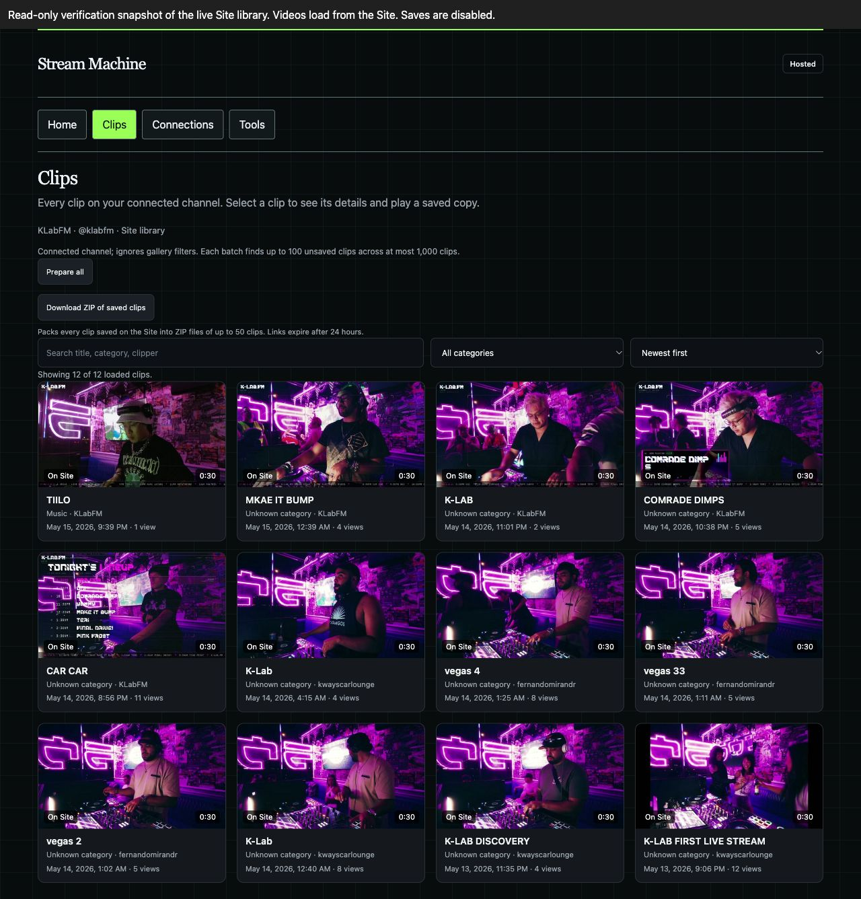
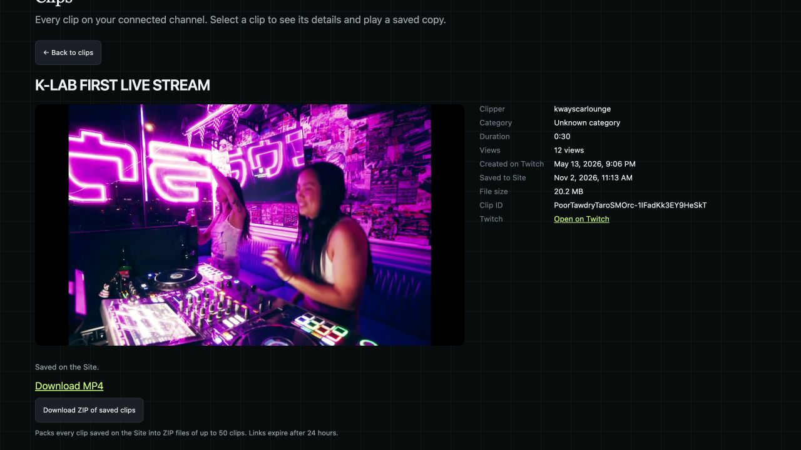

# Live clip gallery verification

Verified 2026-11-02 for [issue #218](https://github.com/prime-optimal/stream-machine-plugin/issues/218) and [PR #222](https://github.com/prime-optimal/stream-machine-plugin/pull/222).

## Deployed result

[Open the clip gallery](https://stream-machine-oauth-test.tinycocoa22.chatgpt.site/clips).
Sites sign-in is required. The Site's audience remains public; the new account API requires a trusted Sites principal.

- Site version: 20.
- Site source: `0795a194f3dde7c7aae96bca007d90f5b7f26227`.
- Deployment: `appgdep_6ae8ef538b8081918f0006337d95d45e`, succeeded.
- Plugin implementation: `42575ecc5ef60c3952b090e0f3b77980e61180b0`.
- Shared HTML SHA-256: `ceb29c3ef07578151c3f05615fd91d87cc593fc65879a01146c4c2d7151f02a3`.
- New resource: `ui://stream-machine/workspace-v5.html`.
- [Hosted source patch](hosted-source.patch) excludes the generated HTML; the hash above proves its match to the plugin build.

## Real provider path

The connected hosted account was KLabFM, with the existing clip scope.
One clip was already stored before this task.
A single new archive saved CAR CAR first, returned complete stored metadata, and played from its new Site URL at 11.67 seconds of 30.02 seconds.

Only after that check, two bounded batches saved five clips each.
Both batches returned zero failures and zero unknown outcomes.
A fresh library read returned all 12 clips with stored metadata and no pagination cursor.
Total stored bytes: 273,445,532. Eleven clips were newly archived; the existing copy was reused.

The requests used the hosted Stream Machine connection. No Twitch token or download URL was copied into browser code.
No broadcasts, OBS settings, Stream Deck state, or Site access settings changed.

## Media and gallery evidence

Every returned Site URL responded to Range GET with HTTP 206, video/mp4, the expected content range, and an MP4 ftyp header.
[HTTP results](media-http.json) preserve each check.

The shared gallery bundle displayed a read-only snapshot of the fresh live library on loopback.
This was real channel metadata and real Site-hosted media, not synthetic clip results.
The preview blocked all write tools and visibly labeled its snapshot status.
It does not prove the authenticated production page or MCP bridge.

Each of the 12 gallery videos loaded and advanced beyond zero with readyState 4.
All durations were approximately 30 seconds.
[Playback results](playback.json) record the title, Site URL, duration, and observed playback time.
The gallery console reported no errors.

The earlier synthetic fixture separately checked one-click save-to-play behavior, native seeking to 14.99 seconds, teardown on Back, and per-item bulk errors.
Those saves did not alter live storage.
Responsive checks at 375, 768, and 1440 pixels had no horizontal overflow.
Screenshots: [375](gallery-375.jpg), [768](gallery-768.jpg), [1440](gallery-1440.jpg).

## Automated checks

| Check | Result |
| --- | --- |
| Plugin check, build, and stdio smoke | Passed |
| Plugin tests after rebase | 303 passed, 2 skipped, 0 failed |
| Site tests | 147 passed, 0 failed |
| Site typecheck and production build | Passed |
| Playback state model | 47 states, configured checks passed |
| Preparation model at 100 clips and 10 pages | 10,194 states, configured checks passed |
| Hooks, whitespace, staged secret checks | Passed before implementation commits |
| Desktop UI audit | Existing MCP -32601 failure; wrong runtime for hosted UI |

Tests first reproduced dropped archive metadata, missing authoritative metadata for saved/skipped outcomes, uncertain post-write confirmation, and stale account-status races.
The gallery HTTP tests require platform identity, reject unsigned owner cookies, reject cross-origin writes, and restrict allowed tools.
Published anonymous checks returned 303 to Sites sign-in for /clips and 401 for /api/tool.

## Limits and handoff

OpenAI sign-in verification blocked the authenticated browser session.
Computer use could not access the native Codex app, and this chat exposed no MCP App tab.
No authenticated production-gallery interaction, native plugin UI, or native-host theme/display-mode matrix is claimed.
A signed-in user should open /clips and refresh the plugin in a new chat to verify the final host presentation.

PR #222 merged during final verification, and issue #218 was closed with Board status Done. The remaining authenticated-host presentation check is explicitly unverified.
PR #211's save-action change alone did not satisfy this flow; #222 contains the complete client behavior and matching published Site backend.

The [preview script](live-gallery-preview.mjs) reads [the captured library](live-library.json) and the current plugin build.
Run `mise run build`, then `mise exec -- bun docs/verification/218/live-gallery-preview.mjs` to reproduce the read-only view.
It serves loopback port 4399 and performs no archive writes.
